<p align="center">
  
</p>

<p align="center">
  <b>中文</b> · <a href="README_EN.md">English</a> · <a href="README_JA.md">日本語</a> · <a href="README_KO.md">한국어</a> · <a href="README_ES.md">Español</a> · <a href="README_PT.md">Português</a> · <a href="README_RU.md">Русский</a>
</p>

<p align="center">
  <a href="https://github.com/Zer0Qing/Muse/releases/latest"></a>
  <a href="https://github.com/Zer0Qing/Muse/releases"></a>
  <a href="https://github.com/Zer0Qing/Muse/stargazers"></a>
  <a href="LICENSE"></a>
  
  
</p>
<p align="center">
  <a href="https://qm.qq.com/q/905451314"></a>
  <a href="https://museai.ltd"></a>
  <a href="https://museai.ltd/download/"></a>
</p>

<p align="center">
  <a href="#这是个什么软件">这是个什么软件</a> ·
  <a href="#界面截图">界面截图</a> ·
  <a href="#下载安装">下载安装</a> ·
  <a href="#快速开始">快速开始</a> ·
  <a href="#功能细节">功能细节</a> ·
  <a href="用户手册.md">用户手册</a> ·
  <a href="#参与贡献">参与贡献</a>
</p>

---

## 这是个什么软件

Muse 是一个装在你自己 Android 手机里的个人 AI 助手。

大多数助手都是你打开网页或 App、聊完关掉，对话和记忆全存在别人的服务器上。我想做的是一个**长期留在你手机里**的工具：不用注册账号，聊天记录、记忆和知识库默认都存在本地数据库里；你想接哪家的 API（DeepSeek、通义千问、智谱、OpenAI、Claude、Gemini 或本地模型）就接哪家，随时能换。

它和普通套壳客户端不太一样的地方主要有这几块：

- **记人，不只记会话**：聊过的重要信息会抽成事实、压缩成摘要、整理成长期记忆，也会区分医疗/身份等重要信息和日常琐事。换了个模型或者新开一个窗口，它还是记得你。
- **会主动找你**：助手能把记挂的事写进账本，到点（或隔几天没联系）自己发消息问候你；如果你经常划掉不看，它会自己收敛频率，晚上免打扰时段也不会吵你。
- **真能替你点手机、跑命令**：只要你愿意开权限，它可以通过无障碍、Shizuku、Root、Termux 或应用内按需下载的 `proot` Ubuntu 环境操作手机、读写沙箱文件、用内置浏览器查网页、跑 Python / Node 脚本；要是觉得手机不够用，也能挂一台你自己的 Linux 服务器通过 SSH 远程干活。
- **消息里能长出能玩的东西**：不只是纯文本，助手可以直接在对话里画图表、生成可交互的小卡片（比如五子棋、记账面板、小测验），卡片里点几下就能在后台悄悄问 AI 下一步怎么走，不用每一步都往聊天记录里刷屏。

---

## 界面截图

<p align="center">
  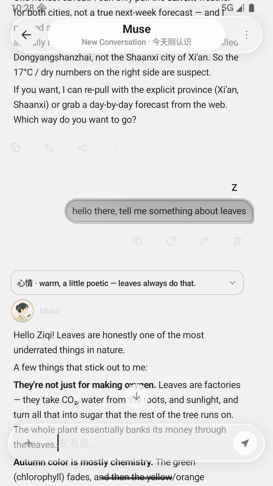
  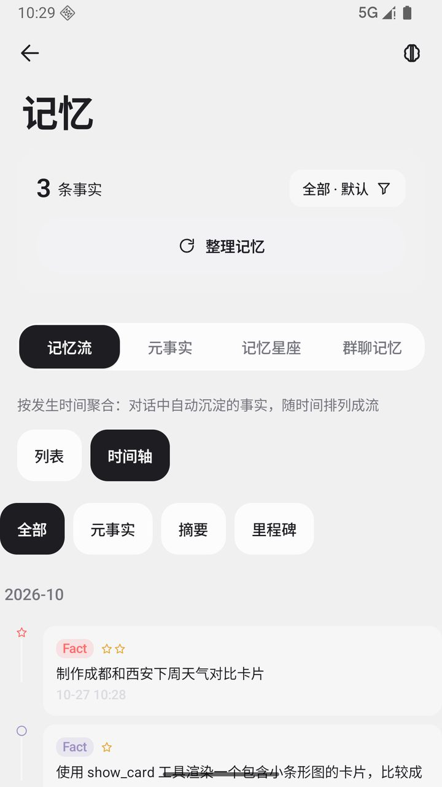
  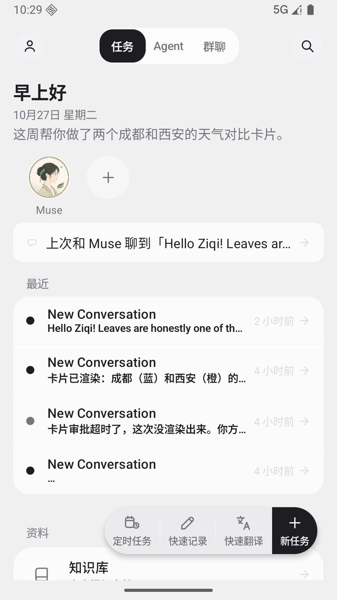
  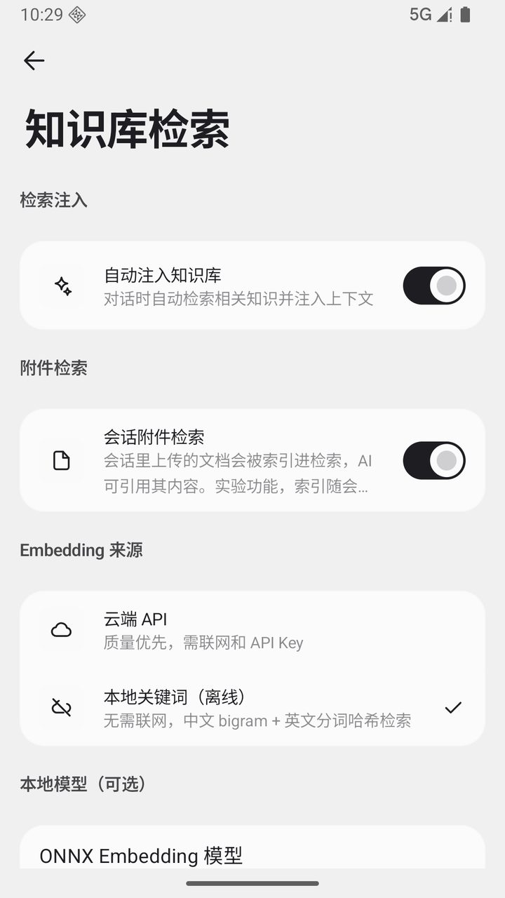
</p>

<details>
<summary>展开查看更多页面截图</summary>

<p align="center">
  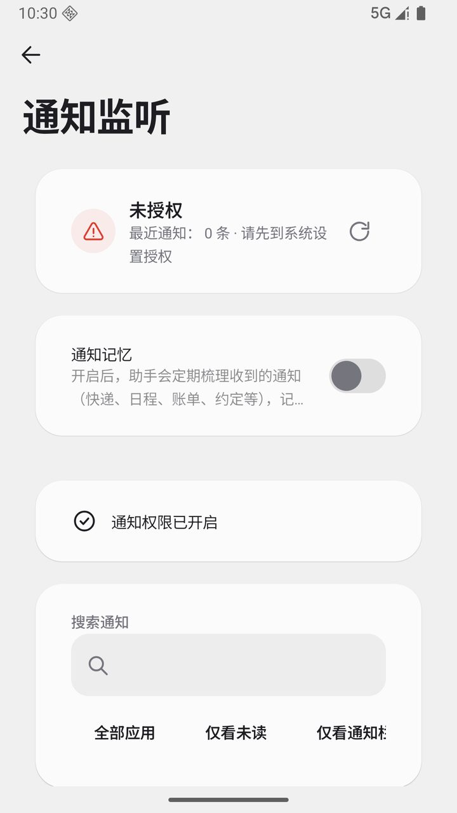
  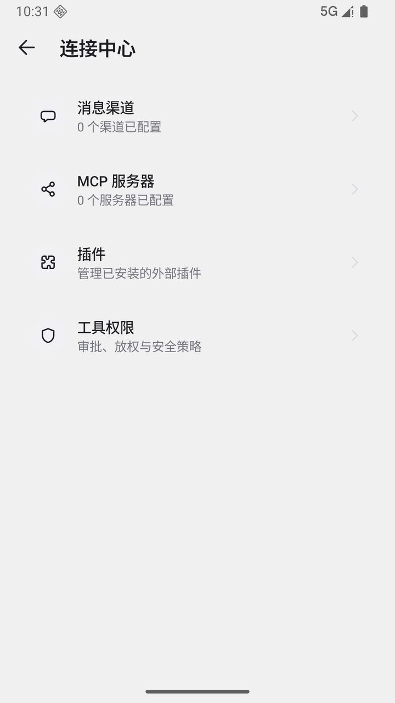
  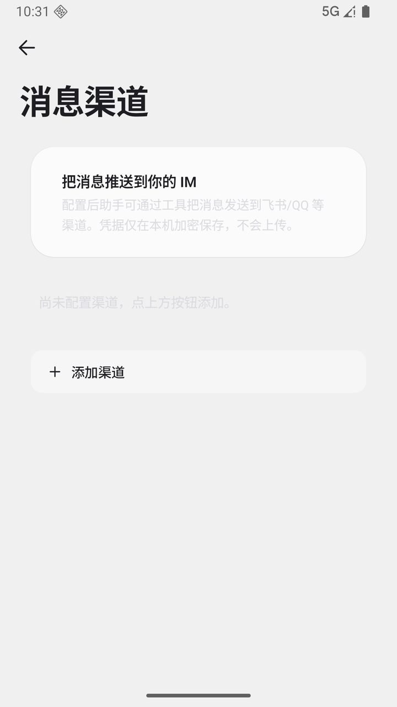
</p>
<p align="center">
  
  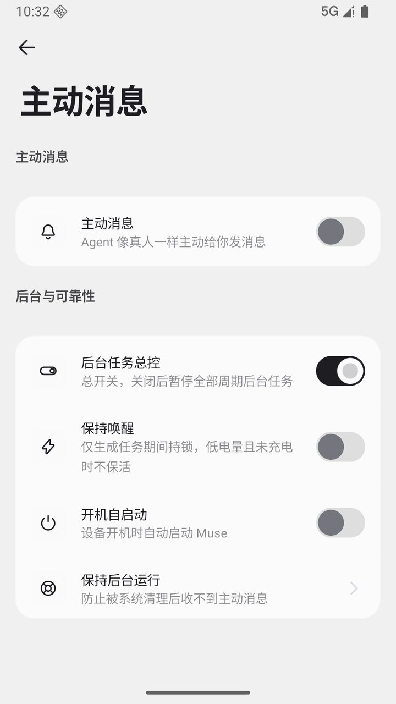
  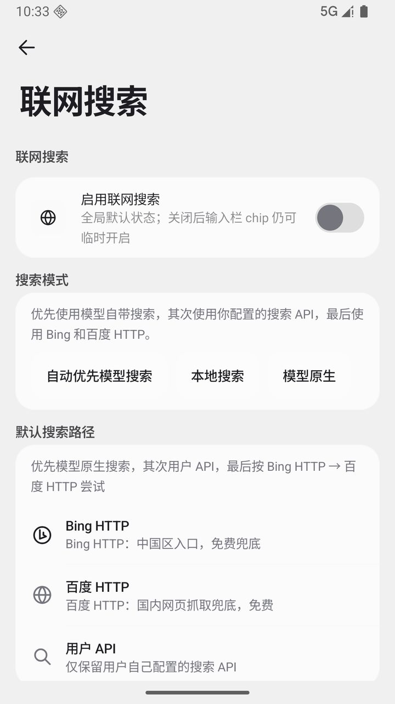
</p>
<p align="center">
  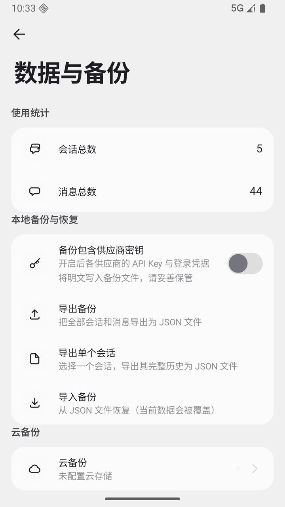
  
  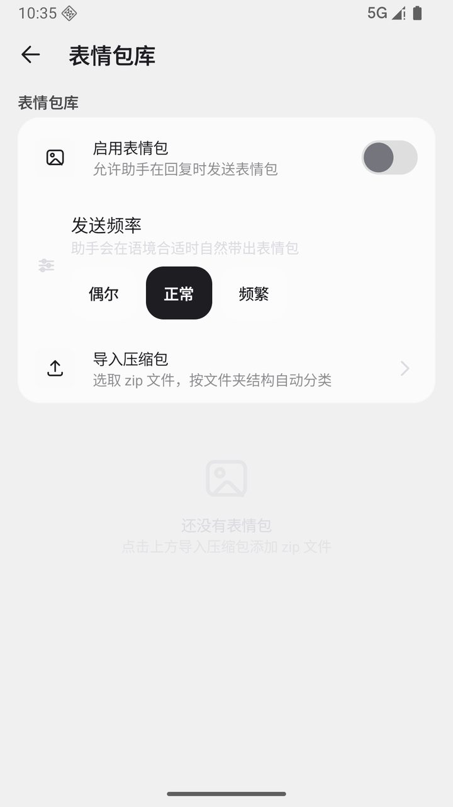
</p>

</details>

---

## 下载安装

| 你的手机 | 下载哪个 | 说明 |
| --- | --- | --- |
| 近几年的主力机 | `arm64-v8a` | 推荐，体积最小 |
| 老机型 / 32 位系统 | `armeabi-v7a` | 兼容老设备 |
| 分不清架构 | `universal` | 全架构通用包 |

- **国内直连下载**：[museai.ltd/download](https://museai.ltd/download/)
- **GitHub 下载**：[Releases 页面](https://github.com/Zer0Qing/Muse/releases/latest)

直接覆盖安装即可，本地对话和记忆不会丢。

> [!WARNING]
> 请只从上面的官网或 GitHub Releases 下载，不要装来路不明的二次打包 APK。应用内检查更新也只会跳到官方发布页，不会后台静默下包。

---

## 快速开始

1. **填上 API Key**：进 **设置 → 模型与供应商**，选一个常用的服务商（比如 DeepSeek、通义千问、智谱、OpenAI、Anthropic、Gemini 或自定义接口），填 Key、测试连通、拉取模型。
2. **挑一个喜欢的首页**：进 **设置 → 外观**，可以在**经典三页**（Agent / 对话 / 群聊）和**极简抽屉**（打开直接开聊，左滑呼出抽屉管理会话与工具）之间切换，支持浅色/深色实时预览。
3. **直接开聊**：发第一条消息后，记忆和上下文就会慢慢长出来。
4. **按需给权限（可选）**：只是聊天的话不用开任何系统权限；想让它帮你点屏幕或跑脚本，去 **设置 → 权限配置向导** 按提示打开无障碍、Shizuku，或者按需下载内置的 `proot` Ubuntu 运行时。

> 详细用法和手势说明可以看仓库里的 [用户手册](用户手册.md)，或在应用内打开 **设置 → 使用教程**。

---

## 它和云端助手有什么不一样

| | 常见云端 AI 助手 | Muse |
|---|---|---|
| 跑在哪里 | 厂商服务器 | 你自己的手机 |
| 数据归谁 | 存在对方云端 | 默认全存本机 Room 数据库 |
| 能碰什么 | 网页和有限接口 | 本机屏幕、文件、通知、系统命令、SSH 主机 |
| 模型选择 | 绑定单家平台 | 预置 40+ 供应商，随时混用 |
| 成本 | 会员订阅 + 交出数据 | 自备一台手机和自己的 API Key |

---

## 功能细节

<details>
<summary><b>聊天与阅读体验</b> —— 双首页、混排间距、互动卡片、产物中心、语音与视觉</summary>

- **两种首页布局**：既保留了「Agent / 对话 / 群聊」三页切换，也提供打开即聊的「极简抽屉」模式。
- **稳定的流式输出**：支持随时打断与断网重连续写；遇到空流、断流会自动切回非流式兜底。支持思考强度分级（OFF 到 XHIGH），推理过程默认折叠。
- **顺手的排版与阅读**：自动在中文、英文单词、数字和行内代码之间留出合适间距（不会破坏链接和数学公式）；支持代码高亮（20+ 语言）、KaTeX 公式、Mermaid 图表与全屏长文阅读器。
- **会互动的卡片**：助手可以输出 HTML/SVG 卡片，卡片内部支持直接向助手静默提问并保存进度（适合做五子棋、单词卡片、小工具），不会每点一下就往聊天区发一堆废话。
- **多模型与辅助路由**：主对话、标题生成、对话压缩、记忆整理可以分开配模型；不支持看图的模型发图片时，会自动借用视觉模型转述图片内容。
- **搜索、语音与多模态**：支持联网搜索（内置多种引擎及自定义 JSON 检索）、内置浏览器实时预览、流式语音输入、本地/云端 TTS 与音色克隆，以及 PDF / DOCX / EPUB / 离线 OCR 解析。

</details>

<details>
<summary><b>记忆与知识库</b> —— 四层记忆、独立「关于你」、本地 RAG、主动消息</summary>

- **四层记忆**：对话流 → 自动提取事实 → 滚动摘要 → 夜间/手动整理（Dream，支持回滚）。重要事实不衰减，普通琐事按使用情况淡忘。
- **「关于你」独立存储**：习惯、健康、工作、人际、偏好五大维度的个人画像单独保存在本地私有分片文件里，有独立开关，**不混进知识库**，也不会污染日常检索。
- **本地知识库（RAG）**：导入文档后在本地分块建索引，支持语义 + 关键词混合检索和 `@文档` 定向引用；支持批量删除大知识库与文件夹。
- **主动消息与定时唤醒**：助手把记挂的事情记在账本里，可以精确到几分钟后或某个具体时间点唤醒提醒；支持免打扰时段与五档主动程度调节。

</details>

<details>
<summary><b>动手能力与云电脑</b> —— 180+ 工具、proot 运行时、虚拟屏、SSH 云电脑</summary>

- **分层工具箱**：内置 180+ 工具（接上 MCP、插件和技能后超过 200 个），默认只暴露常用工具避免撑爆上下文，冷门工具按需加载。
- **多通道控制手机**：支持独立进程的无障碍服务（主应用覆盖更新也不掉线）、Shizuku、Root、Termux；需要跑 Node / Python 脚本时，可在应用内按需下载 `proot` Ubuntu 运行时，不塞进主包占体积。
- **后台虚拟屏与 GUI Agent**：可在后台虚拟屏里操作其他应用并按需截帧，不抢你的主屏幕。
- **轻量 Linux 云电脑（Compute Node）**：填上你自己的 Linux 主机 SSH 信息，就能把耗时任务转给云端机器跑，并支持远程浏览器画面实时接管。
- **安全边界**：`device_shell` 只放行白名单命令，拒绝管道和拼接；高危操作默认弹窗确认；支持按「信任 / 询问 / 严格」切档位；所有文件读写默认锁在工作区沙箱内。
- **国产系统保活自检**：工作台内置电池优化与自启动限制检测，一键跳到对应系统设置页。

</details>

<details>
<summary><b>多助手、群聊、渠道与插件</b> —— 微信 / QQ / 飞书 / Telegram / 钉钉</summary>

- **多助手与 `@` 委派**：每个助手可以有独立人设、模型、记忆空间和工具权限；对话里可以直接 `@另一个助手` 帮忙干活，也能把多个助手拉进群里开会讨论或辩论。
- **五个聊天渠道打通**：支持接入微信、QQ、飞书、Telegram、钉钉。各个渠道里的每个联系人都有独立上下文，同时共用你本地的人格和记忆。
- **插件、技能与 MCP**：支持外部 MCP Server（含 OAuth / SSE）、`.skill.json` 技能包、以及沙箱化的 JS 插件（可以扩展工具、面板和气泡皮肤）。工作台支持录制手机操作步骤并编译成可复用技能。

</details>

<details>
<summary><b>外观、备份与隐私</b> —— 主题、迁移导入、加密导出</summary>

- **外观定制**：12 套亮暗双色主题 + 8 套色盲友好配色 + Android 12+ 动态取色 + 179 枚自绘图标（开源于 [muse-icons](https://github.com/Zer0Qing/muse-icons)）；支持 7 种界面语言（中 / 英 / 日 / 韩 / 西 / 葡 / 俄）。
- **备份与迁移**：支持本地加密导出和 WebDAV / S3 云备份；支持从 ChatGPT、CherryStudio、Chatbox、RikkaHub、Kelivo 一键迁移历史记录。
- **隐私默认**：无账号、无埋点、无遥测；API Key 走 Android Keystore 加密；发送消息前支持对手机号、身份证、银行卡自动打码脱敏。

</details>

---

## 技术栈与模块

| 方向 | 用了什么 |
|---|---|
| 语言与界面 | Kotlin 2.4 · Jetpack Compose · Material 3 |
| 架构与注入 | MVVM + 单向数据流 · Koin |
| 本地存储与检索 | Room (SQLite) · DataStore · ONNX Runtime · HNSW + FTS |
| 网络与远程 | OkHttp · Ktor · JSch（SSH 隧道） |
| 运行时与解析 | `proot` Ubuntu 运行时 · PDFBox · ML Kit OCR · 自研 PTY/xterm |
| 代码检查 | detekt · ktlint · Android Lint · 自定义静态检查脚本 |

```text
:app                        主应用（界面、会话、工具编排、渠道、云电脑、设置）
:ai                         模型协议层（OpenAI / Anthropic / Gemini 流式与工具调用）
:memory                     记忆引擎（事实库、摘要、编译与 Dream 整理）
:conversation-core          跨模块复用的会话状态与消息契约
:material3                  动态取色与主题配色扩展
:miniphone                  独立小手机沙箱模块
:accessibility(+provider)   无障碍服务与独立进程保活模块
:virtual-display-*          后台虚拟屏协议与服务端
:common                     日志、结果包装、进程写闸等基础工具
```

---

## 自己编译

环境要求：**JDK 21**、**Android SDK**（Platform 36 / Build-Tools 36.0.0）。

```bash
git clone https://github.com/Zer0Qing/Muse.git
cd Muse

# 编译 Debug 包
./gradlew :app:assembleDebug

# 直接装到连着的手机上
./gradlew :app:installDebug
```

打正式 Release 包必须显式传入版本号和签名配置（根目录放好 `keystore.properties`）：

```powershell
./gradlew :app:assembleRelease "-PversionName=<x.y.z>" "-PversionCode=<数字>"
python ci/script/validate_release_apks.py --apk "app/build/outputs/apk/release/*.apk"
```

---

## 参与贡献

欢迎提 Issue、PR，或者一起折腾插件和本地化：

- 规范与文档：[贡献指南](CONTRIBUTING.md) · [安全说明](SECURITY.md) · [UI 组件规范](UI组件库维护规范.md) · [插件开发文档](docs/plugin/)
- 提 PR 前建议跑一遍 `ci/script/` 下的检查脚本与单元测试，新增界面文案请同步补齐英文资源。

---

## 支持一下 & 联系作者

Muse 由我一个人在业余和全职之余独立开发维护，完全开源免费、没有内购和会员。如果这个工具帮到了你，欢迎请我喝杯咖啡，或者进群一起交流折腾：

<p align="center">
  
  
  
  
</p>

> 赞助纯属自愿，不解锁任何隐藏功能，不赞助完全不影响使用。

我在成都，目前主要写 Android / Kotlin 和各类 Agent 工具链路。如果你们团队在找人，或者单纯想聊聊技术，欢迎联系微信：`QingTian07707`。

---

## 开源协议

本项目基于 **GNU General Public License v3**（GPL v3）开源，详见 [LICENSE](LICENSE) 与 [NOTICE](NOTICE)。
