<p align="center">
  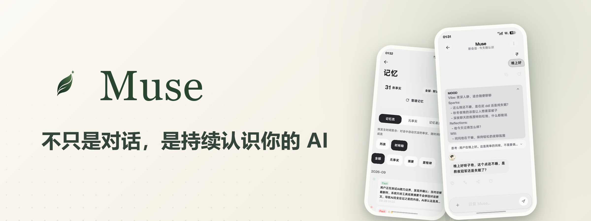
</p>

<p align="center">
  <b>中文</b> · <a href="README_EN.md">English</a> · <a href="README_JA.md">日本語</a> · <a href="README_KO.md">한국어</a> · <a href="README_ES.md">Español</a> · <a href="README_PT.md">Português</a> · <a href="README_RU.md">Русский</a>
</p>

<p align="center">
  <a href="https://github.com/Zer0Qing/Muse/releases/latest"></a>
  <a href="https://github.com/Zer0Qing/Muse/releases"></a>
  <a href="https://github.com/Zer0Qing/Muse/stargazers"></a>
  <a href="LICENSE"></a>
  
  
</p>
<p align="center">
  <a href="https://qm.qq.com/q/905451314"></a>
  <a href="https://museai.ltd"></a>
  <a href="https://museai.ltd/download/"></a>
</p>

<p align="center">
  <a href="#muse-是什么">Muse 是什么</a> ·
  <a href="#截图">截图</a> ·
  <a href="#下载">下载</a> ·
  <a href="#快速上手">快速上手</a> ·
  <a href="#功能一览">功能一览</a> ·
  <a href="用户手册.md">用户手册</a> ·
  <a href="#开源共创">开源共创</a>
</p>

---

## Muse 是什么

Muse 是跑在你自己手机上的个人 Agent（personal agent）。

2026 年的个人 Agent 大多跑在云上。它们记得你，也能替你做事，但对话、记忆和执行过程都在别人的服务器里。

Muse 把这些搬回本机。它常驻在 Android 手机上，模型随你接（预置 40+ 供应商），数据默认不出设备。需要动手时，它直接操作这台手机：读屏、点击、跑命令、读写文件。

它做四件事：

| | 含义 | 在 Muse 里对应什么 |
|---|---|---|
| **连续** | 换会话、换渠道、换模型，还是同一个它 | 四层记忆 + 五个聊天渠道共用同一个人格 |
| **主动** | 没人叫它，也会推进该推进的事 | 牵挂账本、定时任务、久未联系时主动来找你 |
| **能动手** | 不只会说话 | 无障碍 / Shizuku / Root 三层通道，200+ 工具，内置终端与虚拟屏 |
| **持久** | 关掉重开还在 | 常驻保活、本地数据库、离线运行时 |

不用注册，没有账号，卸载即走。

## 截图

<p align="center">
  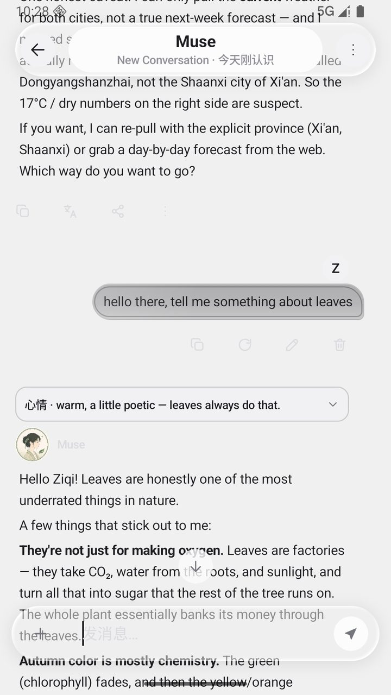
  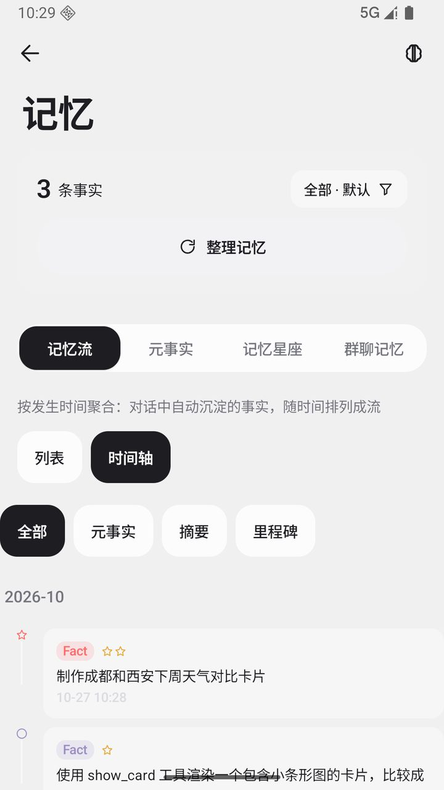
  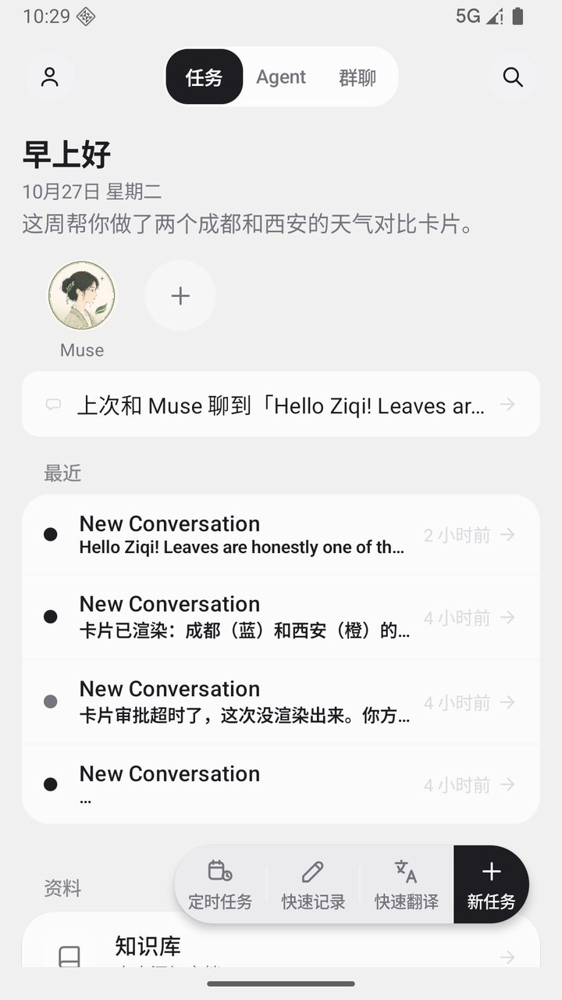
  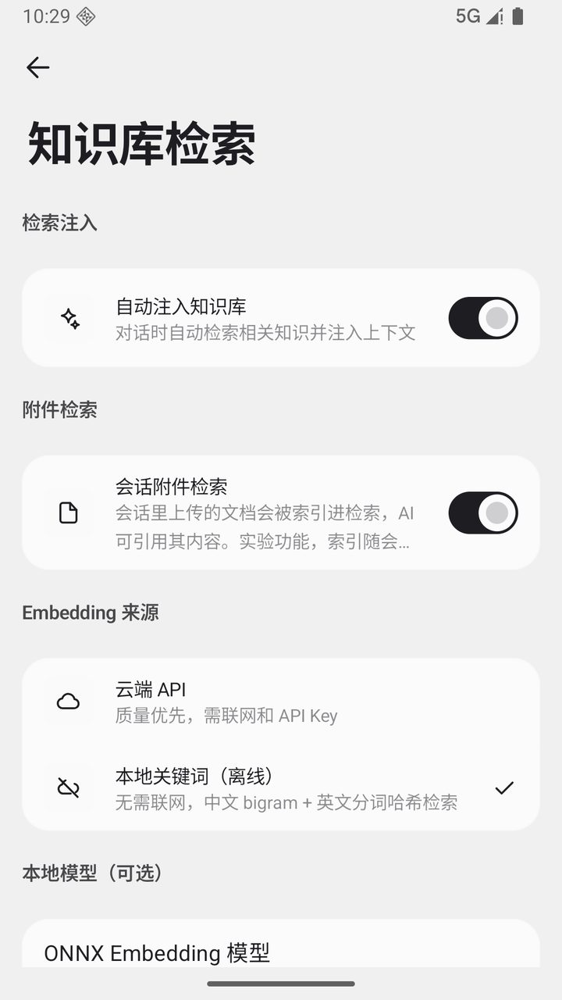
</p>

<details>
<summary><b>更多截图</b>（点击展开）</summary>

<p align="center">
  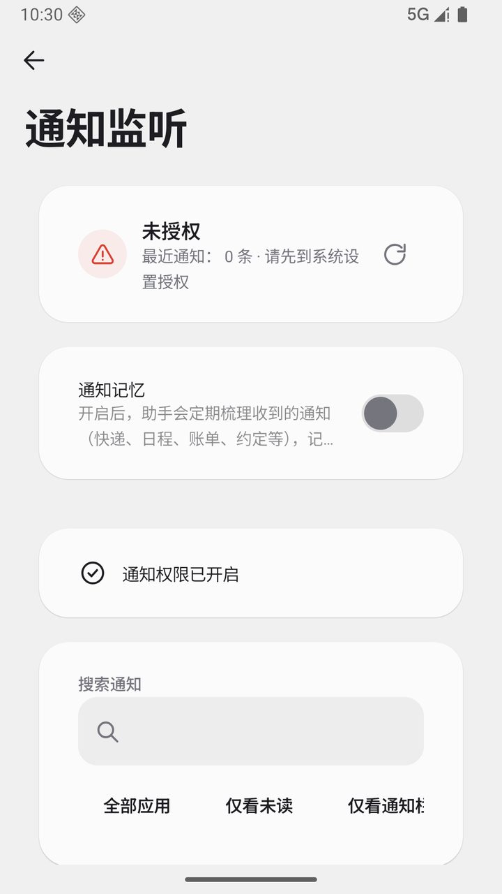
  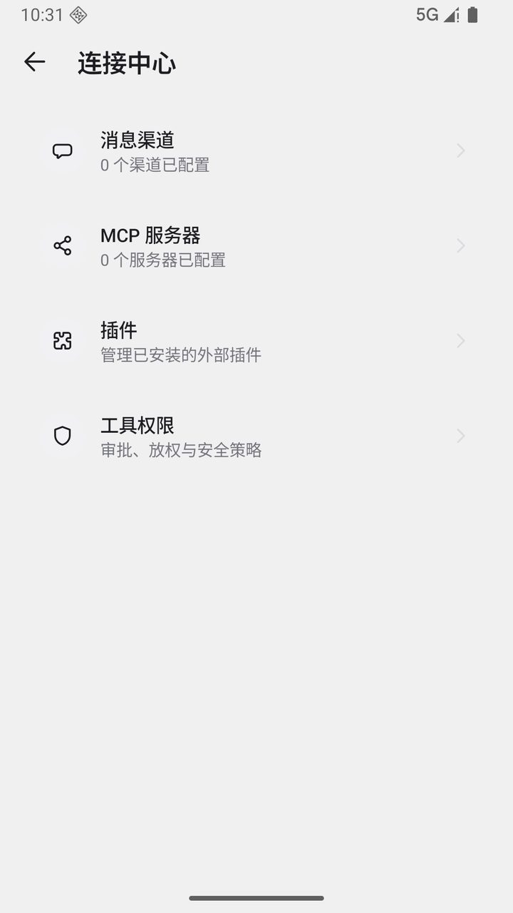
  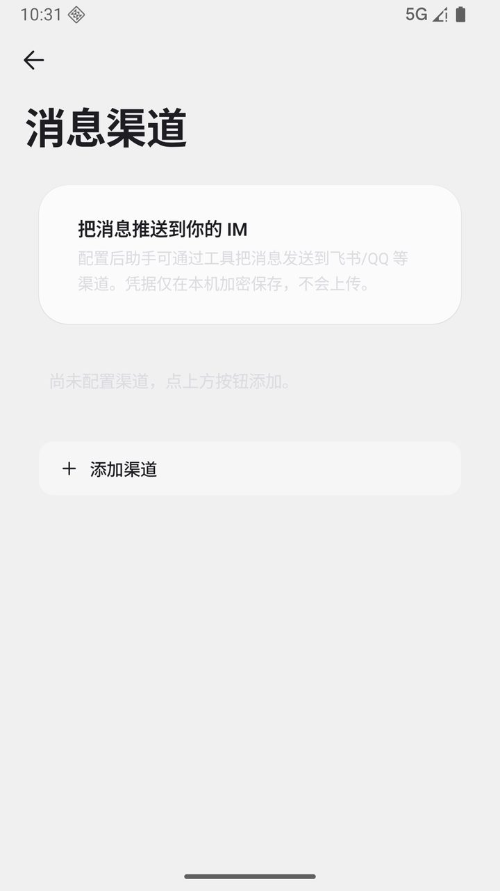
</p>
<p align="center">
  
  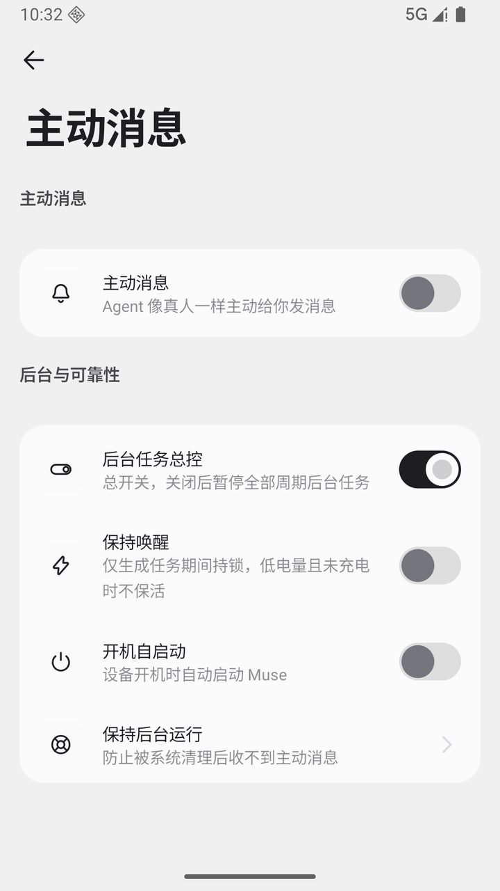
  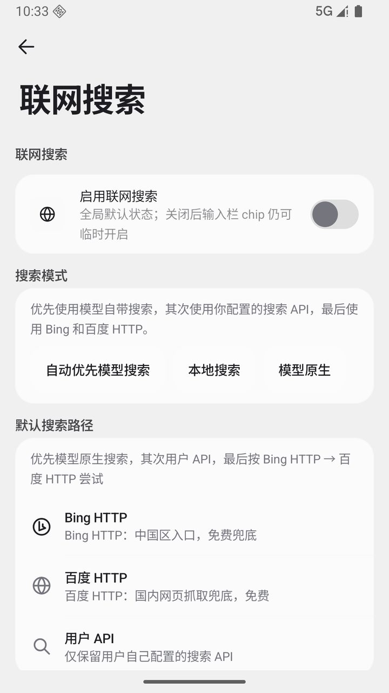
</p>
<p align="center">
  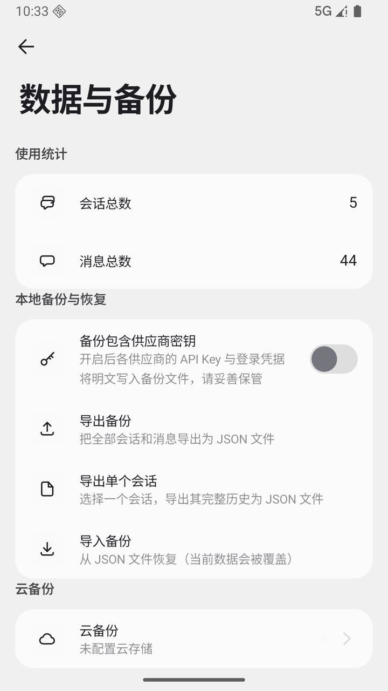
  
  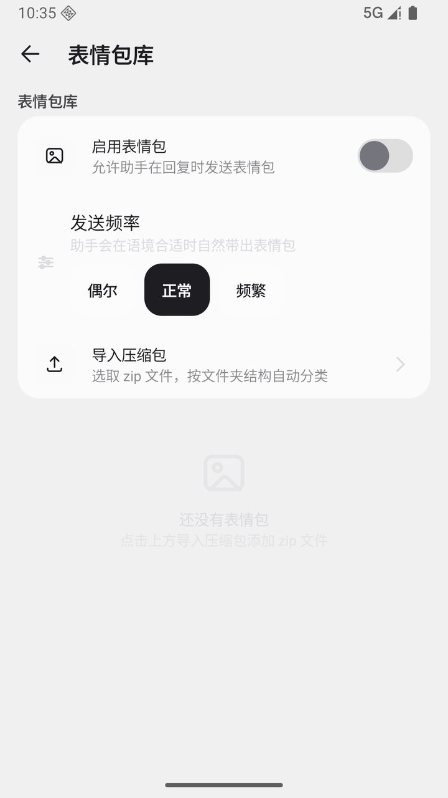
</p>

</details>

## 下载

| 你的设备 | 选择 | 说明 |
| --- | --- | --- |
| 近几年的手机 | `arm64-v8a` | 推荐，体积最小 |
| 较老的手机 | `armeabi-v7a` | 兼容老机型 |
| 不确定 | `universal` | 通用包，全兼容 |

最新 APK 从官网下载页 [museai.ltd/download](https://museai.ltd/download/) 下载，国内直连，推荐；也可以去 [GitHub Releases](https://github.com/Zer0Qing/Muse/releases/latest)。覆盖安装即可，数据不丢。

> [!WARNING]
> 请只从官方 Releases 页面或官网下载安装包。来路不明的包可能被人改过，数据和设备都有风险。

> [!NOTE]
> 应用内更新只跳转 GitHub 的官方 HTTPS 资产，不会自动下载，也不会静默安装 APK。安装时提示“未知来源”属正常现象。

## 快速上手

1. **配置模型服务**：打开 **设置 → 模型与推理 → 供应商**，选一个预置供应商（DeepSeek、通义千问、智谱等注册都送免费额度），填 API Key，测试连接后拉取模型列表。
2. **开始对话**：回到首页发第一条消息。记忆从这一刻开始积累，之后换模型、换会话它都认得你。
3. **按需解锁系统能力（可选）**：想让它动手，打开 **设置 → 权限配置向导**，按引导开启无障碍 / Shizuku / Root / Termux 里需要的通道。每一步都有检测和测试入口。

> 完整说明（包括各种手势和藏起来的操作）见 [用户手册](用户手册.md)，或应用内 **设置 → 使用教程**。

## 为什么是 Muse

### 一、它跑在自己的设备上

云端 Agent 给的是一份服务：登录之后它记得你，数据存在它那边。Muse 是你设备上的一个常驻进程。

- 对话、记忆、知识库都在本地 Room 数据库里；没有遥测、没有分析，也不需要注册
- 模型可换：预置 40+ 供应商，也能接自建或局域网里的 OpenAI 兼容服务
- 敏感配置存 Android Keystore；PII 在发送前打码，回复里的占位符再还原

### 二、记忆按人组织，不按会话

四层记忆，从短期对话一路处理到长期：

```
对话 --> 事实提取 --> 滚动摘要 --> 编译聚合 --> 深度处理
 短期     关键信息     压缩归档     去重整合     深度理解
```

- 医疗、财务、核心身份这类关键事实不衰减，日常信息按使用情况淡忘
- 每条记忆能追溯到来源，可以增删、调权重、搜索；不同用途的记忆按空间隔开
- 微信、QQ、飞书、Telegram、钉钉五个渠道共用一个助手，每个联系人各自维护上下文和滚动摘要

### 三、它不等你开口

- **牵挂账本**：助手把想问的事记下来，到时机挑一条说，不凭空找话
- **结果账**：点开、回复、划掉都记一笔，亲密度据此调整，决定今天还能说几次
- **安静时段**：该睡的时候不响
- **定时任务**：到点执行，结果回到会话

### 四、它可以直接操作手机

| 通道 | 能力 | 门槛 |
|------|------|------|
| 无障碍服务（独立进程） | 读屏、点击 / 滑动 / 长按 / 输入、返回 / Home / 通知栏 | 开一个系统开关 |
| Shell（Shizuku / adb） | 截屏、input 命令、查前台应用、设备命令 | 授权一次 |
| Root | 完全系统控制、访问其他应用数据 | 需 root 设备 |
| Termux | 完整 Linux 环境（apt / pip / gcc / ffmpeg） | 安装 Termux 并授权 |

- **200+ 个工具**，默认分层暴露，长尾能力用 `find_tools` 检索装载
- 每个工具标注所需授权和就绪状态，没就绪时在执行前直接失败，并给出授权指引
- 内置终端（自研 PTY + xterm）、后台虚拟屏、视觉驱动的 GUI Agent、浏览器自动化
- 安全边界：命令白名单、风险审批（信任 / 询问 / 严格）、硬超时、工作区沙箱

### 五、腹稿、人设与多助手

- **Mood 四维腹稿**：回复前的 Vibe / Sparks / Reflections / Will，默认折叠，展开能看到它怎么想的
- **三层人设**：人设层 / 关系层 / 风格层，配 `{{user_name}}` / `{{char}}` 模板变量
- **多 Agent**：`@助手名` 委派任务，任务卡显示进度，子代理在浮窗里跑，助手之间可以发私信
- **群聊会议**：总结卡、表决票、观察者、快速模板、会议控制
- **相伴里程碑**：第 1 条消息、第 7 / 30 / 100 天、第 100 / 1000 条消息

### 与云端 Agent 的差别

| | 云端 personal agent | Muse |
|---|---|---|
| 执行位置 | 云主机 / 浏览器标签 | 你自己的手机 |
| 数据 | 上传之后才能记得你 | 默认不出设备 |
| 能碰到什么 | 网页与 API | 设备本身：读屏、命令、文件、其他应用 |
| 模型 | 平台绑定 | 40+ 供应商，随你换 |
| 代价 | 订阅与隐私 | 你得自己供一台设备、一份 API Key |

## 功能一览

<details>
<summary><b>对话体验</b> —— 流式与续传 / 会话管理 / 消息操作 / 多模型 / 语音 / 多模态 / 搜索</summary>

- **流式与容错**：SSE 逐字输出，随时可停；断流后网络恢复会自动续写。stream-guard 检测流式过早结束（空流、零首包）时降级成非流式重试；首事件看门狗在普通模型 45 秒、推理模型 90 秒没有首包时切换请求方式。
- **会话管理**：置顶、归档、可撤销的删除、文件夹分组，置顶项可以拖拽排序。全局搜索走 SQLite FTS5 全文索引，环境不支持时回退 FTS4。每个会话有独立上下文窗口，超长对话自动压缩成滚动摘要。
- **消息操作**：重新生成保留多个版本，用 `1/3` 这样的角标切换，历史不丢；可以从任意用户消息分叉出新对话线，原线完整保留；引用回复会把原文注入上下文。长按菜单里有复制（纯文本或 Markdown）、转发、分享、收藏、编辑、翻译、朗读、删除，还有消息批注。
- **收藏夹**：收藏集中管理，长按能设分组标签。
- **输入体验**：全屏输入给长文用；斜杠命令有 `/new` `/compact` `/reset` `/pin` `/archive`；粘贴超过阈值自动转成文件（阈值可调）；快捷消息一键发出。上次被打断的工具调用可以恢复执行，也可以丢掉。
- **快速记录**：可选的悬浮胶囊，在任何界面速记，存进本机速记库。
- **深度思考**：推理等级 OFF / AUTO / LOW / MEDIUM / HIGH / XHIGH，对应 1000 到 16000 tokens 的思考预算，推理过程默认折叠。
- **多模型**：原生支持 OpenAI、Anthropic、Gemini 三类协议，以及任意 OpenAI 兼容端点；预置 40+ 供应商，模型列表动态拉取。每个模型标注视觉、推理、工具能力。标题、压缩、摘要、记忆编译这类辅助任务走单独的“小工具 / 大工具”档位。请求头、请求体和网络代理都能自定义。
- **语音**：流式识别边说边转字，有波形，上滑取消。TTS 支持系统语音和云端语音（OpenAI / MiniMax / Edge 等），每个助手单独配置；也能用 ElevenLabs、FishAudio 做云端声音克隆。
- **多模态输入**：一次发多张图；PDF / DOCX / EPUB / TXT 自动解析；扫描件走离线 OCR。
- **视觉辅助**：给不支持视觉的模型发图时，自动调视觉模型生成八维结构化描述（整体概述、OCR 文字、物体布局、图表数据、请求重述、请求回答、视觉证据、不确定性），带坐标 grounding。描述按图片、请求和提示词版本缓存；多图并发分析，60 秒超时，失败降级成文字提示。
- **联网与浏览**：搜索源可选模型原生搜索、Bing、百度、SearXNG、Tavily、DeepSeek 或自定义引擎，按顺序逐级兜底。自定义引擎能接任何返回 JSON 的检索服务（自建 SearXNG、内网网关），支持 GET / POST、字段路径映射和可选的 Bearer 鉴权，排在 Auto 链最前面。网页正文走 Jina Reader 提取。每个会话有独立的内置浏览器，AI 上网时顶部胶囊能展开实时画面。
- **翻译与朗读**：长按消息就能翻译或朗读，翻译模型单独配置，翻译历史保留。
- **渲染与卡片**：Markdown 完整渲染，代码高亮支持 20+ 语言，另有 KaTeX 公式、Mermaid 图表和表格。AI 可以输出交互式卡片和产物卡片（代码、文档、表格），产物在产物中心统一管理，能全屏查看和导出。

</details>

<details>
<summary><b>记忆与成长</b> —— 四层流水线 / 衰减与保护 / 上下文连续性 / 经验库 / 知识库 / 主动消息</summary>

- **四层记忆流水线**：① 原始对话流；② 事实提取，自动抽取关键事实并标注重要度和来源；③ 滚动摘要，长对话压缩但不丢线索；④ 深度处理，后台编译聚合、去重合并成长期记忆。事实入库带全文索引，可以检索。
- **重要度与衰减**：医疗、财务、核心身份这类关键事实不衰减；日常信息按使用频率淡忘。
- **记忆面板**：按空间或分类浏览，能增删条目、调重要度、按时间和权重筛选。列表和时间轴都支持长按多选批量删除，删完不跳回顶部。每条记忆能追溯来源会话，长条目点开看全文。
- **记忆空间**：不同用途的记忆互相隔离，互不污染。
- **上下文连续性**：窗口外的历史不会被静默丢掉。它会生成确定性的历史摘录（保留对话原文片段和工具条目）插在窗口前；工具回合压缩时保留助手说明；压缩摘要里带上这段改过哪些文件。
- **跨会话衔接**：新对话可以带回上一个对话的最后几轮，4 到 40 条可调，默认关闭。
- **经验库**：把“这类问题以后都这么处理”沉淀成经验，后续任务自动参考，可以关掉。
- **知识库（RAG）**：文档导入后自动解析、分块建索引，检索用语义加关键词的混合排序；可以用 @ 指定文档检索；超大文件流式索引；离线环境降级成本地检索；引用能追到原文片段。
- **每日总结与问候**：到设定时点生成当日回顾，首页可见，可选推送。早间问候由模型结合记忆里的近期事项生成，不是固定模板。
- **主动消息**：不按固定间隔轮询，而是记在一本「牵挂账本」里：助手把想问的话记下来，到时机挑一条说。点开、回复、划掉这些反馈进结果账，亲密度从中学习，决定当天还能说几次。五档量级（安静 / 克制 / 标准 / 主动 / 黏人），可以重置回默认并清零当日额度；免打扰时段生效；接不上话时宁可不发；太久没聊会有保底问候。深夜它自己整理记忆，不打扰你；每日推送内容可配（每日总结）。
- **里程碑**：首条消息、相伴第 7 / 30 / 100 天、第 100 / 1000 条消息这些节点自动记录，在里程碑页能回看。
- **统计与活动面板**：统计页有总对话、总消息、日均、连续天数和每日热力图；活动面板展示定时任务、心跳、记忆编译的执行历史。

</details>

<details>
<summary><b>工具与自动化</b> —— 200+ 工具 / 权限分层 / 审批与预算 / 四通道 / 终端 / 虚拟屏 / GUI Agent</summary>

- **工具系统**：200+ 工具按核心、常用、可选、高级分层暴露。默认只发常用工具以省上下文，长尾能力用 `find_tools` 按关键词检索装载，装载后整个会话可用。系统提示里带实时工具能力索引，每轮给出实际可用的数量。
- **权限分层**：需要 Shizuku / Root、无障碍、Termux 的工具各自声明依赖和就绪状态（READY / NOT READY）；没就绪时在执行前就失败，返回结构化的 `permission_required` 错误和授权指引。
- **审批体系**：风险等级（安全 / 普通 / 高危）乘三档模式（信任 / 询问 / 严格）；可以设“本会话允许”，也能按工具单独定策略；高风险动作先问后做。
- **执行引擎**：只读工具受控并行（最多 3 个）提速；阻塞型工具走专用线程池并带硬超时；单条输出超限自动落盘，上下文里只留预览和 `read_file` 引用。统一成败判定，连续失败会早停并说明原因。工具轮次默认不限（可设上限），另有重复调用指纹、无进展检测、总调用数等熔断。
- **四通道执行**：无障碍（独立进程 Provider，AIDL 通信，主应用更新不掉线）、Shizuku（Binder 提权）、Root（su）、Termux（RUN_COMMAND），按可用性自动选档位。
- **设备命令**：`device_shell` 走动词白名单（dumpsys / settings / am / pm / input / screencap / uiautomator / cmd / svc / wm / getprop / content 等），不许管道、重定向和拼接，白名单之外一律拒绝。
- **内置终端**：自研 PTY 引擎加 xterm 终端页。三档环境：应用沙盒终端、设备命令通道、Termux 完整 Linux（apt / pip / gcc / ffmpeg）。
- **虚拟屏**：独立服务端进程在后台建一块隐藏显示屏，Agent 的完整操作流不占主屏，按需截帧回传。
- **GUI Agent**：视觉驱动的多步循环：截图 → 视觉模型决策 → 点击 / 滑动 / 输入 → 再截图验证，直到任务完成。
- **浏览器自动化**：navigate / click / type / extract / scroll / get_html / snapshot，每个会话一个独立浏览器实例。
- **工作区**：受控的文件空间，读写、列目录、移动、删除都限制在沙箱边界内。
- **定时与提醒**：定时任务支持 Cron 表达式和执行历史；另有闹钟、倒计时、日程、备忘录，到点自动执行或提醒。
- **通知监听**：读设备通知流，按内容智能回复或给建议。
- **权限配置向导**：无障碍 / Shizuku / Root / Termux 四通道一键检测和引导，带“测试屏幕读取”实时验证。

</details>

<details>
<summary><b>多助手与生态</b> —— 群聊会议 / 世界书 / Skill / 插件市场 / MCP / 五端渠道</summary>

- **多助手**：每个助手独立配模型、系统提示词、采样参数、资源绑定、工具白名单和技能。`@助手名` 委派任务，任务卡逐步显示状态；子代理在独立浮窗跑长任务，不占主对话；助手之间发私信有单独收件箱。
- **助手进阶**：世界书（常驻条目、关键词触发、深度注入）；提示词注入（按模式注入自定义片段）；资源关联（绑定知识库优先检索）；支持导入 SillyTavern 角色卡，自有助手可以打包分享。
- **群聊会议**：四种讨论模式（轮转 / 自由 / 辩论 / 主持人），每轮先读群聊上下文，可以跳过本轮，每个助手有独立记忆。会议里能出讨论总结卡（复制、分享、存为共享文档），渲染表决票，加观察者成员，维护群共享文档和 AI 专属上下文，控制发言队列（暂停 / 继续 / 跳过），套用快速模板（方案评审 / 正反辩论 / 头脑风暴 / 项目复盘），折叠轮次；轮转中插话不会丢。
- **Skill 系统**：内置技能开箱可用，支持 `.skill.json` 导入导出（含参数 Schema）；提示词技能能接输入参数（`{{input}}` / `{{args}}`）；安装走白名单实现和注入防护。
- **插件市场**：检索、安装、启停、卸载和信任管理；插件可以带工具、UI 面板、消息气泡皮肤；助手能自己写 JS 插件草稿，签名并手动启用后才生效；插件在沙箱边界内运行。
- **MCP 协议**：连接外部 MCP Server 扩展工具，支持 OAuth 鉴权、SSE 传输和自动发现。
- **OAuth 连接器**：接入第三方服务，凭据本地加密存储，连接中心统一管理模型、渠道和连接器。
- **渠道五端**：微信（扫码绑定）、QQ（Bot WebSocket 长连接）、飞书（长连接事件通道）、Telegram、钉钉（Stream 模式）。每个联系人有独立会话上下文和滚动摘要；图片语音等媒体消息自动入库并转写；不同渠道可以绑不同助手和模型；每个平台都有配置向导和连接测试。

</details>

<details>
<summary><b>界面与外观</b> —— 主题 / 气泡皮肤 / 图标 / 多语言 / 备份与数据</summary>

- **主题系统**：12 套完整主题，每套带亮暗两种模式，另有 8 套色盲友好配色；支持动态取色（Android 12+）、白天夜间定时切换和自定义主题。
- **气泡与外观**：消息气泡圆角可调；有气泡皮肤体系，插件也能提供扩展皮肤（高对比、柔光）。
- **自绘图标**：179 枚全自绘图标，24dp 栅格、1.7dp 圆头笔触、深浅自适应，开源在 [muse-icons](https://github.com/Zer0Qing/muse-icons)（MIT）。
- **排版与多语言**：字体、字号、字间距可调，支持预测性返回和无障碍适配；界面有中文 / English / 日本語 / 한국어 / Español / Português / Русский 七种语言。
- **备份与恢复**：本地一键导出（JSON 或分块 NDJSON，可加密）；每天自动备份，打包 muse.db、memory.db、facts.db 快照；支持 S3 和 WebDAV 云同步；主动消息的牵挂账本、结果账和关系亲密度一并备入；恢复前自动留保护副本，失败回滚。
- **数据导入**：CherryStudio / Chatbox / ChatGPT / RikkaHub / Kelivo 一键迁移，也支持导入多格式对话记录。
- **表情包库**：zip 按文件夹结构导入自动分类；发送频率三档（偶尔 / 正常 / 频繁）；支持批量删除和清空。
- **桌面小部件**：一键新建对话；长按应用图标有快捷菜单。
- **账户中心**：头像昵称本地管理，没有登录注册，也就没有账号可丢。
- **审计日志与代理**：工具调用和关键操作留痕；支持自定义网络代理。

</details>

<details>
<summary><b>安全与隐私</b> —— 本地优先 / 加密 / PII 打码 / 沙箱边界</summary>

- **数据本地化**：对话、记忆、知识库都存在本地 Room 数据库；没有遥测、没有分析、不收集数据；不注册不登录；联网功能默认关闭。
- **PII 自动打码**：手机号、身份证、银行卡等在发送前遮蔽成占位符，模型回复里的占位符再还原，真实信息不发出去。
- **加密链路**：敏感配置走 Android Keystore（AES-256-GCM）；云备份密码用 PBKDF2 加 AES-256-GCM。
- **链接防护**：点链接二次确认；WebView 渲染前净化输出，去掉 iframe、form 和伪协议。
- **工具边界**：命令白名单、风险审批、硬超时、权限预检，失败原因如实回传；插件默认在沙箱里跑。
- **崩溃日志**：只存本地，安全模式下手动导出。

</details>

## 技术栈与架构

| 类别 | 技术 |
|------|------|
| 语言 / UI | Kotlin 2.4 · Jetpack Compose · Material 3 |
| 架构 | MVVM + 单向数据流 · Koin（DI） |
| 数据 | Room (SQLite) + DataStore · ONNX Runtime（本地 embedding） |
| 网络 | OkHttp + Ktor |
| 解析与渲染 | PDFBox · ML Kit OCR · 自研 PTY + xterm |
| 质量门禁 | detekt + ktlint + Android Lint + 自定义检查脚本 · Kover 覆盖率 |

```
:app                        应用主体（UI / 会话 / 工具编排 / 渠道 / 设置）
:ai                         Provider 抽象层（OpenAI / Anthropic / Gemini，流式与工具调用）
:memory                     记忆引擎（事实库 / 编译聚合 / 摘要）
:accessibility(+provider)   无障碍服务与独立进程 Provider（主应用更新不掉线）
:terminal                   Termux 通道与终端
:virtual-display-*          虚拟屏服务端与协议
:common                     日志 / 结果类型等共享设施
```

## 从源码构建

前置：JDK 21、Android SDK（platform 36、build-tools 36.0.0）。

```bash
git clone https://github.com/Zer0Qing/Muse.git
cd Muse

# 调试构建
./gradlew :app:assembleDebug

# 安装到已连接设备
./gradlew :app:installDebug
```

正式发布构建必须显式传版本号并提供签名，缺一项会被构建拦下：

```powershell
./gradlew :app:assembleRelease "-PversionName=<x.y.z>" "-PversionCode=<号>"
# 签名：项目根目录需提供 keystore.properties（storeFile / storePassword / keyAlias / keyPassword）

# 发布前校验（全部 ABI 包签名一致性）
python ci/script/validate_release_apks.py --apk "app/build/outputs/apk/release/*.apk"
```

## 开源共创

欢迎参与项目建设：

- [贡献指南](CONTRIBUTING.md) · [安全政策](SECURITY.md) · [UI 组件库维护规范](UI组件库维护规范.md)
- 插件开发文档在 [`docs/plugin/`](docs/plugin/)：作者指南、类型声明与示例
- 提交 PR 前请通过本地门禁脚本和单测；新增字符串要同步到全部语言包
- 门禁与发布流水线脚本在 `ci/script/` 下；应用内置教程（设置 → 使用教程）同步维护

## 支持开发

Muse 由独立开发者维护，免费开源、无内购、无账号体系。如果它对你有帮助，欢迎自愿支持项目持续开发：

**请作者喝咖啡**（微信 / 支付宝扫码）：

<p align="center">
  
  
</p>

**加入交流群**（欢迎来聊）：

<p align="center">
  
  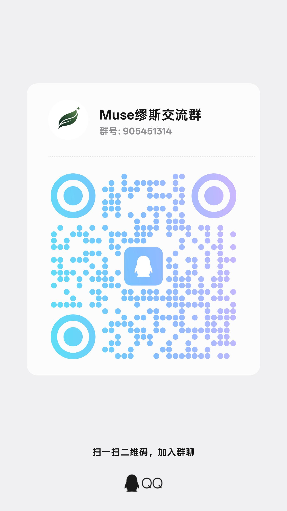
</p>

> 赞助完全自愿，不与任何功能、额度或更新挂钩；不赞助不影响正常使用。

## 关于作者

项目由一名成都的独立开发者维护。如果你所在的团队在找人，或只是想聊聊，欢迎直接联系。

- 坐标：成都
- 意向：软件工程实习生
- 联系方式：见上方交流群，或走仓库 Issue

## 许可证

项目采用 **GNU General Public License v3**（GPL v3）。完整许可证文本见 [LICENSE](LICENSE)，第三方依赖许可证列表见 [NOTICE](NOTICE)。
