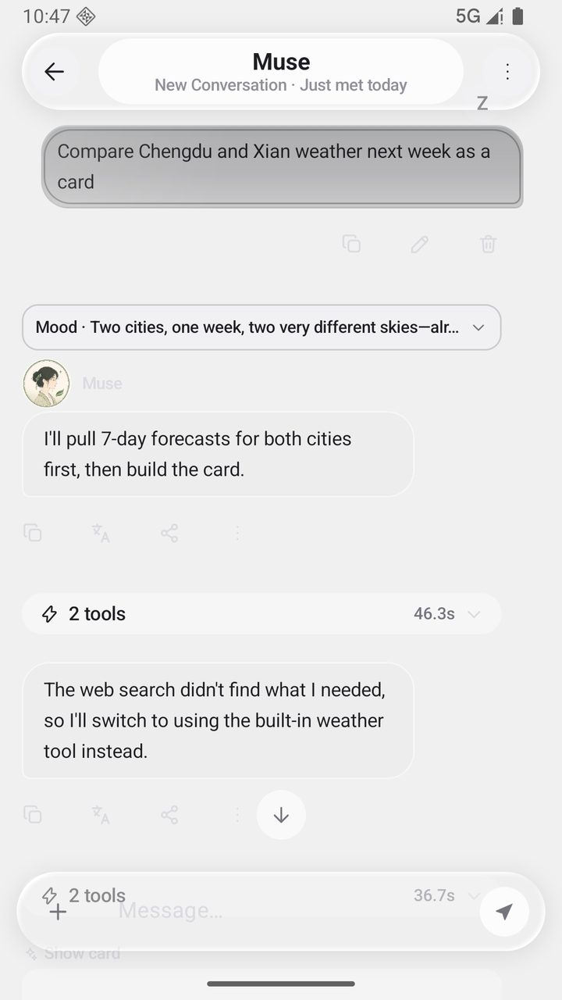
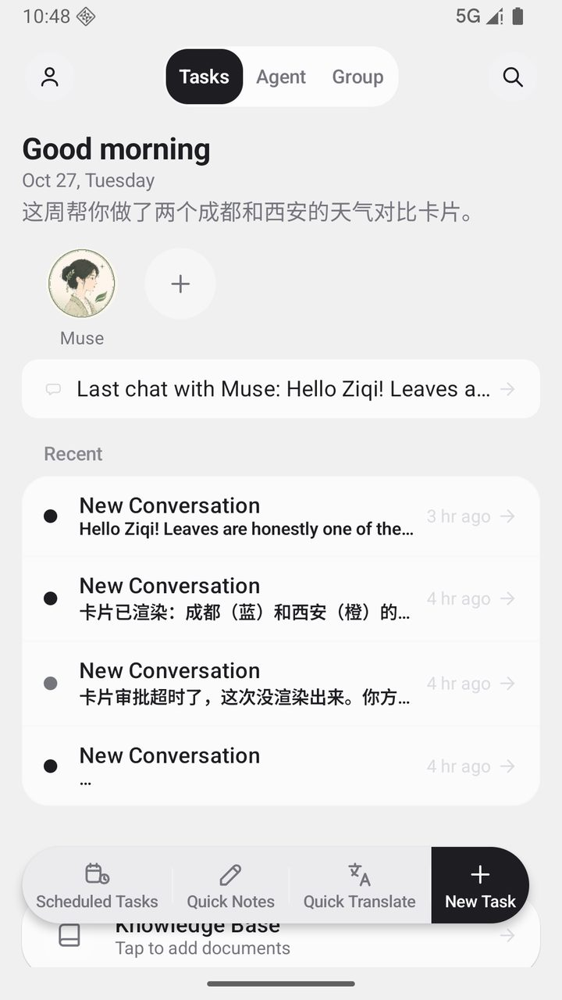
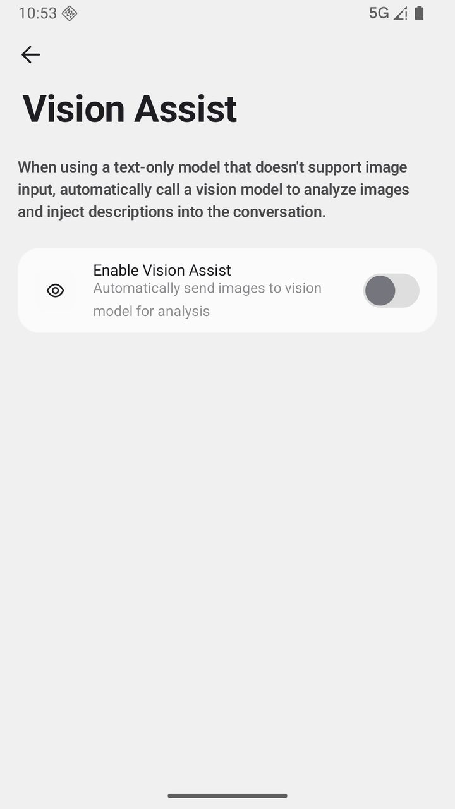

<p align="center">
  
</p>

<p align="center">
  <a href="README.md">中文</a> · <b>English</b> · <a href="README_JA.md">日本語</a> · <a href="README_KO.md">한국어</a> · <a href="README_ES.md">Español</a> · <a href="README_PT.md">Português</a> · <a href="README_RU.md">Русский</a>
</p>

<p align="center">
  <a href="https://github.com/Zer0Qing/Muse/releases/latest"></a>
  <a href="https://github.com/Zer0Qing/Muse/releases"></a>
  <a href="https://github.com/Zer0Qing/Muse/stargazers"></a>
  <a href="LICENSE"></a>
  
  
</p>
<p align="center">
  <a href="https://qm.qq.com/q/905451314"></a>
  <a href="https://museai.ltd"></a>
  <a href="https://museai.ltd/download/"></a>
</p>

<p align="center">
  <a href="#what-is-muse">What is Muse</a> ·
  <a href="#screenshots">Screenshots</a> ·
  <a href="#download">Download</a> ·
  <a href="#quick-start">Quick Start</a> ·
  <a href="#features">Features</a> ·
  <a href="#build-from-source">Build from Source</a> ·
  <a href="#contributing">Contributing</a>
</p>

---

## What is Muse

Muse is a personal AI agent that lives on your own Android phone.

Most AI assistants are cloud tabs: you open them, chat, and close them while everything stays on someone else's server. Muse is built to stay on your device. There is no account and no telemetry—your chats, memories, and knowledge base sit in local SQLite storage by default, and you can plug in any provider you like (OpenAI, Anthropic, Gemini, DeepSeek, Qwen, Zhipu, or local OpenAI-compatible servers) and switch anytime.

A few things make it different from a typical API wrapper:

- **Remembers you, not just one chat**: important facts are extracted, rolled into summaries, and organized over time, while medical or identity details stay protected from decay. Switch models or start a new session, and it still knows who you are.
- **Reaches out on its own**: the assistant tracks things it wants to follow up on, wakes up on schedule, and checks in when you have been quiet—backing off if you dismiss it and staying silent during quiet hours.
- **Actually operates your phone**: when you grant permissions, it can tap the screen, run shell commands, browse in an isolated WebView, read/write sandboxed files, run Python/Node via an on-demand `proot` Ubuntu runtime, or tunnel over SSH to your own lightweight Linux host.
- **Interactive cards inside chat**: instead of dumping walls of text, the assistant can render charts and interactive HTML/SVG cards (like Gomoku, trackers, or quizzes) that talk back to the AI silently without flooding your chat history.

---

## Screenshots

<p align="center">
  
  
  
  
</p>

<details>
<summary>Show more screenshots</summary>

<p align="center">
  
  
  
</p>
<p align="center">
  
  
  
</p>
<p align="center">
  
  
  
</p>

</details>

---

## Download

| Your device | Pick | Notes |
| --- | --- | --- |
| Modern Android phones | `arm64-v8a` | Recommended, smallest APK |
| Older 32-bit devices | `armeabi-v7a` | Legacy compatibility |
| Not sure | `universal` | Works on all ABIs |

- **GitHub Releases**: [Latest Release](https://github.com/Zer0Qing/Muse/releases/latest)
- **Mirror / Official site**: [museai.ltd/download](https://museai.ltd/download/)

Install over the existing app to keep all local data intact.

> [!WARNING]
> Only install APKs from GitHub Releases or the official website above. In-app update checks only open the official release page and never silently download APKs.

---

## Quick Start

1. **Add an API key**: go to **Settings → Models & Providers**, pick a preset (or custom OpenAI/Anthropic/Gemini endpoint), enter your key, test the connection, and fetch models.
2. **Choose your home layout**: go to **Settings → Appearance** to preview and switch between the **Classic 3-Tab** layout and the **Minimal Drawer** layout (opens straight into chat with a slide-out drawer).
3. **Start talking**: send your first message and memory starts building locally.
4. **Unlock device tools (optional)**: pure chat needs zero extra permissions. If you want screen automation or scripts, open **Settings → Permission Wizard** to enable Accessibility / Shizuku or download the on-demand `proot` Ubuntu runtime.

---

## How it compares to cloud agents

| | Cloud Agents | Muse |
|---|---|---|
| Where it runs | Remote cloud servers | Your own Android phone |
| Where data lives | Uploaded to the vendor | Local Room SQLite by default |
| What it can touch | Web APIs and browser tabs | Device screen, files, notifications, shell, your own SSH host |
| Model lock-in | Tied to one platform | 40+ preset providers, swap anytime |
| Cost | Monthly subscription + privacy | Your own device and API key |

---

## Features

<details>
<summary><b>Chat & Reading</b> — dual home layouts, typography, interactive cards, voice & vision</summary>

- **Two home layouts**: Classic 3-Tab (Agent / Chat / Group Chat) or Minimal Drawer (chat-first canvas with a slide-out sidebar).
- **Resilient streaming**: SSE streaming with stop/resume, automatic non-streaming fallback on empty streams, and configurable thinking budgets (`OFF` to `XHIGH`).
- **Clean typography & reader**: automatic spacing between CJK text, Latin words, numbers, and inline code (without breaking URLs or `$...$` math), syntax highlighting for 20+ languages, KaTeX, Mermaid, and a full-screen long-text artifact reader.
- **Silent interactive cards**: HTML/SVG cards can query the assistant silently in the background (`window.muse.ask` / `saveState`) for multi-turn games or tools without cluttering the chat timeline.
- **Multi-model routing & vision assist**: separate models for chat, titles, compression, and memory; automatic 8-part visual description when sending images to text-only models.
- **Search, voice & files**: configurable web search (including custom JSON endpoints), per-session browser preview, streaming ASR, local/cloud TTS + voice cloning, and PDF / DOCX / EPUB / offline OCR parsing.

</details>

<details>
<summary><b>Memory & Knowledge Base</b> — four-tier memory, standalone profile shards, local RAG, proactive wake-ups</summary>

- **Four-tier memory**: conversation stream → fact extraction → rolling summaries → periodic/manual Dream organization (with rollback).
- **Standalone "About You" profile**: five personal domains (habits, health, interpersonal, work/study, preferences) stored in private local files outside the knowledge base, with an independent toggle.
- **Local RAG knowledge base**: hybrid vector + keyword retrieval, `@document` scoping, streaming indexing for large files, and fast batch deletion for large folders/bases.
- **Scheduled proactive messages**: reminders and check-ins triggered at exact minute offsets or timestamps, respecting quiet hours and user dismissal feedback.

</details>

<details>
<summary><b>Device Automation & Compute Node</b> — 180+ tools, proot runtime, virtual display, SSH Compute Node</summary>

- **Tiered toolset**: 180+ built-in tools (200+ with MCP, plugins, and skills), loaded on demand via `find_tools` to save context tokens.
- **Multiple execution channels**: separate-process Accessibility provider (survives app updates), Shizuku, Root, Termux, plus an on-demand `proot` Ubuntu rootfs for Node/Python without bloating the base APK.
- **Virtual display & GUI Agent**: run multi-step screen tasks on a hidden background display without taking over your phone.
- **Lightweight Linux Compute Node**: attach your own Linux machine over SSH for heavy tasks and live remote browser takeover.
- **Safety boundaries**: allowlisted `device_shell` verbs, four-tier tool permissions, risk-based approvals, workspace sandboxing, and OEM battery/background wake diagnostics.

</details>

<details>
<summary><b>Multi-Agent, Group Chats, Channels & Plugins</b> — WeChat / QQ / Feishu / Telegram / DingTalk</summary>

- **Multi-agent & `@` delegation**: per-assistant personas, models, memory scopes, and `@name` task delegation; multi-assistant group meetings with debate/rotation/host modes, voting, and shared docs.
- **Five chat platforms**: connect WeChat, QQ, Feishu, Telegram, and DingTalk, sharing one local persona while isolating per-contact history.
- **MCP, Skills & JS Plugins**: connect external MCP servers (OAuth/SSE), import `.skill.json` workflows, record UI steps into reusable skills, or extend tools, panels, and bubble skins via sandboxed JS plugins.

</details>

<details>
<summary><b>Appearance, Backup & Privacy</b> — themes, imports, local encryption</summary>

- **Customization**: 12 light/dark themes, 8 color-blind-friendly palettes, Android 12+ dynamic color, 179 custom icons ([muse-icons](https://github.com/Zer0Qing/muse-icons)), and 7 UI languages.
- **Backup & migration**: encrypted local export, WebDAV / S3 sync, and one-click import from ChatGPT, CherryStudio, Chatbox, RikkaHub, and Kelivo.
- **Privacy by default**: no sign-up, no analytics, Android Keystore encryption for secrets, and automatic PII masking before requests leave the device.

</details>

---

## Tech Stack & Modules

| Area | Stack |
|---|---|
| Language & UI | Kotlin 2.4 · Jetpack Compose · Material 3 |
| Architecture | MVVM + unidirectional data flow · Koin |
| Data & Search | Room (SQLite) · DataStore · ONNX Runtime · HNSW + FTS |
| Network & Remote | OkHttp · Ktor · JSch (SSH Compute Node tunnel) |
| Runtime & Parsing | `proot` Ubuntu runtime · PDFBox · ML Kit OCR · custom PTY/xterm |
| Quality Gates | detekt · ktlint · Android Lint · custom CI check scripts |

```text
:app                        Main app (UI, sessions, tool orchestration, channels, compute node, settings)
:ai                         Model provider layer (OpenAI / Anthropic / Gemini streaming & tools)
:memory                     Memory engine (facts, summaries, compilation, Dream)
:conversation-core          Shared conversation state & message contracts
:material3                  Dynamic color & custom theme extensions
:miniphone                  Standalone mini-phone sandbox module
:accessibility(+provider)   Accessibility service & separate-process keep-alive provider
:virtual-display-*          Virtual display protocol & server
:common                     Logging, result wrappers, write gates & utilities
```

---

## Build from Source

Requires **JDK 21** and **Android SDK** (Platform 36, Build-Tools 36.0.0).

```bash
git clone https://github.com/Zer0Qing/Muse.git
cd Muse

# Debug build
./gradlew :app:assembleDebug

# Install to connected device
./gradlew :app:installDebug
```

Release builds require explicit version flags and `keystore.properties` at the repo root:

```powershell
./gradlew :app:assembleRelease "-PversionName=<x.y.z>" "-PversionCode=<number>"
python ci/script/validate_release_apks.py --apk "app/build/outputs/apk/release/*.apk"
```

---

## Contributing

Issues, PRs, plugins, and translations are welcome:

- [Contributing Guide](CONTRIBUTING.md) · [Security Policy](SECURITY.md) · [Plugin Docs](docs/plugin/)
- Please run the check scripts under `ci/script/` and unit tests before opening a PR.

---

## Support & Contact

Muse is built and maintained independently, free and open-source with no paywalls or accounts. If you find it useful, voluntary support is appreciated:

<p align="center">
  
  
  
  
</p>

Built by an independent developer in Chengdu (Android / Kotlin & agent tooling). Contact on WeChat: `QingTian07707`.

---

## License

Licensed under the **GNU General Public License v3** (GPL v3). See [LICENSE](LICENSE) and [NOTICE](NOTICE).
