<p align="center">
  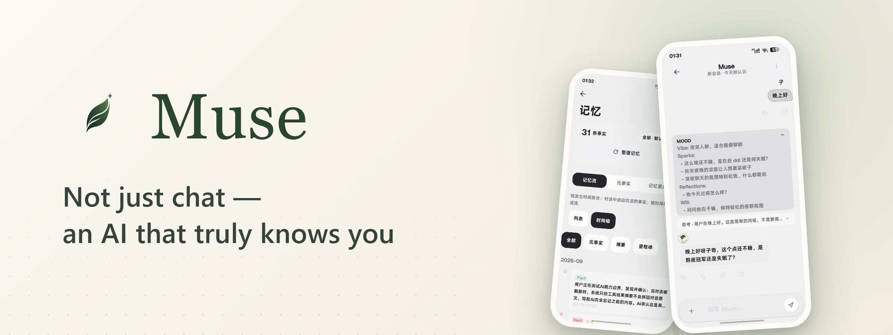
</p>

<p align="center">
  <a href="README.md">中文</a> · <b>English</b> · <a href="README_JA.md">日本語</a> · <a href="README_KO.md">한국어</a> · <a href="README_ES.md">Español</a> · <a href="README_PT.md">Português</a> · <a href="README_RU.md">Русский</a>
</p>

<p align="center">
  <a href="https://github.com/Zer0Qing/Muse/releases/latest"></a>
  <a href="https://github.com/Zer0Qing/Muse/releases"></a>
  <a href="https://github.com/Zer0Qing/Muse/stargazers"></a>
  <a href="LICENSE"></a>
  
  
</p>
<p align="center">
  <a href="https://qm.qq.com/q/905451314"></a>
  <a href="https://museai.ltd"></a>
  <a href="https://museai.ltd/download/"></a>
</p>

<p align="center">
  <a href="#what-is-muse">What is Muse</a> ·
  <a href="#screenshots">Screenshots</a> ·
  <a href="#download">Download</a> ·
  <a href="#quick-start">Quick Start</a> ·
  <a href="#features">Features</a> ·
  <a href="#open-source">Open Source</a>
</p>

---

## What is Muse

Muse is a personal agent that runs on your own phone.

Most personal agents in 2026 run in the cloud. They remember you and they can get work done, but the conversation, the memory and the execution all sit on someone else's server.

Muse moves this back onto the device. It lives on your Android phone, connects to any model you want (40+ preset providers), and keeps your data on the device by default. When something needs doing, it operates the phone directly: reading the screen, tapping, running commands, reading and writing files.

It does four things:

| | Meaning | How Muse does it |
|---|---|---|
| **Continuous** | Switch sessions, channels or models, it is still the same one | Four-tier memory + one persona across five chat channels |
| **Proactive** | It moves things forward without being called | Pending-thoughts ledger, scheduled tasks, reaching out when it has been quiet |
| **Capable** | It does more than talk | Accessibility / Shizuku / Root tiers, 200+ tools, terminal and virtual display |
| **Persistent** | Close and reopen, it is still there | Keep-alive service, local database, offline runtimes |

No sign-up, no account, uninstall and it is gone.

## Screenshots

<p align="center">
  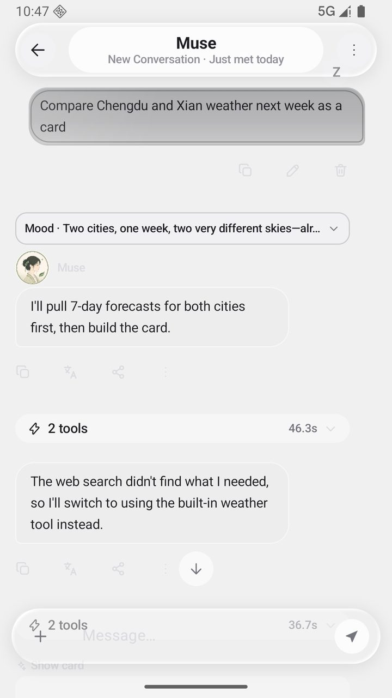
  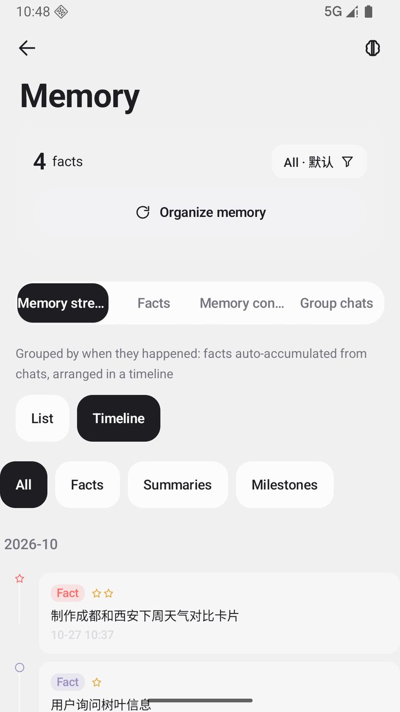
  
  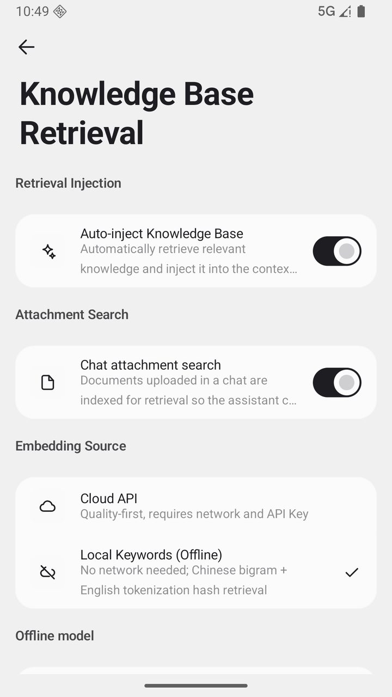
</p>

<details>
<summary><b>More screenshots</b> (click to expand)</summary>

<p align="center">
  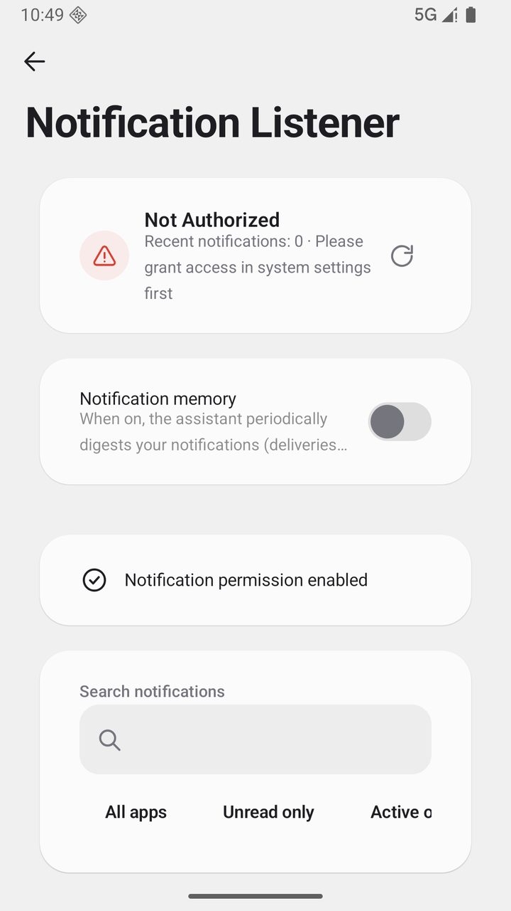
  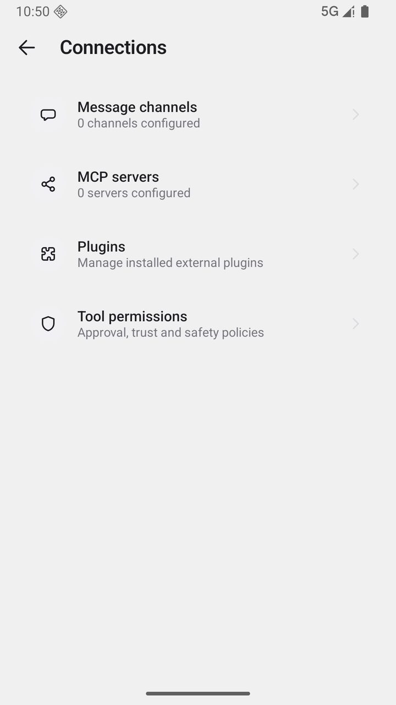
  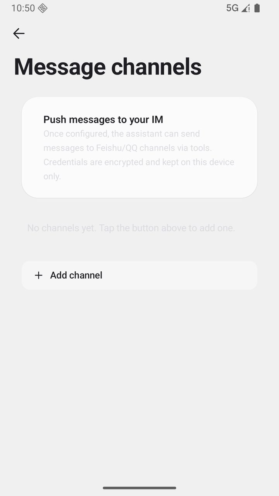
</p>
<p align="center">
  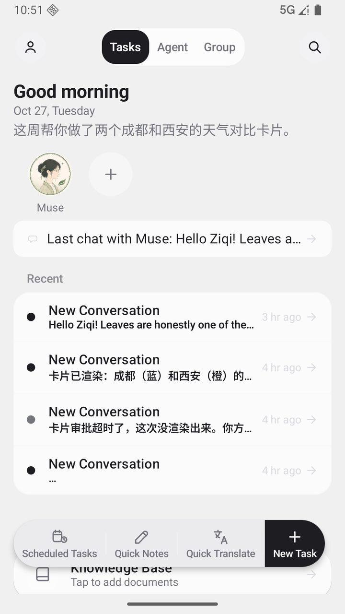
  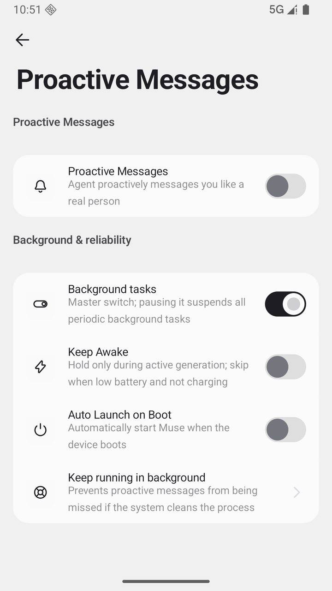
  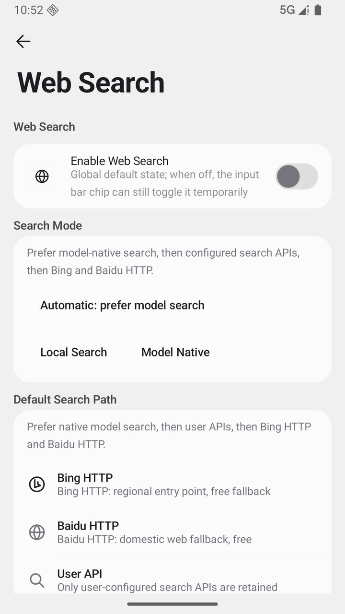
</p>
<p align="center">
  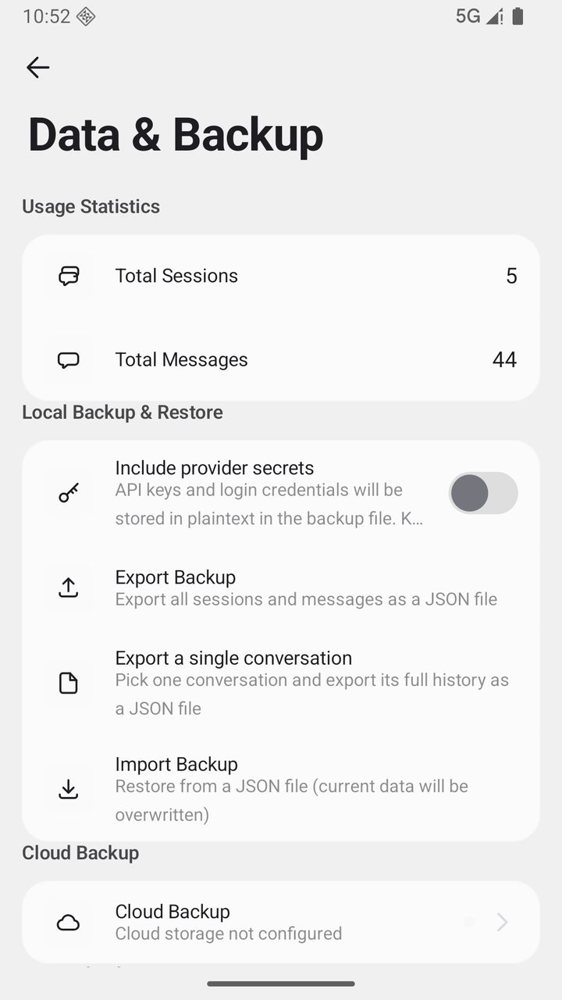
  
  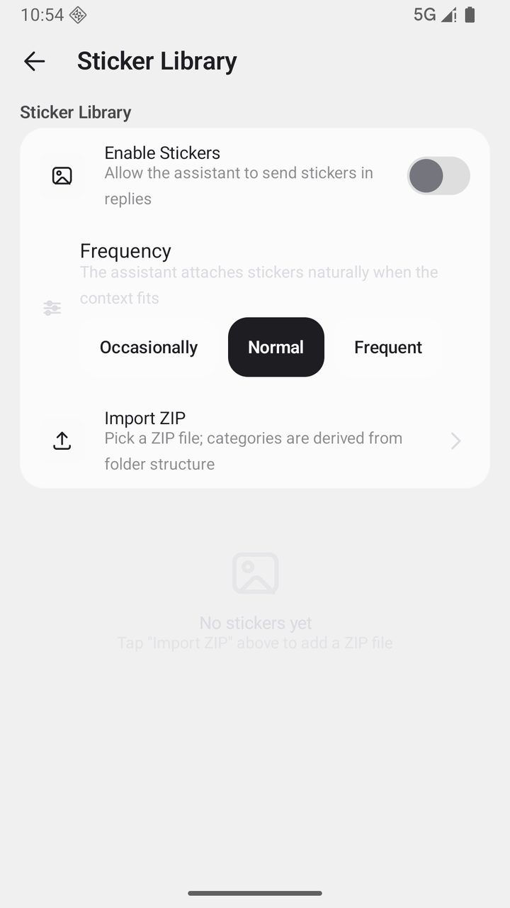
</p>

</details>

## Download

| Your device | Choose | Notes |
| --- | --- | --- |
| Recent phones | `arm64-v8a` | Recommended, smallest download |
| Older phones | `armeabi-v7a` | For older devices |
| Not sure | `universal` | Works everywhere |

Download the latest APK from the official download page [museai.ltd/download](https://museai.ltd/download/) (fast direct downloads in China); it's also available on [GitHub Releases](https://github.com/Zer0Qing/Muse/releases/latest). Install over the top; your data stays intact.

> [!WARNING]
> Only download from the official Releases page or the official website. Packages from unknown sources may be tampered with, risking your data and device.

> [!NOTE]
> In-app updates only open the official GitHub HTTPS assets; the app never downloads or silently installs APKs. A "Unknown sources" prompt during installation is expected.

## Quick Start

1. **Configure a model provider**: open **Settings → Models & Reasoning → Providers**, pick a preset provider (DeepSeek, Qwen, Zhipu and others offer free credits on sign-up), paste your API key, test the connection and fetch the model list.
2. **Start chatting**: go back to the home screen and send your first message. Memory starts accumulating from that moment, and it keeps recognising you across models and sessions.
3. **Unlock system-level abilities (optional)**: to let it act on your phone, open **Settings → Permission Wizard** and enable the Accessibility / Shizuku / Root / Termux channels you need. Every step has built-in detection and test entry points.

> The full guide (including the gestures and the less obvious operations) is in the [user manual (Chinese)](用户手册.md) and in-app under **Settings → Tutorial**.

## Why Muse

### 1. It runs on a device you own

A cloud agent gives you a service: you sign in, it remembers you, the data lives there. Muse is a long-running process on your own device.

- Conversations, memory and knowledge base live in a local Room database; no telemetry, no analytics, no sign-up
- Any model: 40+ preset providers, plus self-hosted or LAN OpenAI-compatible endpoints
- Sensitive settings go through Android Keystore; PII is masked before sending and restored on the way back

### 2. Memory is organised by person, not by session

Four memory tiers, from the short-term conversation down to long-term processing:

```
chat --> fact extraction --> rolling summary --> compilation --> deep processing
short     key facts          compression        dedup/merge     long-term memory
```

- Medical, financial and core-identity facts do not decay; everyday details fade with use
- Every memory entry can be traced to its source, and edited, reweighted or searched; memories for different purposes are isolated by space
- One assistant across WeChat / QQ / Feishu / Telegram / DingTalk, with per-contact context and rolling summaries

### 3. It does not wait to be spoken to

- **Pending-thoughts ledger**: the assistant writes down what it wants to ask you later and picks one when the moment fits
- **Outcome ledger**: opened, replied, dismissed — all recorded; intimacy learns from it and decides how many times it may speak today
- **Quiet hours**: it stays silent when you should be asleep
- **Scheduled tasks**: run on time, results land back in the conversation

### 4. It can operate the phone directly

| Channel | Capabilities | Requirement |
|---------|--------------|-------------|
| Accessibility (separate process) | Read the screen tree, tap / swipe / long-press / type, Back / Home / notification shade | One system toggle |
| Shell (Shizuku / adb) | Screenshots, `input` commands, foreground app lookup, device commands | One-time authorization |
| Root | Full system control, access other apps' data | Rooted device |
| Termux | Full Linux environment (apt / pip / gcc / ffmpeg) | Install Termux and authorize |

- **200+ tools**, exposed in tiers by default; long-tail capabilities are loaded on demand via `find_tools`
- Every tool declares its required authorization and readiness (READY / NOT READY); an unready call fails before execution with guidance
- Built-in terminal (custom PTY + xterm), background virtual display, vision-driven GUI Agent, browser automation
- Safety boundaries: command allowlist, risk-based approval (Trusted / Ask / Strict), hard timeouts, workspace sandbox

### 5. Drafts, persona and multiple assistants

- **Mood, in four dimensions**: Vibe / Sparks / Reflections / Will before every reply, collapsed by default
- **Three-layer persona**: persona / relationship / style layers, with `{{user_name}}` / `{{char}}` template variables
- **Multi-agent**: delegate with `@assistant-name`, task cards show progress per step, sub-agents run in floating windows, assistants can DM each other
- **Group meetings**: summary cards, votes, observers, quick templates, meeting controls
- **Milestones**: first message, day 7 / 30 / 100, message 100 / 1000

### How it differs from a cloud agent

| | Cloud personal agent | Muse |
|---|---|---|
| Runs on | A cloud host / a browser tab | Your own phone |
| Data | Uploaded before it can remember you | Stays on the device by default |
| Can touch | Web pages and APIs | The device itself: screen, commands, files, other apps |
| Model | Bound to the platform | 40+ providers, swap anytime |
| Cost | Subscription and privacy | You supply a device and an API key |

## Features

<details>
<summary><b>Chat Experience</b> — streaming & continuity / sessions / message tools / multi-model / voice / multimodal / search</summary>

- **Streaming & resilience**: SSE token-by-token output, stop anytime; an interrupted stream resumes when the network recovers. A built-in stream guard detects "premature stream end" (empty streams / zero first byte) and falls back to a non-streaming retry; a first-event watchdog (45s for regular models, 90s for reasoning models without a first token) switches request modes automatically.
- **Session management**: pin / archive / undoable delete / folders, with drag-to-reorder for pinned sessions. Global search uses SQLite FTS5 (with an automatic FTS4 fallback). Each session has its own context window, and long conversations are compressed with rolling summaries.
- **Message tools**: regenerate keeps multiple versions (`1/3` switcher, nothing lost); branching forks a new timeline from any user message and leaves the original intact; quote-reply injects the quoted text into context. Long-press menu: copy (plain text / Markdown), forward, share, favorite, edit, translate, read aloud, delete, plus message annotations.
- **Favorites**: a dedicated favorites view, with group tags on long-press.
- **Input experience**: full-screen input for long texts, slash commands (`/new` `/compact` `/reset` `/pin` `/archive`), paste-as-file with a configurable threshold, quick messages. An interrupted tool call can be resumed with one tap or discarded.
- **Quick capture**: an optional floating capsule for notes from any screen, saved to a local notebook.
- **Deep thinking**: reasoning levels OFF / AUTO / LOW / MEDIUM / HIGH / XHIGH, roughly 1,000 to 16,000 thinking tokens, with the reasoning shown collapsed.
- **Multi-model**: native OpenAI / Anthropic / Gemini protocols plus any OpenAI-compatible endpoint; 40+ preset providers with dynamically fetched model lists. Each model is tagged for vision, reasoning and tools. Auxiliary tasks (titles, compression, summaries, memory compilation) route through separate "small tool / large tool" model tiers. Request headers, request bodies and network proxy are all configurable.
- **Voice**: streaming speech-to-text with live transcription, a waveform and swipe-up to cancel. TTS covers system voices and cloud voices (OpenAI / MiniMax / Edge and more) configured per assistant, plus cloud voice cloning (ElevenLabs / FishAudio).
- **Multimodal input**: multiple images per message; PDF / DOCX / EPUB / TXT parsed automatically; offline OCR for scans.
- **Vision assist**: when you send images to a non-vision model, a vision model generates an eight-dimension structured description (overview, OCR text, objects and layout, chart data, request restatement, answer, visual evidence, uncertainty) with coordinate grounding. Descriptions are cached per image, request and prompt version; multi-image analysis runs concurrently with a 60-second timeout and a text-only fallback.
- **Web search & browsing**: search sources are configurable (native model search, Bing, Baidu, SearXNG, Tavily, DeepSeek, custom engines) with layered fallback. A custom engine can point at any JSON search service you run (self-hosted SearXNG, an internal gateway), supports GET or POST, a results field mapping and an optional Bearer token, and sits first in the Auto chain. Article extraction uses Jina Reader. Each session has its own built-in browser, and the capsule expands into a live view while the AI browses.
- **Translation & read-aloud**: translate or read any message on long-press; the translation model is configured separately; translation history is kept.
- **Rendering & cards**: full Markdown rendering with syntax highlighting for 20+ languages, KaTeX formulas, Mermaid diagrams and tables. The AI can emit interactive cards and artifact cards (code / documents / tables), managed in an artifact center with full-screen view and export.

</details>

<details>
<summary><b>Memory & Growth</b> — four-tier pipeline / decay & protection / context continuity / experience library / knowledge base / proactive messages</summary>

- **Four-tier memory pipeline**: (1) the raw conversation stream; (2) fact extraction, pulling key facts with importance and source; (3) rolling summaries, compressing long conversations without losing the thread; (4) deep processing, compiling, deduplicating and merging in the background into long-term memory. Facts are full-text indexed and searchable.
- **Importance & decay**: medical, financial and core-identity facts are protected from decay; everyday details fade with use.
- **Memory panel**: browse by space or category; add, edit and delete entries, adjust importance, filter by time or weight. Long-press for multi-select bulk delete on both the list and the timeline, and the list stays where it was. Every memory traces back to its source session, and long entries expand in place.
- **Memory spaces**: memories for different purposes are isolated from each other.
- **Context continuity**: history that scrolls out of the context window is not silently dropped. A deterministic digest, with verbatim conversation fragments and tool entries, is placed ahead of the window; tool-round compression keeps the assistant's notes; the compressed summary records which files that span touched.
- **Cross-session carry-over**: a new conversation can bring back the last few turns of the previous one (4 to 40, adjustable, off by default).
- **Experience library**: distils "handle this kind of problem this way" into reusable experience that future tasks consult automatically (toggleable).
- **Knowledge base (RAG)**: imported documents are parsed, chunked and indexed; retrieval uses hybrid semantic and keyword ranking; @-mentions scope retrieval to specific documents; very large files are indexed in a streaming fashion; offline environments fall back to local retrieval; citations trace back to the original passages.
- **Daily summary & greetings**: a recap generated at configurable times, visible on the home screen with optional push. Morning greetings are generated from near-term items in memory, not from a template.
- **Proactive messages**: no fixed-interval polling. A pending-thoughts ledger holds what the assistant wants to ask you later, and it picks one when the moment fits. Being opened, answered or dismissed goes into an outcome ledger, and intimacy learns from those outcomes to decide how often it may speak. Five levels (Quiet / Reserved / Standard / Active / Clingy), a reset that returns to the default level and clears today's quota, quiet hours that are honored, and silence when it has nothing to add; after a long gap it greets you as a fallback. At night it tidies memories without disturbing you, and daily push content is configurable.
- **Milestones**: first message, days 7 / 30 / 100 together, messages 100 / 1000 and other moments are recorded automatically and can be revisited on the milestones page.
- **Stats & activity panel**: conversation and message totals, daily average, streaks and a daily heatmap; an activity panel shows the execution history of scheduled tasks, heartbeats and memory compilation.

</details>

<details>
<summary><b>Tools & Automation</b> — 200+ tools / permission tiers / approvals & budgets / four channels / terminal / virtual display / GUI Agent</summary>

- **Tool system**: 200+ tools exposed in tiers (core / standard / optional / advanced). Only common tools are sent by default to keep context lean, and long-tail capabilities load on demand via `find_tools` and stay available for the session. The system prompt carries a live capability index with the number actually available this round.
- **Permission tiers**: every tool that needs Shizuku / Root, Accessibility or Termux declares its dependencies and readiness (READY / NOT READY); an unready call fails before execution with a structured `permission_required` error and authorization guidance.
- **Approvals**: risk levels (safe / normal / high) combined with three modes (Trusted / Ask / Strict); "allow for this session" and per-tool policies; high-risk actions always ask first.
- **Execution engine**: read-only tools run with bounded parallelism (max 3) for speed; blocking tools run on a dedicated thread pool with hard timeouts; oversized outputs are written to disk with previews and `read_file` references in context. Success is judged uniformly, repeated failures stop early with the reason reported, and tool rounds are unlimited by default (a cap is configurable), with circuit breakers for repeated identical calls, no-progress rounds and total call counts.
- **Four execution channels**: Accessibility (separate-process provider over AIDL, surviving main-app updates), Shizuku (Binder elevation), Root (su), Termux (RUN_COMMAND); the tier is chosen automatically by availability.
- **Device commands**: `device_shell` runs through a verb allowlist (dumpsys / settings / am / pm / input / screencap / uiautomator / cmd / svc / wm / getprop / content, etc.); pipes, redirection and command chaining are rejected, as is anything outside the allowlist.
- **Built-in terminal**: custom PTY engine with an xterm terminal page, in three environments: the app sandbox shell, the device command channel, and a full Termux Linux (apt / pip / gcc / ffmpeg).
- **Virtual display**: a separate server process creates a hidden display in the background so the agent's workflow never takes over your main screen; frames are captured on demand.
- **GUI Agent**: a vision-driven multi-step loop: screenshot → vision-model decision → tap / swipe / type → screenshot verification, until the task is done.
- **Browser automation**: navigate / click / type / extract / scroll / get_html / snapshot, with an independent browser instance per session.
- **Workspace**: a controlled file space (read / write / list / move / delete) confined to sandbox boundaries.
- **Schedules & reminders**: scheduled tasks with cron expressions and run history; alarms, timers, calendar events and memos fire or notify on time.
- **Notification listener**: reads the device notification stream and replies or suggests.
- **Permission wizard**: detection and guidance for all four channels in one place, with a live "test screen reading" check.

</details>

<details>
<summary><b>Assistants & Ecosystem</b> — group meetings / world book / skills / plugin market / MCP / five chat platforms</summary>

- **Multiple assistants**: each assistant configures its own model, system prompt, sampling parameters, bound resources, tool allowlist and skills; delegate with `@name`; task cards show each step's status; sub-agents run long tasks in floating windows without blocking the main conversation; assistants have a private DM inbox.
- **Assistant extras**: world book (always-on entries, keyword triggers, depth injection); prompt injections (custom snippets per mode); resource binding (attach a knowledge base for priority retrieval); import and export, including SillyTavern character card import and packing your own assistants for sharing.
- **Group meetings**: four discussion modes (rotation / free / debate / host-led), with the group context read before each round, a pass option and isolated memory per assistant. Meeting features: discussion summary cards (copy / share / save as a shared doc), vote rendering, observer members, group shared docs and per-AI private context, speaking-queue controls (pause / resume / skip), quick templates (design review / debate / brainstorm / retrospective), round folding, and interjections during rotation are kept.
- **Skill system**: built-in skills work out of the box; `.skill.json` import and export with parameter schemas; prompt skills accept inputs (`{{input}}` / `{{args}}` placeholders); installation goes through implementation allowlists and injection guards.
- **Plugin market**: search, install, enable, disable and uninstall with trust management; plugins can contribute tools, UI panels and message bubble skins; the assistant can draft JS plugins itself, which take effect only after signing and manual enabling; plugins run inside sandbox boundaries.
- **MCP**: connect external MCP servers to extend the tool set, with OAuth, SSE transport and automatic discovery.
- **OAuth connectors**: connect third-party services with credentials encrypted locally, managed from a connection center alongside models and channels.
- **Five chat platforms**: WeChat (QR binding), QQ (bot WebSocket), Feishu (long-connection events), Telegram, DingTalk (Stream mode). Each contact gets its own session context and rolling summary; images and voice messages are ingested and transcribed; each channel can bind a different assistant and model; every platform ships with a setup wizard and connection test.

</details>

<details>
<summary><b>Interface & Appearance</b> — themes / bubble skins / icons / languages / backup & data</summary>

- **Themes**: 12 complete themes, each with light and dark variants, plus 8 color-blind-friendly palettes; dynamic color (Android 12+), scheduled day/night switching and custom themes.
- **Bubbles & appearance**: adjustable bubble corner radius; a bubble skin system, with plugin-provided skins (high contrast, soft glow).
- **Hand-drawn icons**: 179 custom icons on a 24dp grid with 1.7dp rounded strokes, adaptive to light and dark, open-sourced at [muse-icons](https://github.com/Zer0Qing/muse-icons) (MIT).
- **Typography & languages**: font, size and letter spacing, predictive back, accessibility support; the interface ships in Chinese / English / Japanese / Korean / Spanish / Portuguese / Russian.
- **Backup & restore**: one-tap local export (JSON or chunked NDJSON, optionally encrypted); daily automatic backups bundling muse.db, memory.db and facts.db snapshots; S3 and WebDAV cloud sync; the proactive ledgers, outcomes and relationship intimacy are included; a protective copy is kept before every restore, with automatic rollback on failure.
- **Data import**: one-click migration from CherryStudio / Chatbox / ChatGPT / RikkaHub / Kelivo, plus multi-format conversation import.
- **Sticker library**: import zip packs organised in folders for automatic categories; three send-frequency levels (occasionally / normal / frequently); bulk delete and clear.
- **Home screen widget**: create a conversation in one tap; long-press the app icon for shortcuts.
- **Account center**: avatar and nickname stored locally, no sign-up, so there is no account to lose.
- **Audit log & proxy**: tool calls and key actions are logged; custom network proxy supported.

</details>

<details>
<summary><b>Security & Privacy</b> — local-first / encryption / PII masking / sandbox boundaries</summary>

- **Local-first**: conversations, memories and knowledge bases live in a local Room database; no telemetry, no analytics, no data collection; no sign-up, no login; network features are off by default.
- **PII masking**: phone numbers, ID numbers and bank cards are masked into placeholders before requests leave the device and unmasked in replies, so real values never reach the provider.
- **Encryption**: sensitive configuration in Android Keystore (AES-256-GCM); backup passwords with PBKDF2 and AES-256-GCM.
- **Link protection**: confirmation before opening links; model output is sanitized before WebView rendering, dropping iframe, form and pseudo-protocols.
- **Tool boundaries**: command allowlists, risk-based approvals, hard timeouts, permission preflight, failures reported as they are; plugins run sandboxed by default.
- **Crash logs**: stored locally only, exportable manually in safe mode.

</details>

## Tech Stack & Architecture

| Area | Technology |
|------|------------|
| Language / UI | Kotlin 2.4 · Jetpack Compose · Material 3 |
| Architecture | MVVM + unidirectional data flow · Koin (DI) |
| Data | Room (SQLite) + DataStore · ONNX Runtime (local embeddings) |
| Networking | OkHttp + Ktor |
| Parsing & rendering | PDFBox · ML Kit OCR · custom PTY + xterm |
| Quality gates | detekt + ktlint + Android Lint + custom check scripts · Kover coverage |

```
:app                        App shell (UI / sessions / tool orchestration / channels / settings)
:ai                         Provider abstraction (OpenAI / Anthropic / Gemini, streaming & tool calls)
:memory                     Memory engine (fact store / compilation / summaries)
:accessibility(+provider)   Accessibility service + separate-process provider (survives app updates)
:terminal                   Termux channel & terminal
:virtual-display-*          Virtual display server & protocol
:common                     Logging, result types and shared utilities
```

## Build from Source

Prerequisites: JDK 21, Android SDK (platform 36, build-tools 36.0.0).

```bash
git clone https://github.com/Zer0Qing/Muse.git
cd Muse

# Debug build
./gradlew :app:assembleDebug

# Install on a connected device
./gradlew :app:installDebug
```

Release builds require an explicit version and signing configuration; missing either one fails the build by design:

```powershell
./gradlew :app:assembleRelease "-PversionName=<x.y.z>" "-PversionCode=<number>"
# Signing: provide keystore.properties at the repo root (storeFile / storePassword / keyAlias / keyPassword)

# Pre-release verification (signing consistency across all ABI APKs)
python ci/script/validate_release_apks.py --apk "app/build/outputs/apk/release/*.apk"
```

## Open Source

Contributions are welcome:

- [Contributing guide](CONTRIBUTING.md) · [Security policy](SECURITY.md) · [UI component guidelines](UI组件库维护规范.md)
- Plugin development docs are in [`docs/plugin/`](docs/plugin/): authoring guide, type declarations and samples
- Please pass the local gate scripts and unit tests before opening a PR; new strings must be synced across all language packs
- Gate and release pipeline scripts live in `ci/script/`; the in-app tutorial (Settings → Tutorial) is maintained alongside

## Support the Project

Muse is maintained by an independent developer, free and open source, with no in-app purchases and no account system. If it helps you, you're welcome to support its continued development:

**Buy the author a coffee** (WeChat / Alipay QR codes):

<p align="center">
  
  
</p>

**Join the community**:

<p align="center">
  
  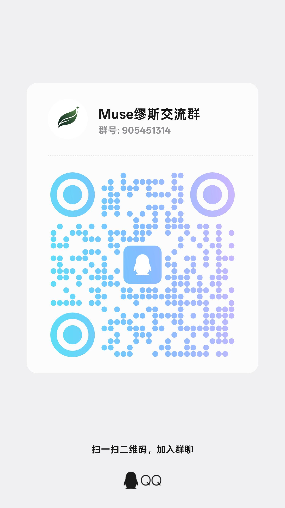
</p>

> Sponsorship is entirely voluntary and is not tied to any feature, quota or update; not sponsoring does not affect your use of Muse.

## License

Muse is licensed under the **GNU General Public License v3** (GPL v3). See [LICENSE](LICENSE) for the full text, and [NOTICE](NOTICE) for third-party dependency licenses.
