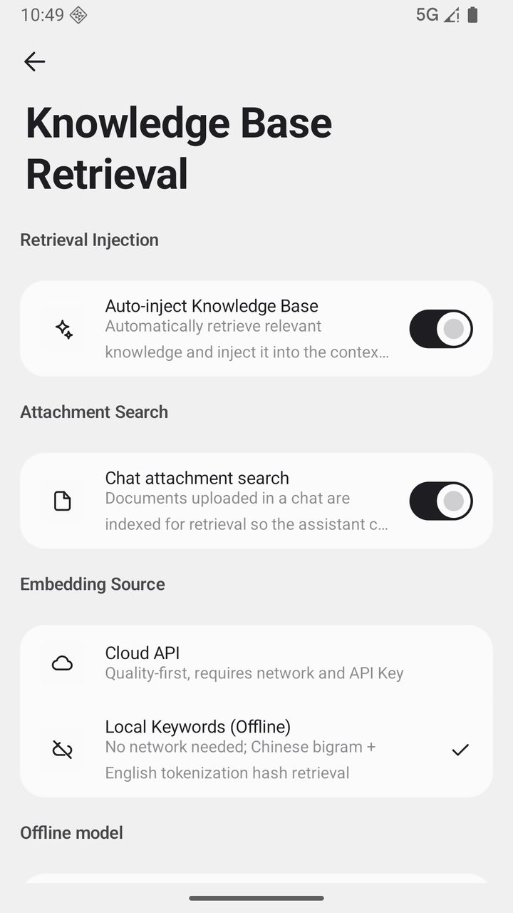

<p align="center">
  
</p>

<p align="center">
  <a href="README.md">中文</a> · <a href="README_EN.md">English</a> · <a href="README_JA.md">日本語</a> · <a href="README_KO.md">한국어</a> · <b>Español</b> · <a href="README_PT.md">Português</a> · <a href="README_RU.md">Русский</a>
</p>

<p align="center">
  <a href="https://github.com/Zer0Qing/Muse/releases/latest"></a>
  <a href="https://github.com/Zer0Qing/Muse/releases"></a>
  <a href="https://github.com/Zer0Qing/Muse/stargazers"></a>
  <a href="LICENSE"></a>
  
  
</p>
<p align="center">
  <a href="https://qm.qq.com/q/905451314"></a>
  <a href="https://museai.ltd"></a>
  <a href="https://museai.ltd/download/"></a>
</p>

<p align="center">
  <a href="#qué-es-muse">Qué es Muse</a> ·
  <a href="#capturas">Capturas</a> ·
  <a href="#descarga">Descarga</a> ·
  <a href="#inicio-rápido">Inicio rápido</a> ·
  <a href="#funciones">Funciones</a> ·
  <a href="#compilar-desde-el-código">Compilar</a> ·
  <a href="#contribuir">Contribuir</a>
</p>

---

## Qué es Muse

Muse es un agente personal de IA que vive en tu propio teléfono Android.

La mayoría de los asistentes de IA son pestañas en la nube: los abres, conversas y al cerrar todo queda en servidores ajenos. Muse está hecho para quedarse en tu dispositivo. No requiere cuenta ni telemetría; tus chats, recuerdos y base de conocimiento se guardan en SQLite local por defecto, y puedes conectar el proveedor que prefieras (OpenAI, Anthropic, Gemini, DeepSeek, Qwen, Zhipu o servidores locales compatibles con OpenAI) y cambiarlo cuando quieras.

Lo que lo diferencia de un cliente de API convencional:

- **Recuerda a la persona, no solo una sesión**: extrae hechos importantes, los resume y los organiza con el tiempo, protegiendo del olvido datos médicos o de identidad. Cambia de modelo o abre otro chat y seguirá sabiendo quién eres.
- **Toma la iniciativa cuando toca**: anota asuntos pendientes para preguntarte más adelante, despierta a la hora programada y respeta tus horas de silencio (y si lo ignoras, reduce la frecuencia).
- **Opera tu teléfono de verdad**: si le das permisos, puede leer la pantalla, tocar, ejecutar comandos, navegar en su propio WebView, trabajar con archivos en sandbox, usar un entorno Ubuntu `proot` bajo demanda (Node / Python) o conectarse por SSH a tu propio servidor Linux.
- **Tarjetas interactivas dentro del chat**: en lugar de soltar bloques infinitos de texto, puede dibujar gráficos y tarjetas HTML/SVG interactivas (como Gomoku, rastreadores o cuestionarios) que consultan al asistente en segundo plano sin inundar el historial.

---

## Capturas

<p align="center">
  
  
  
  
</p>

<details>
<summary>Ver más capturas</summary>

<p align="center">
  
  
  
</p>
<p align="center">
  
  
  
</p>
<p align="center">
  
  
  
</p>

</details>

---

## Descarga

| Tu dispositivo | Archivo | Notas |
| --- | --- | --- |
| Teléfonos Android recientes | `arm64-v8a` | Recomendado, menor tamaño |
| Dispositivos antiguos de 32 bits | `armeabi-v7a` | Compatibilidad clásica |
| No estás seguro | `universal` | Funciona en todas las arquitecturas |

- **GitHub Releases**: [Última versión](https://github.com/Zer0Qing/Muse/releases/latest)
- **Web oficial**: [museai.ltd/download](https://museai.ltd/download/)

Instala encima de la versión anterior sin perder tus datos locales.

> [!WARNING]
> Descarga solo desde GitHub Releases o el sitio oficial. Las comprobaciones de actualización solo abren la página oficial y nunca descargan APKs en segundo plano.

---

## Inicio rápido

1. **Añade tu clave API**: ve a **Ajustes → Modelos y proveedores**, elige un proveedor (o endpoint propio), pega tu clave, prueba la conexión y obtén los modelos.
2. **Elige tu pantalla de inicio**: en **Ajustes → Apariencia** puedes previsualizar y cambiar entre **Clásico (3 pestañas)** y **Cajón minimalista** (abre directo en el chat).
3. **Empieza a hablar**: desde el primer mensaje, la memoria empieza a construirse en tu dispositivo.
4. **Activa permisos solo si los necesitas**: chatear no requiere permisos extra. Para automatizar el teléfono o ejecutar scripts, abre **Ajustes → Asistente de permisos** o descarga el runtime Ubuntu `proot` bajo demanda.

---

## Diferencias frente a un agente en la nube

| | Agente en la nube | Muse |
|---|---|---|
| Dónde corre | Servidores remotos | Tu propio teléfono Android |
| Dónde viven los datos | Subidos al proveedor | SQLite Room local por defecto |
| Qué puede tocar | APIs web y pestañas | Pantalla, archivos, notificaciones, shell y tu host SSH |
| Modelos | Atado a una plataforma | Más de 40 proveedores, cámbialos cuando quieras |
| Coste | Suscripción + tus datos | Tu dispositivo y tu propia clave API |

---

## Funciones

<details>
<summary><b>Chat y lectura</b> —— dos inicios, tipografía, tarjetas interactivas, voz y visión</summary>

- **Dos diseños de inicio**: 3 pestañas clásicas o cajón minimalista directo al chat.
- **Streaming resistente**: pausar/reanudar SSE, respaldo automático sin streaming ante flujos vacíos y niveles de razonamiento (`OFF` a `XHIGH`).
- **Tipografía cuidada y lector**: espaciado limpio entre texto CJK, palabras latinas, números y código en línea (sin romper URLs ni fórmulas `$...$`), resaltado en más de 20 idiomas, KaTeX, Mermaid y lector de artefactos a pantalla completa.
- **Tarjetas silenciosas**: las tarjetas HTML/SVG consultan al asistente en segundo plano (`window.muse.ask` / `saveState`) sin llenar el chat de mensajes por cada clic.
- **Enrutado multimodelo y visión**: modelos separados para chat, títulos, compresión y memoria; descripción automática en 8 dimensiones al enviar imágenes a modelos sin visión.
- **Búsqueda, voz y archivos**: búsqueda web configurable, navegador por sesión, ASR en streaming, TTS local/nube + clonación de voz, y lectura de PDF / DOCX / EPUB / OCR sin conexión.

</details>

<details>
<summary><b>Memoria y base de conocimiento</b> —— cuatro capas, perfil independiente, RAG local</summary>

- **Memoria en cuatro capas**: flujo de chat → extracción de hechos → resúmenes continuos → organización Dream (con rollback).
- **Perfil "Sobre ti" independiente**: cinco ámbitos personales guardados en archivos locales privados fuera de la base de conocimiento, con interruptor propio.
- **RAG local**: búsqueda híbrida vectorial + palabras clave, menciones `@documento`, indexado en streaming para archivos grandes y borrado por lotes.
- **Mensajes proactivos programados**: recordatorios exactos por minutos o fecha/hora, respetando horas de silencio.

</details>

<details>
<summary><b>Automatización y Compute Node</b> —— 180+ herramientas, proot, pantalla virtual, SSH</summary>

- **Más de 180 herramientas** (200+ con MCP, plugins y skills), cargadas bajo demanda con `find_tools`.
- **Múltiples canales**: accesibilidad en proceso independiente (sobrevive a actualizaciones), Shizuku, Root, Termux y runtime `proot` Ubuntu bajo demanda para Node/Python.
- **Pantalla virtual y GUI Agent**: ejecuta flujos multipaso en una pantalla oculta sin bloquear tu pantalla principal.
- **Compute Node ligero por SSH**: conecta tu propia máquina Linux por SSH para tareas pesadas y control en vivo del navegador remoto.
- **Límites de seguridad**: lista blanca en `device_shell`, permisos en cuatro niveles, aprobaciones por riesgo y diagnóstico de ahorro de batería.

</details>

<details>
<summary><b>Multiasistente, grupos, canales y plugins</b> —— WeChat / QQ / Feishu / Telegram / DingTalk</summary>

- **Multiasistente y `@` delegación**: personas, modelos y memorias independientes por asistente, además de reuniones grupales con turnos, debate o moderador.
- **Cinco plataformas**: WeChat, QQ, Feishu, Telegram y DingTalk con historial separado por contacto y la misma persona local.
- **MCP, Skills y plugins JS**: servidores MCP (OAuth/SSE), `.skill.json`, grabación de pasos a skills y plugins JS en sandbox.

</details>

<details>
<summary><b>Apariencia, copias y privacidad</b> —— temas, importación y cifrado</summary>

- **Personalización**: 12 temas claro/oscuro, 8 paletas para daltonismo, color dinámico (Android 12+), 179 iconos propios ([muse-icons](https://github.com/Zer0Qing/muse-icons)) y 7 idiomas.
- **Copias e importación**: exportación local cifrada, WebDAV / S3 e importación desde ChatGPT, CherryStudio, Chatbox, RikkaHub y Kelivo.
- **Privacidad por defecto**: sin cuenta, sin analíticas, secretos en Android Keystore y enmascarado automático de datos sensibles antes de enviar.

</details>

---

## Stack y módulos

| Área | Tecnología |
|---|---|
| Lenguaje y UI | Kotlin 2.4 · Jetpack Compose · Material 3 |
| Arquitectura | MVVM + flujo unidireccional · Koin |
| Datos y búsqueda | Room (SQLite) · DataStore · ONNX Runtime · HNSW + FTS |
| Red y remoto | OkHttp · Ktor · JSch (túnel SSH) |
| Runtime y parsing | Runtime Ubuntu `proot` · PDFBox · ML Kit OCR · PTY/xterm propio |
| Calidad | detekt · ktlint · Android Lint · scripts CI propios |

```text
:app                        App principal (UI, sesiones, herramientas, canales, ajustes)
:ai                         Capa de proveedores (OpenAI / Anthropic / Gemini)
:memory                     Motor de memoria (hechos, resúmenes, Dream)
:conversation-core          Estado y contratos de conversación compartidos
:material3                  Color dinámico y extensiones de tema
:miniphone                  Módulo sandbox independiente
:accessibility(+provider)   Servicio de accesibilidad en proceso separado
:virtual-display-*          Protocolo y servidor de pantalla virtual
:common                     Logs, Result y utilidades compartidas
```

---

## Compilar desde el código

Requisitos: **JDK 21** y **Android SDK** (Platform 36, Build-Tools 36.0.0).

```bash
git clone https://github.com/Zer0Qing/Muse.git
cd Muse

./gradlew :app:assembleDebug
./gradlew :app:installDebug
```

Para compilación Release hace falta versión explícita y `keystore.properties` en la raíz:

```powershell
./gradlew :app:assembleRelease "-PversionName=<x.y.z>" "-PversionCode=<number>"
python ci/script/validate_release_apks.py --apk "app/build/outputs/apk/release/*.apk"
```

---

## Contribuir

Se aceptan Issues, PRs, plugins y traducciones:

- [Guía de contribución](CONTRIBUTING.md) · [Seguridad](SECURITY.md) · [Documentación de plugins](docs/plugin/)

---

## Apoyo y contacto

Muse es un proyecto independiente, gratuito y de código abierto. Si te resulta útil, se agradece cualquier apoyo voluntario:

<p align="center">
  
  
  
  
</p>

Mantenido por un desarrollador independiente en Chengdu. WeChat: `QingTian07707`.

---

## Licencia

Bajo **GNU General Public License v3** (GPL v3). Consulta [LICENSE](LICENSE) y [NOTICE](NOTICE).
