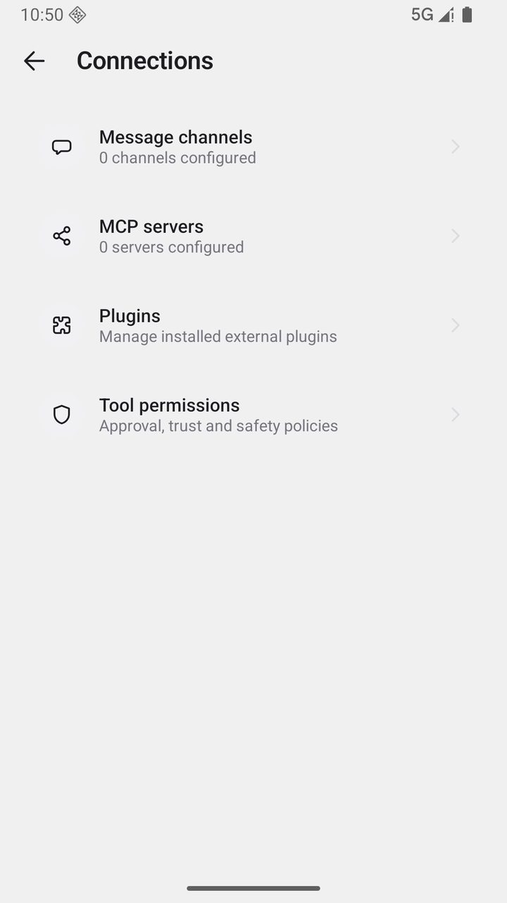
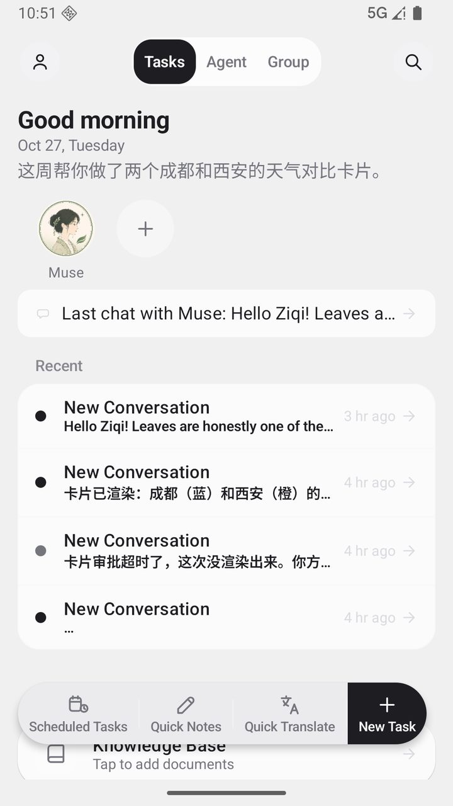
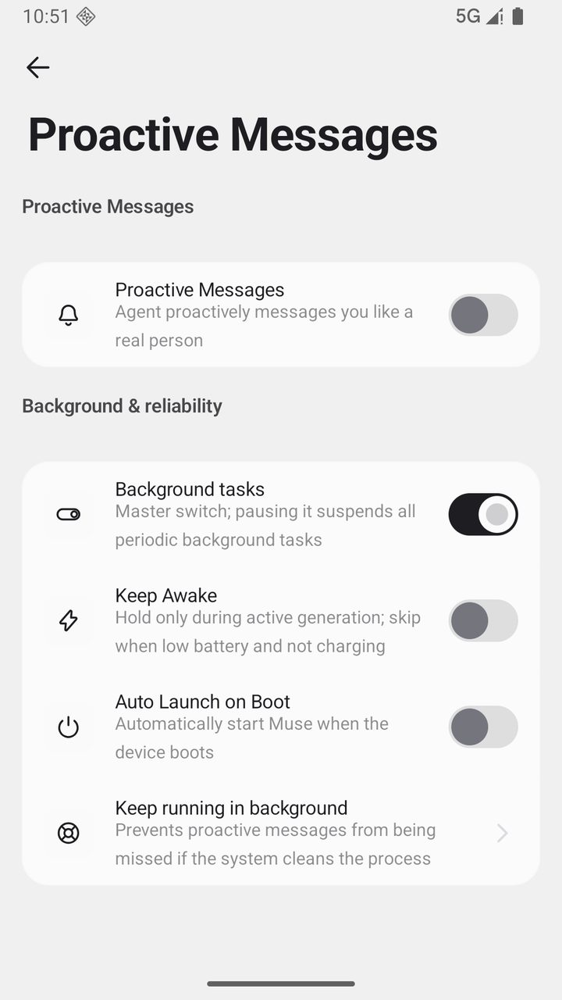
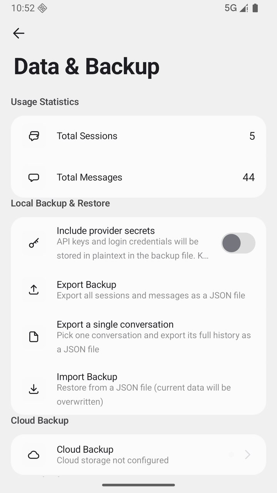
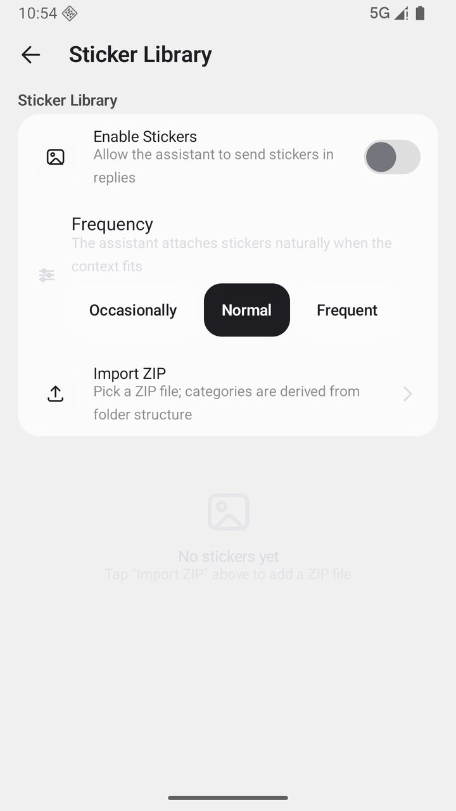

<p align="center">
  
</p>

<p align="center">
  <a href="README.md">中文</a> · <a href="README_EN.md">English</a> · <b>日本語</b> · <a href="README_KO.md">한국어</a> · <a href="README_ES.md">Español</a> · <a href="README_PT.md">Português</a> · <a href="README_RU.md">Русский</a>
</p>

<p align="center">
  <a href="https://github.com/Zer0Qing/Muse/releases/latest"></a>
  <a href="https://github.com/Zer0Qing/Muse/releases"></a>
  <a href="https://github.com/Zer0Qing/Muse/stargazers"></a>
  <a href="LICENSE"></a>
  
  
</p>
<p align="center">
  <a href="https://qm.qq.com/q/905451314"></a>
  <a href="https://museai.ltd"></a>
  <a href="https://museai.ltd/download/"></a>
</p>

<p align="center">
  <a href="#muse-とは">Muse とは</a> ·
  <a href="#スクリーンショット">スクリーンショット</a> ·
  <a href="#ダウンロード">ダウンロード</a> ·
  <a href="#クイックスタート">クイックスタート</a> ·
  <a href="#機能一覧">機能一覧</a> ·
  <a href="#ソースからビルド">ソースからビルド</a> ·
  <a href="#コントリビュート">コントリビュート</a>
</p>

---

## Muse とは

Muse は、自分の Android スマホの中に置いて使うパーソナル AI エージェントです。

多くの AI アシスタントは、ブラウザやアプリを開いて会話したらそれで終わりで、会話も記憶もすべて他社のサーバーに残ります。Muse は「自分の端末にずっと居続ける道具」を目指して作りました。アカウント登録もテレメトリも不要で、会話・記憶・ナレッジベースは既定で端末内の SQLite に保存されます。OpenAI、Anthropic、Gemini、DeepSeek、Qwen、Zhipu、ローカルの OpenAI 互換サーバーなど、使いたい API を自由につないでいつでも切り替えられます。

普通の API クライアントと少し違うところは次の 4 点です：

- **セッションではなく「人」を覚える**：大切な事実は自動で抽出・要約・整理され、医療や本人情報などは忘却から保護されます。モデルを変えても新しいスレッドを開いても、あなたのことを覚えています。
- **必要なときに自分から話しかける**：気になっていることを台帳に控え、指定した時刻や久しぶりのタイミングで声をかけます。スワイプで閉じれば頻度を控えめにし、おやすみ時間帯は静かに待ちます。
- **スマホの操作やコマンド実行までこなす**：権限を許可すれば、画面の読み取り・タップ、シェル実行、内蔵ブラウザ、サンドボックス内のファイル操作、オンデマンドの `proot` Ubuntu 環境（Node / Python）、さらには SSH 経由で自分の Linux ホストに接続して作業できます。
- **チャットの中に遊べる・使えるカードを置ける**：長い文章だけでなく、チャートや対話型の HTML/SVG カード（五目並べ、トラッカー、クイズなど）を描画でき、カード内から会話を汚さずに裏側で AI とやり取りできます。

---

## スクリーンショット

<p align="center">
  
  
  
  
</p>

<details>
<summary>その他のスクリーンショットを見る</summary>

<p align="center">
  
  
  
</p>
<p align="center">
  
  
  
</p>
<p align="center">
  
  
  
</p>

</details>

---

## ダウンロード

| 端末 | 選ぶファイル | 備考 |
| --- | --- | --- |
| 最近の Android スマホ | `arm64-v8a` | 推奨、最小サイズ |
| 古い 32bit 端末 | `armeabi-v7a` | 旧機種向け |
| 分からない場合 | `universal` | 全 ABI 対応 |

- **GitHub Releases**: [最新リリース](https://github.com/Zer0Qing/Muse/releases/latest)
- **公式サイト**: [museai.ltd/download](https://museai.ltd/download/)

上書きインストールしても端末内の会話や記憶は消えません。

> [!WARNING]
> 必ず公式リリースまたは公式サイトからダウンロードしてください。アプリ内の更新チェックも公式ページを開くだけで、バックグラウンドで APK を自動ダウンロードすることはありません。

---

## クイックスタート

1. **API キーを設定**：**設定 → モデルとプロバイダー** を開き、使うサービスを選んで API キーを入力し、接続テストとモデル一覧の取得を行います。
2. **ホーム画面を選ぶ**：**設定 → 外観** で、**クラシック 3 タブ**（Agent / チャット / グループ）と **ミニマルドロワー**（起動してすぐ話せる構成）をプレビュー付きで切り替えられます。
3. **話し始める**：最初のメッセージを送ると、そこからローカルに記憶が育ち始めます。
4. **必要に応じて権限を開く（任意）**：会話だけなら追加権限は不要です。画面操作やスクリプト実行を使いたい場合は **設定 → 権限設定ウィザード** からアクセシビリティ / Shizuku を有効にするか、`proot` Ubuntu ランタイムをダウンロードしてください。

---

## クラウド版エージェントとの違い

| | クラウド型エージェント | Muse |
|---|---|---|
| 実行場所 | クラウドサーバー | 自分のスマホ |
| データの保存先 | サービス側のサーバー | 既定で端末内の Room DB |
| 触れる範囲 | Web API とブラウザタブ | 画面、ファイル、通知、シェル、自分の SSH ホスト |
| モデル選択 | プラットフォーム固定 | 40 以上のプリセット＋互換エンドポイント |
| コスト | サブスク費用とプライバシー | 自分の端末と API キー |

---

## 機能一覧

<details>
<summary><b>チャットと閲覧体験</b> —— デュアルホーム、文字組み、対話カード、音声・ビジョン</summary>

- **2 種類のホームレイアウト**：3 タブ構成と、開いてすぐ話せるドロワー構成を切り替え可能。
- **途切れにくいストリーミング**：SSE ストリーミングの中断・再開、空応答時の非ストリーミングフォールバック、思考レベル設定（`OFF`〜`XHIGH`）に対応。
- **読みやすいレイアウトとリーダー**：日中英・数字・インラインコード間の余白調整（URL や `$...$` 数式は壊しません）、20 以上の言語のシンタックスハイライト、KaTeX、Mermaid、全画面アーティファクトリーダーを搭載。
- **カード内サイレント対話**：HTML/SVG カード内から `window.muse.ask` / `saveState` で裏側から AI に問い合わせて進捗を保存できます。
- **マルチモデルとビジョン補助**：会話・タイトル・圧縮・記憶整理でモデルを分けられ、非対応モデルへ画像を渡す際は自動で視覚説明を生成します。
- **検索・音声・ドキュメント**：Web 検索、セッションごとの内蔵ブラウザ、ストリーミング音声入力、TTS・音声クローン、PDF / DOCX / EPUB / オフライン OCR に対応。

</details>

<details>
<summary><b>記憶とナレッジベース</b> —— 4 層記憶、独立プロファイル、ローカル RAG、定時リマインド</summary>

- **4 層メモリ**：会話ストリーム → 事実抽出 → ローリング要約 → 夜間/手動の Dream 整理（ロールバック対応）。
- **独立した「あなたについて」保存**：習慣・健康・対人・仕事/学習・好みの 5 領域をナレッジベースから切り離したローカルファイルで管理し、専用スイッチで制御できます。
- **ローカル RAG**：ハイブリッド検索（ベクトル + キーワード）、`@ドキュメント` 指定、大容量ファイル向けストリーミング索引、大型フォルダの一括削除に対応。
- **時刻指定のプロアクティブ通知**：分単位の遅延や指定時刻でのウェイクアップに対応し、おやすみ時間帯は自動で繰り延べます。

</details>

<details>
<summary><b>端末操作とクラウド PC</b> —— 180+ ツール、proot ランタイム、仮想ディスプレイ、SSH</summary>

- **階層化ツールボックス**：180 以上の内蔵ツール（MCP / プラグイン / スキルで 200+ に拡張可能）を `find_tools` で必要時のみ読み込みます。
- **複数チャネルとオンデマンド環境**：別プロセス動作のアクセシビリティサービス（アプリ更新でも維持）、Shizuku、Root、Termux に加え、アプリ内から `proot` Ubuntu ランタイム（Node / Python）をオンデマンド導入可能。
- **仮想ディスプレイ & GUI Agent**：メイン画面を奪わずにバックグラウンドの仮想画面上で操作を完結できます。
- **軽量 Linux クラウド PC（Compute Node）**：自分の Linux サーバーへ SSH トンネル接続し、重い処理の委譲やリモートブラウザのライブ操作が可能です。
- **安全境界**：`device_shell` のホワイトリスト制限、4 段階ツール権限、承認ポリシー、ワークスペースサンドボックス、各社 ROM 向けバックグラウンド制限診断を備えています。

</details>

<details>
<summary><b>マルチエージェント・チャネル・プラグイン</b> —— WeChat / QQ / Feishu / Telegram / DingTalk</summary>

- **マルチアシスタント & `@` 委譲**：アシスタントごとに人格・モデル・記憶空間を分離し、`@名前` でタスクを委譲したりグループ会議で議論させたりできます。
- **5 つの外部チャットチャネル**：WeChat、QQ、Feishu、Telegram、DingTalk と連携し、連絡先ごとに履歴を分けながら同じ人格・記憶を共有します。
- **MCP・スキル・JS プラグイン**：外部 MCP サーバー（OAuth / SSE）、`.skill.json`、操作録画からのスキル化、サンドボックス化された JS プラグインに対応。

</details>

<details>
<summary><b>外観・バックアップ・プライバシー</b> —— テーマ、インポート、暗号化バックアップ</summary>

- **外観カスタム**：12 種のライト/ダークテーマ、色覚配慮パレット、Android 12+ ダイナミックカラー、179 種の独自アイコン（[muse-icons](https://github.com/Zer0Qing/muse-icons)）、7 言語 UI。
- **バックアップと移行**：暗号化ローカル書き出し、WebDAV / S3 同期、ChatGPT / CherryStudio / Chatbox / RikkaHub / Kelivo からのインポートに対応。
- **プライバシー設計**：アカウント不要、テレメトリなし、Android Keystore による機密情報保護、送信前の個人情報マスキングに対応。

</details>

---

## 技術スタックとモジュール

| 領域 | 技術 |
|---|---|
| 言語 / UI | Kotlin 2.4 · Jetpack Compose · Material 3 |
| アーキテクチャ | MVVM + 単方向データフロー · Koin |
| データ / 検索 | Room (SQLite) · DataStore · ONNX Runtime · HNSW + FTS |
| 通信 / リモート | OkHttp · Ktor · JSch（SSH トンネル） |
| ランタイム / 解析 | `proot` Ubuntu ランタイム · PDFBox · ML Kit OCR · 独自 PTY/xterm |
| 品質チェック | detekt · ktlint · Android Lint · カスタム CI スクリプト |

```text
:app                        本体アプリ（UI・セッション・ツール実行・チャネル・設定）
:ai                         モデルプロバイダー抽象層（OpenAI / Anthropic / Gemini）
:memory                     メモリエンジン（事実ストア・要約・Dream 整理）
:conversation-core          モジュール共通の会話状態・契約
:material3                  ダイナミックカラー・カスタムテーマ拡張
:miniphone                  独立ミニスマホモジュール
:accessibility(+provider)   アクセシビリティサービスと別プロセス常駐プロバイダー
:virtual-display-*          仮想ディスプレイプロトコルとサーバー
:common                     ロギング・Result・プロセス書き込みゲート等の共通基盤
```

---

## ソースからビルド

必要環境：**JDK 21**、**Android SDK**（Platform 36 / Build-Tools 36.0.0）。

```bash
git clone https://github.com/Zer0Qing/Muse.git
cd Muse

./gradlew :app:assembleDebug
./gradlew :app:installDebug
```

リリースビルドにはバージョン指定とルート直下の `keystore.properties` が必要です：

```powershell
./gradlew :app:assembleRelease "-PversionName=<x.y.z>" "-PversionCode=<number>"
python ci/script/validate_release_apks.py --apk "app/build/outputs/apk/release/*.apk"
```

---

## コントリビュート

Issue、PR、プラグインや翻訳の貢献を歓迎します：

- [コントリビュートガイド](CONTRIBUTING.md) · [セキュリティポリシー](SECURITY.md) · [プラグイン開発ドキュメント](docs/plugin/)
- PR を出す前に `ci/script/` のチェックスクリプトと単体テストの通過を確認してください。

---

## サポートと連絡先

Muse は個人で開発・保守している完全無料のオープンソースプロジェクトです。役に立ったと感じたら、コーヒー一杯分の支援をいただけると励みになります：

<p align="center">
  
  
  
  
</p>

成都の個人開発者が保守しています。連絡先 WeChat：`QingTian07707`。

---

## ライセンス

**GNU General Public License v3**（GPL v3）。詳細は [LICENSE](LICENSE) と [NOTICE](NOTICE) をご覧ください。
