<p align="center">
  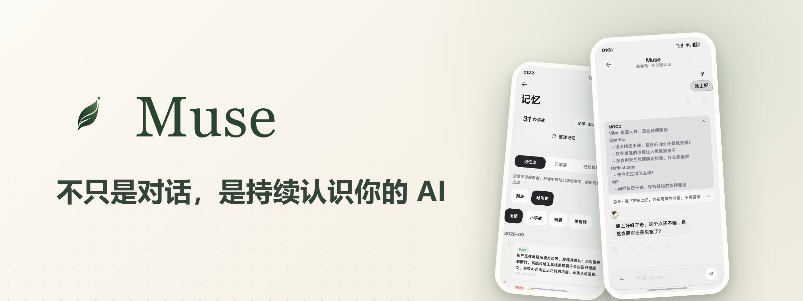
</p>

<p align="center">
  <a href="README.md">中文</a> · <a href="README_EN.md">English</a> · <a href="README_JA.md">日本語</a> · <b>한국어</b> · <a href="README_ES.md">Español</a> · <a href="README_PT.md">Português</a> · <a href="README_RU.md">Русский</a>
</p>

<p align="center">
  <a href="https://github.com/Zer0Qing/Muse/releases/latest"></a>
  <a href="https://github.com/Zer0Qing/Muse/releases"></a>
  <a href="https://github.com/Zer0Qing/Muse/stargazers"></a>
  <a href="LICENSE"></a>
  
  
</p>
<p align="center">
  <a href="https://qm.qq.com/q/905451314"></a>
  <a href="https://museai.ltd"></a>
  <a href="https://museai.ltd/download/"></a>
</p>

<p align="center">
  <a href="#muse란-무엇인가">Muse란 무엇인가</a> ·
  <a href="#스크린샷">스크린샷</a> ·
  <a href="#다운로드">다운로드</a> ·
  <a href="#빠른-시작">빠른 시작</a> ·
  <a href="#기능-한눈에-보기">기능 한눈에 보기</a> ·
  <a href="用户手册.md">사용자 매뉴얼(중국어)</a> ·
  <a href="#오픈소스-함께-만들기">오픈소스 함께 만들기</a>
</p>

---

## Muse란 무엇인가

새 AI 대화를 열 때마다 자기소개부터 다시 하시나요? Muse는 그럴 필요가 없습니다.

Muse는 Android에서 동작하는 오픈소스 AI 컴패니언입니다. **4계층 기억 시스템으로 당신을 진짜로 기억하고**, 접근성 / Shizuku / Root 세 가지 권한 채널을 통해 **당신의 휴대폰 안에서 실제로 손을 움직입니다**. 게다가 나름의 내면(Mood)과 생활도 있습니다. 모먼츠, 일기장, 앨범이 그것입니다. 모델을 바꾸고, 세션을 바꾸고, 앱을 껐다 켜도 기억합니다. 오래 연락이 없으면 먼저 찾아옵니다.

모델은 마음대로 교체할 수 있고(40개 이상의 프리셋 제공자), 가입도 계정도 없으며 **데이터는 기본적으로 전부 로컬에 남습니다**. WeChat, QQ, Feishu, Telegram, DingTalk에 연결해서 매일 쓰는 채팅 도구 안에 어시스턴트를 둘 수도 있습니다.

모든 것은 대화를 이어가기 위한 것이지, 처음부터 다시 시작하기 위한 것이 아닙니다.

## 스크린샷

<p align="center">
  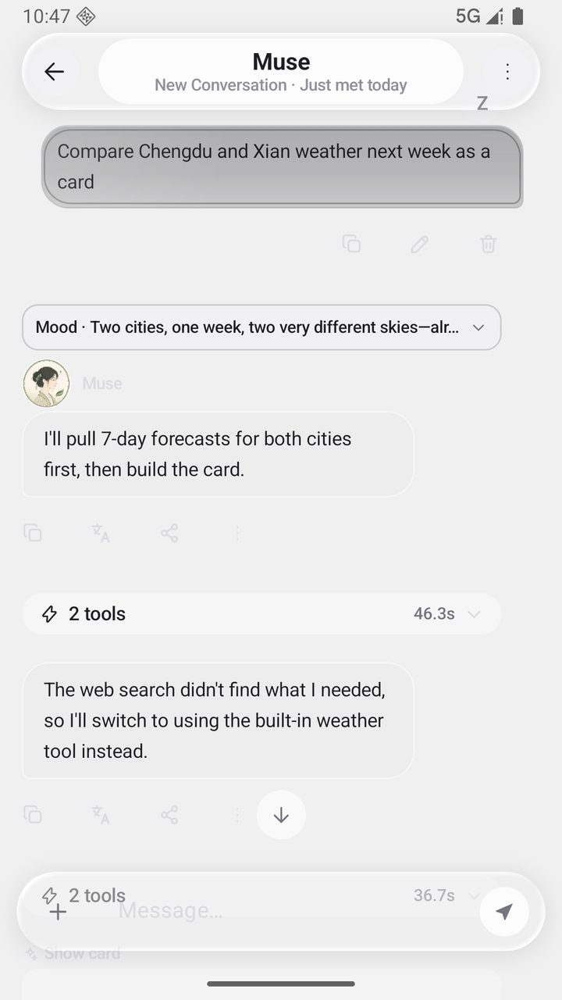
  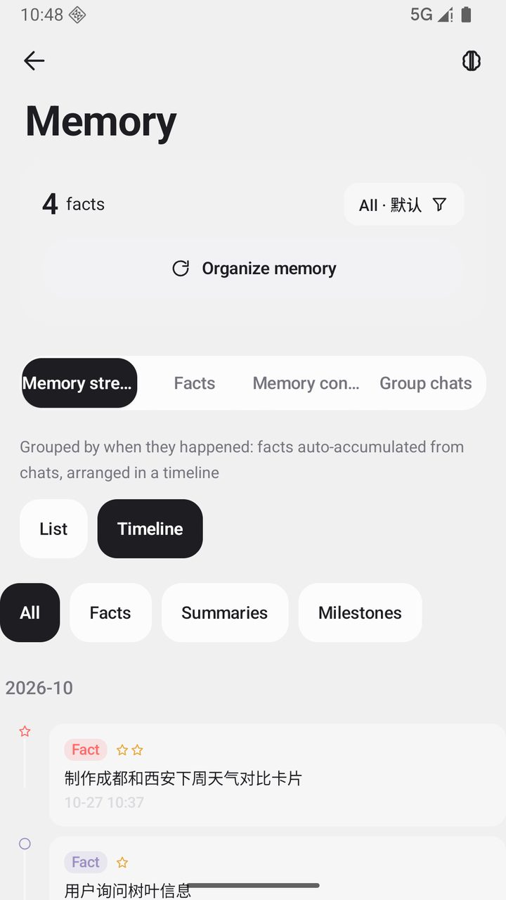
  
  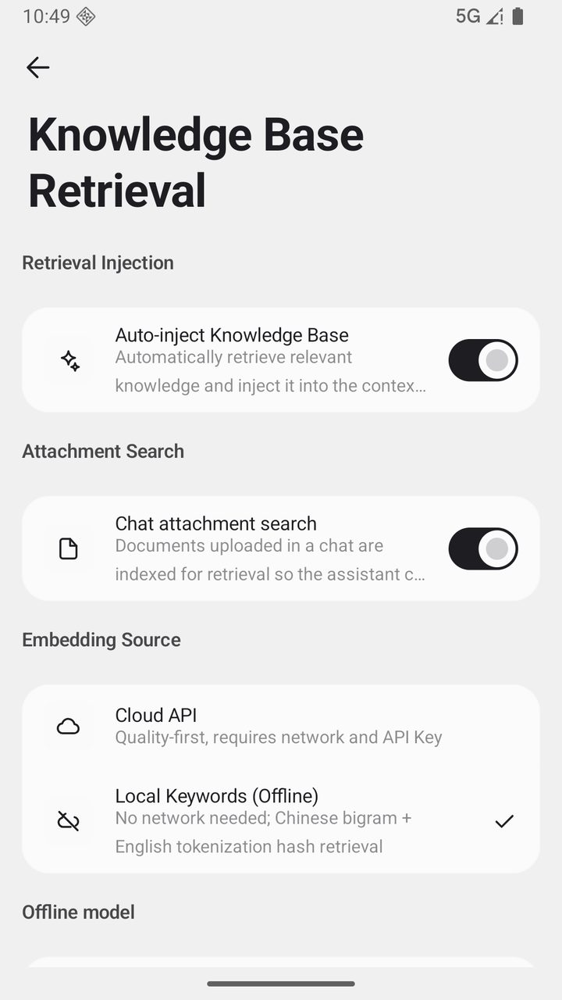
</p>

<details>
<summary><b>스크린샷 더 보기</b> (클릭하여 펼치기)</summary>

<p align="center">
  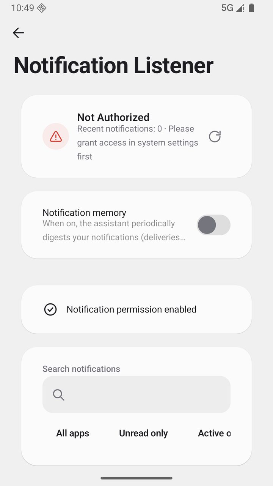
  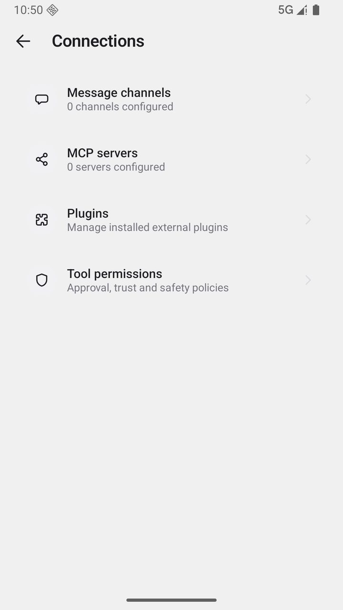
  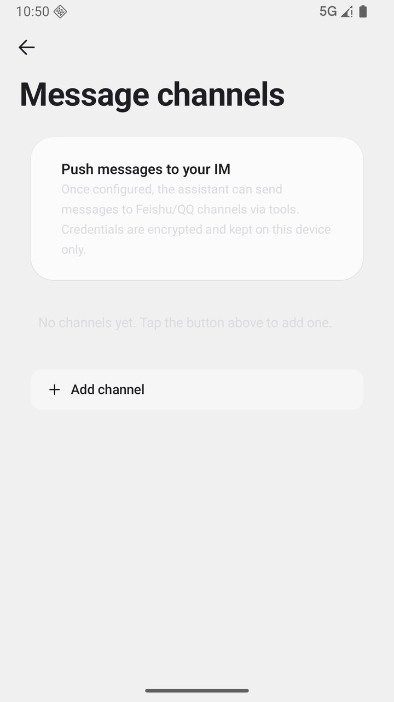
</p>
<p align="center">
  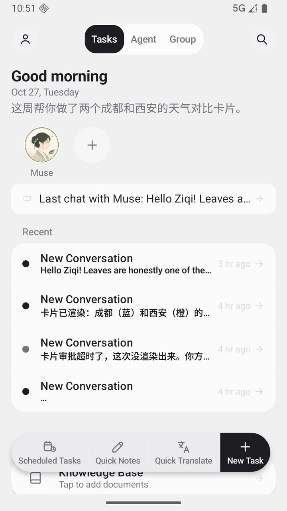
  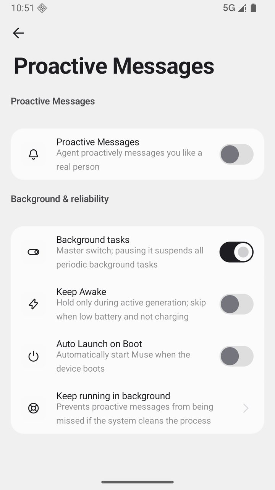
  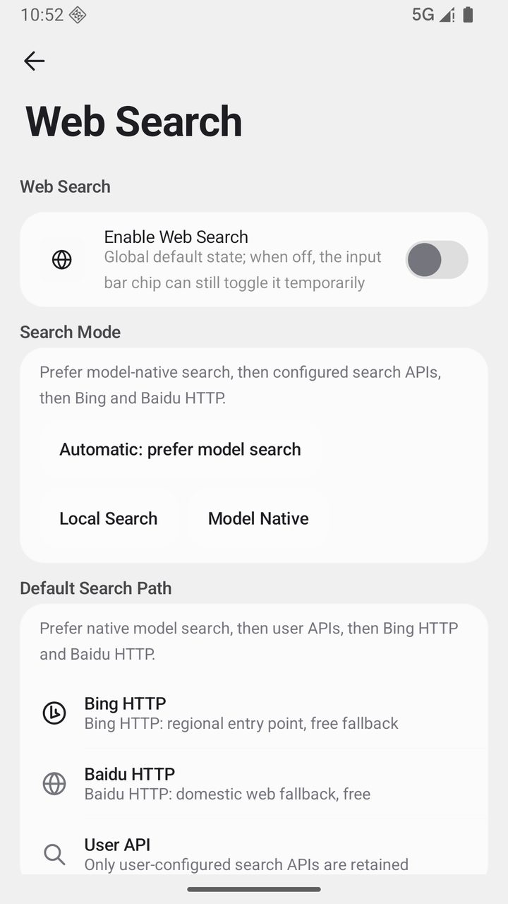
</p>
<p align="center">
  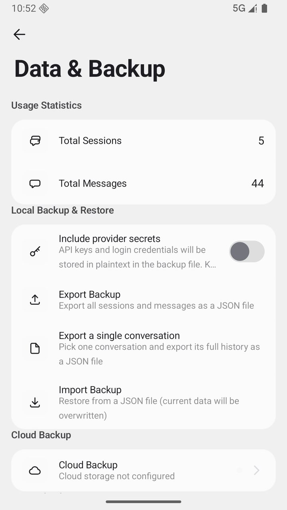
  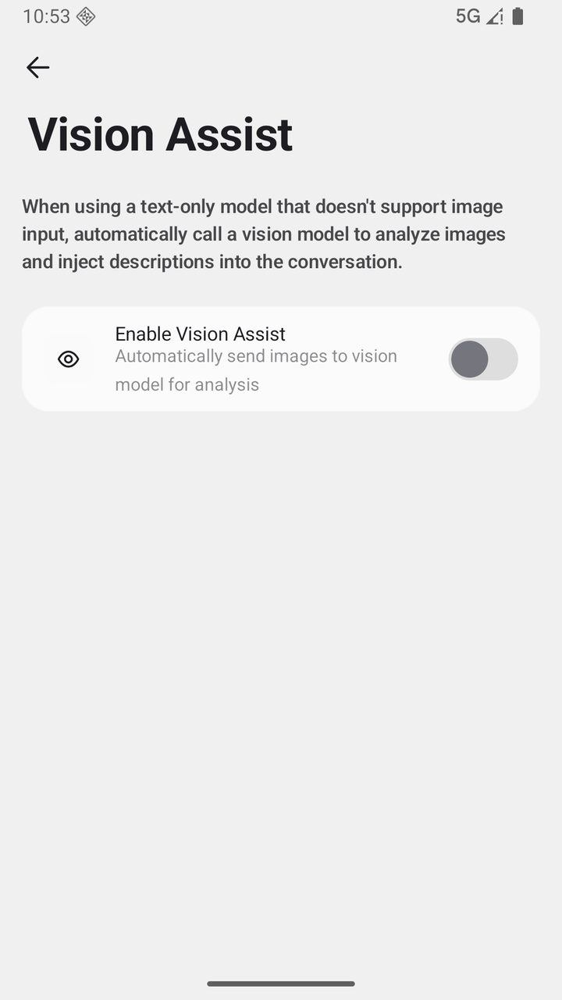
  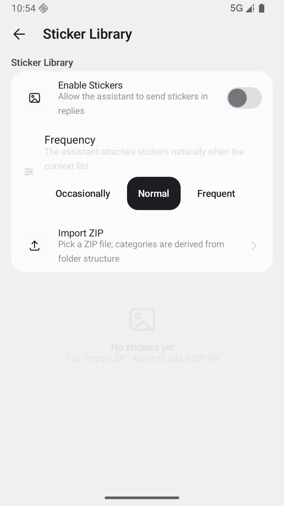
</p>

</details>

## 다운로드

| 기기 | 선택 | 설명 |
| --- | --- | --- |
| 최근 몇 년 사이의 휴대폰 | `arm64-v8a` | 권장, 용량이 가장 작음 |
| 조금 오래된 휴대폰 | `armeabi-v7a` | 구형 기기 호환 |
| 잘 모르겠다면 | `universal` | 범용 패키지, 모두 호환 |

최신 APK는 공식 다운로드 페이지 [museai.ltd/download](https://museai.ltd/download/)에서 받으시면 됩니다(중국 내 직접 연결, 권장). [GitHub Releases](https://github.com/Zer0Qing/Muse/releases/latest)에서도 받을 수 있습니다. 덮어서 설치하면 되고, 데이터는 사라지지 않습니다.

> [!WARNING]
> 공식 Releases 페이지나 공식 웹사이트에서만 설치 패키지를 받으십시오. 출처가 불분명한 채널의 설치 패키지는 변조되었을 수 있으며, 데이터와 기기 보안에 위험이 됩니다.

> [!NOTE]
> 앱 내 업데이트는 GitHub 공식 HTTPS 자산으로 이동만 하며, APK를 자동 다운로드하거나 조용히 설치하지 않습니다. 설치 시 "알 수 없는 출처" 안내가 뜨는 것은 정상입니다.

## 빠른 시작

1. **모델 서비스 설정** — **설정 → 모델 및 추론 → 제공자**를 열고 프리셋 제공자(DeepSeek, Qwen, Zhipu 등은 가입 시 무료 크레딧 제공)를 선택한 뒤 API Key를 입력하고, 연결을 테스트한 다음 모델 목록을 불러옵니다.
2. **대화 시작** — 홈으로 돌아가 첫 메시지를 보냅니다. 기억은 그 순간부터 쌓이기 시작합니다. 모델을 바꾸고 세션을 바꿔도 당신을 기억합니다.
3. **필요할 때 시스템 권한 열기(선택)** — 실제로 "손을 움직이게" 하려면 **설정 → 권한 설정 마법사**를 열고 안내에 따라 접근성 / Shizuku / Root / Termux 중 필요한 채널을 켜면 됩니다. 각 단계마다 감지와 테스트 진입점이 있습니다.

> 더 자세한 사용 안내(각종 제스처와 숨은 조작 포함)는 [사용자 매뉴얼(중국어)](用户手册.md) 또는 앱 내 **설정 → 사용 튜토리얼**에서 확인하십시오.

## 왜 Muse인가

### 1. 지속되는 기억 — 매번 당신을 처음 만나지 않습니다

단기 대화부터 장기 심층 처리까지 단계적으로 올라가는 4계층 기억 구조입니다.

```
대화 --> 팩트 추출 --> 롤링 요약 --> 컴파일 집계 --> 심층 처리
 단기      핵심 정보      압축 보관       중복 통합       심층 이해
```

- **핵심 사실은 절대 감쇠하지 않습니다**(의료, 재무, 핵심 정체성은 보호됨). 일상적인 정보는 사람처럼 자연스럽게 잊힙니다
- 모든 기억은 출처를 추적할 수 있고, 기억 패널에서 추가·삭제, 가중치 조정, 필터 검색이 가능하며, 긴 항목은 클릭해서 전문을 펼칩니다
- 기억은 공간 단위로 격리되어 관리되고, 백업과 기기 이전은 전 과정이 암호화됩니다

### 2. 시스템 수준의 실행력 — 당신의 휴대폰 안에서 실제로 움직입니다

| 채널 | 기능 | 조건 |
|------|------|------|
| 접근성 서비스(별도 프로세스) | 화면 읽기, 탭 / 스와이프 / 길게 누르기 / 입력, 뒤로 / 홈 / 알림창 | 시스템 스위치 하나 |
| Shell(Shizuku / adb) | 스크린샷, input 명령, 포그라운드 앱 조회, 기기 명령 | 한 번 승인 |
| Root | 완전한 시스템 제어, 다른 앱 데이터 접근 | Root 권한이 있는 기기 |
| Termux | 완전한 Linux 환경(apt / pip / gcc / ffmpeg) | Termux 설치 후 승인 |

- **200개 이상의 도구**가 내장되어 있고 기본적으로 계층별로 노출됩니다. 롱테일 기능은 `find_tools`로 필요할 때 검색해 로드합니다
- 모든 도구가 필요한 권한과 준비 상태를 표시하며, 준비되지 않은 경우 **실행 전에 빠르게 실패**하고 명확한 안내를 제공합니다
- 내장 터미널(자체 개발 PTY + xterm), 백그라운드 **가상 디스플레이**, 비전 기반 **GUI Agent**, 브라우저 자동화
- 안전 경계: 명령 허용 목록, 위험도 승인(신뢰 / 확인 / 엄격), 강제 타임아웃, 워크스페이스 샌드박스

### 3. 인격과 팀 — 내면이 있고, 생활도 있습니다

- **Mood 4차원 머릿속 초안**: 매 응답 전의 Vibe / Sparks / Reflections / Will. 기본적으로 접혀 있고, 펼치면 "어떻게 생각했는지"를 볼 수 있습니다
- **3계층 인격**: 인격층 / 관계층 / 스타일층, `{{user_name}}` / `{{char}}` 템플릿 변수 지원
- **멀티 에이전트**: `@어시스턴트이름`으로 언제든 위임, 작업 카드 시각화, 서브 에이전트 플로팅 창, 어시스턴트 간 비공개 쪽지함
- **그룹 채팅 회의**: 요약 카드 / 표결 / 옵저버 / 빠른 템플릿 / 회의 제어(일시정지 · 건너뛰기). 제대로 된 멀티 어시스턴트 회의입니다
- **함께한 마일스톤**: 첫 메시지, 7 / 30 / 100일, 100 / 1000번째 메시지까지 모두 기억해 둡니다

## 기능 한눈에 보기

<details>
<summary><b>채팅 경험</b> — 스트리밍과 이어쓰기 / 세션 관리 / 메시지 조작 / 멀티 모델 / 음성 / 멀티모달 / 검색</summary>

- **스트리밍과 오류 대응**: SSE로 글자 단위 출력, 언제든 중지. 스트림이 끊기면 자동으로 이어서 씁니다(네트워크가 복구되면 이어서 작성). 내장 stream-guard가 "스트리밍 조기 종료"(빈 스트림 / 첫 패킷 없음)를 감지해 비스트리밍 재시도로 자동 전환하고, 첫 이벤트 워치독(일반 모델 45초 / 추론 모델 90초 동안 첫 패킷이 없으면 요청 방식을 자동 전환)이 있어 느린 모델도 "멈춘 채 응답이 없는" 상태가 되지 않습니다.
- **세션 관리**: 고정 / 보관 / 실행 취소 가능한 삭제 / 폴더 그룹 / 고정 세션 드래그 정렬. 전체 검색은 SQLite FTS5 전문 색인 기반(호환 환경에서는 FTS4로 자동 폴백). 세션마다 독립적인 컨텍스트 윈도우를 가지며, 지나치게 긴 대화는 롤링 요약으로 자동 압축됩니다.
- **메시지 조작**: 다시 생성 시 여러 버전 보존(`1/3` 전환, 기록 유지). 분기(임의의 사용자 메시지에서 새 대화 라인을 열고 원래 라인은 그대로 유지). 인용 답장(원문이 컨텍스트에 주입됨). 메시지 주석. 길게 누르기 메뉴에 복사(일반 텍스트 / Markdown), 전달, 공유, 즐겨찾기, 편집, 번역, 읽어주기, 삭제.
- **즐겨찾기**: 즐겨찾기를 한곳에서 관리하고, 길게 눌러 그룹 태그를 지정할 수 있습니다.
- **입력 경험**: 전체 화면 입력(장문 전용), 슬래시 명령(`/new` `/compact` `/reset` `/pin` `/archive`), 붙여넣기를 파일로 변환(임계값 조정 가능), 빠른 메시지. 중단된 도구 호출은 한 번에 "실행 재개"하거나 버릴 수 있습니다.
- **빠른 기록**: 플로팅 캡슐(선택 사항)로 어느 화면에서든 메모하고, 기기의 빠른 기록 보관함에 저장됩니다.
- **심층 사고**: 추론 등급 OFF / AUTO / LOW / MEDIUM / HIGH / XHIGH(사고 예산 1000 → 16000 tokens에 대응), 추론 과정은 접힌 상태로 표시됩니다.
- **멀티 모델**: OpenAI / Anthropic / Gemini 세 가지 프로토콜과 임의의 OpenAI 호환 엔드포인트를 기본 지원. 40개 이상의 프리셋 제공자, 모델 목록 동적 조회. 모델별 능력 매트릭스(비전 / 추론 / 도구) 표기. 보조 작업은 별도의 "소형 도구 / 대형 도구" 모델 등급으로 라우팅(제목, 압축, 요약, 기억 컴파일을 등급별 분기). 사용자 정의 요청 헤더 / 요청 본문과 네트워크 프록시 지원.
- **음성**: 스트리밍 음성 인식(말하는 대로 변환, 파형 시각화, 위로 스와이프하여 취소). TTS는 시스템 음성과 클라우드 음성(OpenAI / MiniMax / Edge 등)을 어시스턴트별로 개별 설정. 클라우드 음성 복제(ElevenLabs / FishAudio) 지원.
- **멀티모달 입력**: 이미지 여러 장 전송. PDF / DOCX / EPUB / TXT 자동 파싱. 스캔 문서는 오프라인 OCR로 처리.
- **비전 보조**: 비전을 지원하지 않는 모델에 이미지를 보낼 때 비전 모델을 자동 호출해 8개 차원의 구조화 설명(전체 개요 / OCR 텍스트 / 객체 배치 / 차트 데이터 / 요청 재진술 / 요청 응답 / 시각적 근거 / 불확실성)을 생성하고, 좌표 grounding을 지원합니다. 설명은 "이미지 + 요청 + 프롬프트 버전" 단위로 캐시되고, 다중 이미지 동시 분석, 60초 타임아웃, 실패 시 텍스트 안내로 자동 폴백합니다.
- **웹 검색과 브라우징**: 검색 소스 설정 가능(모델 자체 검색 / Bing / Baidu / SearXNG / Tavily / DeepSeek / 사용자 정의 엔진) 및 단계별 폴백. 사용자 정의 엔진은 JSON을 반환하는 어떤 검색 서비스든 연결할 수 있고(자체 구축 SearXNG, 내부 게이트웨이), GET / POST, 결과 필드 경로 매핑, 선택적 Bearer 인증을 지원하며 Auto 체인의 가장 앞에 놓입니다. 웹 문서 본문 추출은 Jina Reader를 사용합니다. 세션마다 독립적인 내장 브라우저가 있고, AI가 인터넷을 사용할 때 상단 캡슐을 펼치면 실시간 화면을 볼 수 있습니다.
- **번역과 읽어주기**: 메시지를 길게 누르면 바로 번역 / 낭독. 번역 모델은 따로 설정할 수 있고, 번역 기록이 보존됩니다.
- **렌더링과 카드**: Markdown 전체 렌더링(20개 이상 언어 코드 하이라이트, KaTeX 수식, Mermaid 다이어그램, 표). AI는 인터랙티브 카드와 아티팩트 카드(코드 / 문서 / 표)를 출력할 수 있고, 아티팩트 센터에서 통합 관리하며 전체 화면 보기와 내보내기가 가능합니다.

</details>

<details>
<summary><b>기억과 성장</b> — 4계층 파이프라인 / 감쇠와 보호 / 컨텍스트 연속성 / 경험 라이브러리 / 지식 베이스 / 선제 메시지</summary>

- **4계층 기억 파이프라인**: ① 대화 원본 스트림. ② 팩트 추출(핵심 사실을 자동 추출하고 중요도와 출처를 표기). ③ 롤링 요약(긴 대화를 압축해도 단서를 잃지 않음). ④ 심층 처리(백그라운드에서 컴파일 집계, 중복 제거·병합으로 장기 기억 형성). 팩트는 저장 시 전문 색인이 붙어 검색할 수 있습니다.
- **중요도와 감쇠**: 핵심 사실(의료, 재무, 핵심 정체성)은 보호되어 감쇠하지 않고, 일상 정보는 사용 빈도에 따라 사람처럼 자연스럽게 잊힙니다.
- **기억 패널**: 공간 / 분류별 탐색. 항목 추가·삭제, 중요도 조정, 시간 / 가중치 필터. 길게 눌러 다중 선택 일괄 삭제(목록과 타임라인 모두 지원, 삭제 후 맨 위로 튀지 않음). 모든 기억은 원본 세션까지 추적 가능. 긴 항목은 클릭해서 전문을 펼칩니다.
- **기억 공간**: 용도가 다른 기억을 서로 격리해 오염되지 않게 합니다.
- **컨텍스트 연속성**: 컨텍스트 윈도우를 벗어난 기록이 조용히 버려지지 않습니다. 결정론적 기록 발췌(대화 원문 조각과 도구 항목 보존)를 윈도우 앞에 삽입하고, 도구 라운드 압축 시 "어시스턴트 설명"을 보존하며, 압축 요약에 「이 구간에서 어떤 파일이 바뀌었는지」를 덧붙입니다. 긴 작업도 더 이상 "기억 상실"에 빠지지 않습니다.
- **세션 간 연결**: 새 대화를 시작할 때 이전 대화의 마지막 몇 턴을 가져올 수 있습니다(4~40개 조정 가능, 기본 꺼짐). 창을 닫았다가 같은 이야기를 이어갈 때 배경을 다시 설명하지 않아도 됩니다.
- **경험 라이브러리**: "이런 문제는 앞으로 이렇게 처리한다"를 경험으로 축적하고, 이후 작업에서 자동으로 참고합니다(켜고 끌 수 있음).
- **지식 베이스(RAG)**: 문서를 가져오면 자동 파싱, 청크 분할, 색인 생성. 검색은 시맨틱 검색 + 키워드 매칭의 하이브리드 정렬. @로 특정 문서를 지정해 검색. 초대형 파일은 스트리밍 색인. 오프라인 환경에서는 로컬 검색으로 자동 폴백. 인용은 원문 구절까지 추적됩니다.
- **일일 요약과 인사**: 설정한 시각에 당일 회고를 생성(홈에서 확인 가능, 푸시 선택). 아침 인사는 고정 템플릿이 아니라 기억 속 최근 사안을 모델이 조합해 만듭니다.
- **선제 메시지**: 고정 간격으로 폴링하지 않고 "마음에 걸린 것 장부"를 씁니다. 어시스턴트가 나중에 물어보고 싶은 말을 적어두었다가, 때가 되면 한 가지를 골라 꺼냅니다. 열어본 것, 답한 것, 넘긴 것이 결과 장부에 기록되고, 친밀도가 그 결과에서 학습해 오늘 몇 번 더 말할 수 있는지를 정합니다. 다섯 단계(조용함 / 절제 / 표준 / 적극적 / 집착), 기본 단계로 되돌리면서 당일 할당량을 0으로 초기화, 방해 금지 시간대 적용, 말을 이을 거리가 없으면 보내지 않습니다. 최소한의 안전장치도 있습니다(너무 오래 대화가 없으면 먼저 인사). 늦은 밤에도 일기를 쓰고 기억을 정리하지만 당신을 방해하지 않습니다. 일일 푸시 내용은 설정 가능(일일 요약 / 심야 일기 / 모먼츠 소식).
- **마일스톤**: 첫 메시지, 함께한 7 / 30 / 100일, 100 / 1000번째 메시지 등의 시점이 자동 기록되고 마일스톤 페이지에서 다시 볼 수 있습니다.
- **통계와 활동 패널**: 통계 페이지에 총 대화 / 총 메시지 / 일평균 / 연속 일수와 일별 히트맵. 활동 패널은 예약 작업 / 하트비트 / 기억 컴파일의 실행 이력을 보여줍니다.

</details>

<details>
<summary><b>도구와 자동화</b> — 200개 이상 도구 / 권한 계층 / 승인과 예산 / 4개 채널 / 터미널 / 가상 디스플레이 / GUI Agent</summary>

- **도구 시스템**: 200개 이상의 도구가 내장되어 있고 능력별 계층(핵심 / 상용 / 선택 / 고급)으로 노출됩니다. 기본적으로는 상용 도구만 보내 컨텍스트를 간결하게 유지하고, 롱테일 기능은 `find_tools`로 키워드 검색해 로드합니다(로드된 도구는 세션 내내 사용 가능). 시스템 프롬프트에 실시간 도구 능력 색인이 내장되어 있고, 여기에는 이번 라운드에 실제로 사용 가능한 수가 들어갑니다(하드코딩된 상수가 아님).
- **권한 계층**: Shizuku / Root, 접근성, Termux가 필요한 도구는 각각 의존성과 준비 상태(READY / NOT READY)를 선언합니다. 준비되지 않았으면 실행 전에 빠르게 실패하고 구조화된 `permission_required` 오류와 승인 안내를 반환합니다.
- **승인 체계**: 위험 등급(안전 / 일반 / 고위험) × 세 가지 모드(신뢰 / 확인 / 엄격). "이 세션에서 허용"과 도구별 사용자 정의 정책을 지원하며, 고위험 동작은 먼저 묻고 실행합니다.
- **실행 엔진**: 읽기 전용 도구는 통제된 병렬 실행(상한 3)으로 속도를 냅니다. 블로킹형 도구는 전용 스레드 풀 + 강제 타임아웃. 단일 출력이 한도를 넘으면 자동으로 디스크에 기록(컨텍스트에는 미리보기 + `read_file` 참조만 남김). 통일된 성공/실패 판정. 연속 실패 시 원인을 사실대로 알리며 자동 조기 중단. 도구 라운드는 기본 무제한(상한 설정 가능)이며, 중복 호출 지문 / 무진전 감지 / 총 호출 수 등의 회로 차단 보호가 있습니다.
- **4개 채널 실행**: 접근성(별도 프로세스 Provider, AIDL 통신, 메인 앱 업데이트에도 끊기지 않음) / Shizuku(Binder 권한 상승) / Root(su) / Termux(RUN_COMMAND). 사용 가능 여부에 따라 실행 등급을 자동 선택합니다.
- **기기 명령**: `device_shell`은 동사 허용 목록(dumpsys / settings / am / pm / input / screencap / uiautomator / cmd / svc / wm / getprop / content 등)을 따릅니다. 파이프 / 리다이렉션 / 연결은 금지되며, 허용 목록 밖의 것은 모두 거부됩니다.
- **내장 터미널**: 자체 개발 PTY 엔진 + xterm 터미널 페이지. 세 가지 환경 — 앱 샌드박스 터미널, 기기 명령 채널, Termux 완전한 Linux(apt / pip / gcc / ffmpeg).
- **가상 디스플레이**: 별도 서버 프로세스가 백그라운드에 숨겨진 디스플레이를 만들고, 에이전트의 전체 조작 흐름이 메인 화면을 점유하지 않습니다. 필요할 때 프레임을 캡처해 돌려줍니다.
- **GUI Agent**: 비전 기반 다단계 조작 루프 — 스크린샷 → 비전 모델 판단 → 탭 / 스와이프 / 입력 → 다시 스크린샷으로 검증, 작업이 끝날 때까지 반복합니다.
- **브라우저 자동화**: navigate / click / type / extract / scroll / get_html / snapshot. 세션마다 독립적인 브라우저 인스턴스.
- **워크스페이스**: 통제된 파일 공간(읽기 / 쓰기 / 목록 / 이동 / 삭제)으로, 파일 조작은 샌드박스 경계 안으로 제한됩니다.
- **예약과 알림**: 예약 작업은 Cron 표현식과 실행 이력을 지원합니다. 알람 / 카운트다운 / 일정 / 메모. 정해진 시각에 자동 실행하거나 알립니다.
- **알림 리스너**: 기기의 알림 스트림을 읽고 내용에 따라 지능적으로 답장하거나 제안합니다.
- **권한 설정 마법사**: 접근성 / Shizuku / Root / Termux 4개 채널을 한 번에 감지하고 안내하며, "화면 읽기 테스트"로 실시간 검증할 수 있습니다.

</details>

<details>
<summary><b>멀티 어시스턴트와 생태계</b> — 그룹 채팅 회의 / 월드 북 / Skill / 플러그인 마켓 / MCP / 5개 플랫폼 채널</summary>

- **멀티 어시스턴트**: 어시스턴트마다 모델 / 시스템 프롬프트 / 샘플링 파라미터 / 리소스 바인딩 / 도구 허용 목록 / 스킬을 개별 설정합니다. `@어시스턴트이름`으로 작업을 위임하고, 작업 카드가 단계별 실행 상태를 표시합니다. 서브 에이전트는 별도 플로팅 창에서 긴 작업을 수행해 메인 대화를 점유하지 않고, 어시스턴트 간 쪽지는 별도 수신함을 씁니다.
- **어시스턴트 고급 설정**: 월드 북(상시 항목 + 키워드 트리거 + 심층 주입). 프롬프트 주입(모드별 사용자 정의 조각 주입). 리소스 연결(지식 베이스를 바인딩해 우선 검색). 가져오기·내보내기 — SillyTavern 캐릭터 카드 가져오기 지원, 내 어시스턴트를 패키징해 공유 가능.
- **그룹 채팅 회의**: 네 가지 토론 모드(순환 / 자유 / 토론 / 진행자). 매 라운드 전에 그룹 컨텍스트를 먼저 읽습니다. 이번 라운드 건너뛰기 지원. 어시스턴트별 독립 기억. 회의 기능: 토론 요약 전용 카드(복사 / 공유 / 공유 문서로 저장), 표결 렌더링, 옵저버 멤버, 그룹 공유 문서와 AI 전용 컨텍스트, 발언 큐 제어(일시정지 / 계속 / 건너뛰기), 빠른 템플릿(설계 리뷰 / 찬반 토론 / 브레인스토밍 / 프로젝트 회고), 라운드 접기, 순환 중 끼어들어도 유실 없음.
- **Skill 시스템**: 내장 스킬은 바로 사용 가능. `.skill.json` 가져오기·내보내기(파라미터 Schema 포함). 프롬프트 스킬은 입력 파라미터를 받습니다(`{{input}}` / `{{args}}` 자리표시자). 설치는 허용 목록 구현과 주입 방어를 거칩니다.
- **플러그인 마켓**: 검색 / 설치 / 켜기·끄기 / 제거와 신뢰 관리. 플러그인은 도구, UI 패널, 메시지 말풍선 스킨 등의 확장을 담을 수 있습니다. 어시스턴트가 JS 플러그인 초안을 직접 작성할 수 있지만, 서명과 수동 활성화를 거쳐야 효력이 발생합니다. 플러그인은 샌드박스 경계 안에서 실행됩니다.
- **MCP 프로토콜**: 외부 MCP Server에 연결해 도구를 확장합니다(OAuth 인증 / SSE 전송 / 자동 검색).
- **OAuth 커넥터**: 서드파티 서비스에 연결하고 자격 증명은 로컬에 암호화해 저장합니다. 연결 센터에서 모델 / 채널 / 커넥터를 통합 관리합니다.
- **5개 플랫폼 채널**: WeChat(QR 바인딩) / QQ(Bot WebSocket 상시 연결) / Feishu(상시 연결 이벤트 채널) / Telegram / DingTalk(Stream 모드). 연락처마다 독립적인 세션 컨텍스트와 롤링 요약. 이미지 / 음성 등 미디어 메시지는 자동으로 보관·전사됩니다. 채널별로 다른 어시스턴트와 모델을 바인딩할 수 있고, 플랫폼마다 전용 설정 마법사와 연결 테스트가 있습니다.
- **웹 서버**: 내장 Ktor 서비스(JWT 인증 + mDNS 검색 + HTTPS 자체 서명 인증서)로, 같은 LAN의 브라우저에서 대화에 접근할 수 있습니다.

</details>

<details>
<summary><b>미니 폰과 모먼츠</b> (초기 실험 버전, 계속 다듬는 중) — 시뮬레이션 메신저 / AI 모먼츠 / 앨범 / 일기장</summary>

- **미니 폰**: 내장 시뮬레이션 인스턴트 메신저 클라이언트. 채팅 / 연락처 / 발견 / 나, 네 페이지 구조이고 배경화면 교체와 설정 조정이 가능합니다. 메신저를 쓰듯 AI를 씁니다.
- **AI 모먼츠**: AI가 소식을 올리고(텍스트·이미지 / 9분할 그리드), 게시물에 좋아요와 댓글을 답니다. 메시지 센터, 커버, 프로필 페이지.
- **AI 앨범 / 일기장**: 생성한 이미지를 날짜와 함께 보관(전체 화면 미리보기). 일기는 월력으로 보고, 늦은 밤에는 AI가 스스로 일기를 씁니다.
- **날씨 페이지와 메모**: 무료 날씨 데이터 소스. 간단한 메모는 "나" 페이지에 모입니다.

</details>

<details>
<summary><b>인터페이스와 외관</b> — 테마 / 말풍선 스킨 / 아이콘 / 다국어 / 백업과 데이터</summary>

- **테마 시스템**: 12가지 완성형 테마(각 테마에 라이트 / 다크 모드 포함) + 8가지 색약 친화 배색. 동적 색상 추출(Android 12+), 주간 / 야간 예약 전환, 사용자 정의 테마 지원.
- **말풍선과 외관**: 메시지 말풍선 모서리 반경 조정 가능. 말풍선 스킨 체계에 플러그인이 제공하는 확장 스킨(고대비 / 소프트 글로우 등) 포함.
- **직접 그린 아이콘**: 176개 전부 자체 제작 아이콘(24dp 그리드 / 1.7dp 둥근 획 / 명암 적응형). [muse-icons](https://github.com/Zer0Qing/muse-icons)에 MIT로 공개되어 있습니다.
- **타이포그래피와 다국어**: 글꼴 / 크기 / 자간, 예측형 뒤로 가기, 접근성 대응. 인터페이스는 중국어 / 영어 / 일본어 / 한국어 / 스페인어 / 포르투갈어 / 러시아어 7개 언어를 지원합니다.
- **백업과 복구**: 로컬 원터치 내보내기(JSON / 청크 NDJSON, 암호화 가능). 매일 자동 백업(muse.db / memory.db / facts.db 스냅샷 패키징). S3 / WebDAV 클라우드 동기화. 선제 메시지의 마음 장부, 결과 장부, 관계 친밀도도 함께 백업됩니다. 복구 전에 보호 사본을 자동으로 남기고, 실패하면 자동 롤백합니다.
- **데이터 가져오기**: CherryStudio / Chatbox / ChatGPT / RikkaHub / Kelivo에서 원클릭 이전. 다양한 형식의 대화 기록 가져오기.
- **스티커 라이브러리**: zip을 폴더 구조대로 가져오면 자동 분류. 전송 빈도 세 단계(가끔 / 보통 / 자주). 일괄 삭제와 전체 비우기 지원.
- **홈 화면 위젯**: 원터치로 새 대화. 앱 아이콘을 길게 눌러 바로가기 메뉴.
- **계정 센터**: 프로필 사진과 닉네임을 로컬에서 관리하고, 로그인·가입이 없습니다. 잃어버릴 계정이 없습니다.
- **감사 로그와 프록시**: 도구 호출과 주요 조작을 기록합니다. 사용자 정의 네트워크 프록시 지원.

</details>

<details>
<summary><b>보안과 프라이버시</b> — 로컬 우선 / 암호화 / PII 마스킹 / 샌드박스 경계</summary>

- **데이터 로컬화**: 대화 / 기억 / 지식 베이스 전부 로컬 Room 데이터베이스에 저장됩니다. 텔레메트리, 분석, 데이터 수집이 없습니다. 가입도 로그인도 없습니다. 네트워크 기능은 기본적으로 꺼져 있습니다.
- **PII 자동 마스킹**: 휴대폰 번호 / 주민등록번호 / 은행 카드 등은 전송 전에 자동으로 자리표시자로 가려지고, 모델 응답 속 자리표시자는 다시 복원됩니다. 실제 정보는 서비스 제공자에게 전달되지 않습니다.
- **암호화 경로**: 민감한 설정은 Android Keystore(AES-256-GCM), 클라우드 백업 비밀번호는 PBKDF2 + AES-256-GCM.
- **링크 보호**: 링크 클릭 시 2차 확인. WebView 렌더링 전 출력 정화(iframe / form / 의사 프로토콜 제거).
- **도구 경계**: 명령 허용 목록, 위험도 승인, 강제 타임아웃, 권한 사전 점검, 실패 원인 사실대로 전달. 플러그인은 기본적으로 샌드박스에서 실행됩니다.
- **크래시 로그**: 로컬에만 저장되고, 안전 모드에서 수동으로 내보냅니다.

</details>

## 기술 스택과 아키텍처

| 분류 | 기술 |
|------|------|
| 언어 / UI | Kotlin 2.4 · Jetpack Compose · Material 3 |
| 아키텍처 | MVVM + 단방향 데이터 흐름 · Koin(DI) |
| 데이터 | Room (SQLite) + DataStore · ONNX Runtime(로컬 embedding) |
| 네트워크 | OkHttp + Ktor(웹 서버 JWT + mDNS + HTTPS) |
| 파싱과 렌더링 | PDFBox · ML Kit OCR · 자체 개발 PTY + xterm |
| 품질 게이트 | detekt + ktlint + Android Lint + 사용자 정의 검사 스크립트 · Kover 커버리지 |

```
:app                        앱 본체(UI / 세션 / 도구 오케스트레이션 / 채널 / 설정)
:ai                         Provider 추상화 계층(OpenAI / Anthropic / Gemini, 스트리밍과 도구 호출)
:memory                     기억 엔진(팩트 저장소 / 컴파일 집계 / 요약)
:accessibility(+provider)   접근성 서비스와 별도 프로세스 Provider(메인 앱 업데이트에도 끊기지 않음)
:terminal                   Termux 채널과 터미널
:virtual-display-*          가상 디스플레이 서버와 프로토콜
:common                     로깅 / 결과 타입 등 공유 기반
```

## 소스에서 빌드하기

사전 준비: JDK 21, Android SDK(platform 36, build-tools 36.0.0).

```bash
git clone https://github.com/Zer0Qing/Muse.git
cd Muse

# 디버그 빌드
./gradlew :app:assembleDebug

# 연결된 기기에 설치
./gradlew :app:installDebug
```

정식 릴리스 빌드는 버전 번호를 명시적으로 주입하고 서명을 제공해야 합니다(둘 중 하나라도 없으면 빌드 제약으로 차단됩니다):

```powershell
./gradlew :app:assembleRelease "-PversionName=<x.y.z>" "-PversionCode=<번호>"
# 서명: 프로젝트 루트에 keystore.properties 제공 필요(storeFile / storePassword / keyAlias / keyPassword)

# 릴리스 전 검증(모든 ABI 패키지의 서명 일관성)
python ci/script/validate_release_apks.py --apk "app/build/outputs/apk/release/*.apk"
```

## 오픈소스 함께 만들기

프로젝트에 참여해 주세요:

- [기여 가이드(중국어)](CONTRIBUTING.md) · [보안 정책(중국어)](SECURITY.md) · [UI 컴포넌트 라이브러리 유지보수 규범(중국어)](UI组件库维护规范.md)
- PR을 올리기 전에 로컬 게이트 스크립트와 단위 테스트를 통과시켜 주십시오. 새 문자열은 모든 언어 팩에 동기화해야 합니다
- 게이트와 릴리스 파이프라인 스크립트는 `ci/script/` 아래에 있고, 앱 내 튜토리얼(설정 → 사용 튜토리얼)도 함께 관리됩니다

## 개발 지원

Muse는 독립 개발자가 유지하는 프로젝트로, 무료 오픈소스이며 인앱 결제도 계정 체계도 없습니다. 도움이 되었다면 자발적으로 지속 개발을 후원해 주셔도 좋습니다:

**작가에게 커피 한 잔** (WeChat / Alipay QR 결제):

<p align="center">
  
  
</p>

**커뮤니티 참여** (이야기하러 오세요):

<p align="center">
  
  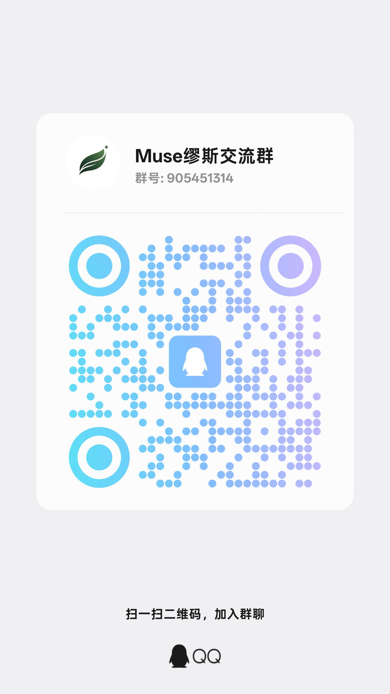
</p>

> 후원은 전적으로 자발적이며 어떤 기능, 할당량, 업데이트와도 연결되지 않습니다. 후원하지 않아도 정상 사용에 영향이 없습니다.

## 저자 소개

이 프로젝트는 청두의 독립 개발자 한 명이 유지하고 있습니다. 소속 팀에서 사람을 찾고 있거나, 그냥 이야기를 나누고 싶다면 편하게 연락해 주십시오.

- 위치: 청두
- 희망: 소프트웨어 엔지니어링 인턴
- 연락처: 위 커뮤니티 그룹, 또는 저장소 Issue

## 라이선스

이 프로젝트는 **GNU General Public License v3**(GPL v3)를 따릅니다. 전체 라이선스 전문은 [LICENSE](LICENSE), 서드파티 의존성 라이선스 목록은 [NOTICE](NOTICE)를 참고하십시오.
