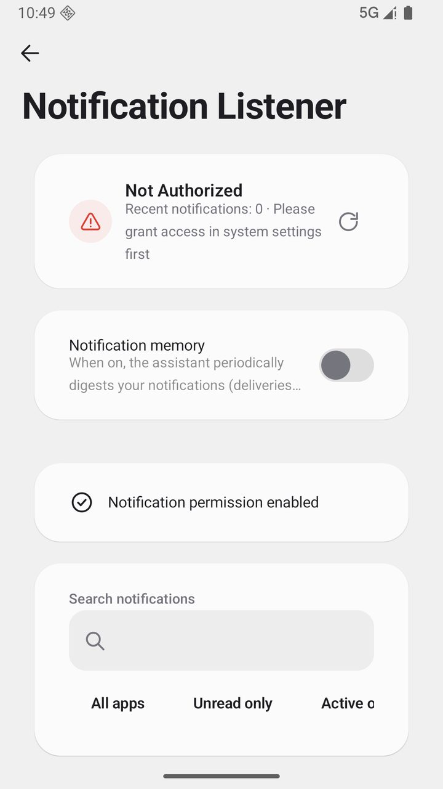
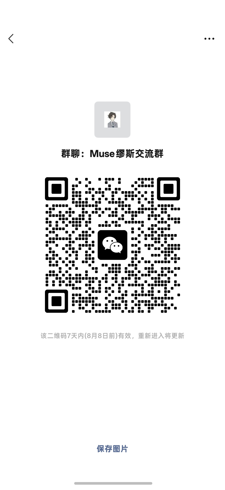
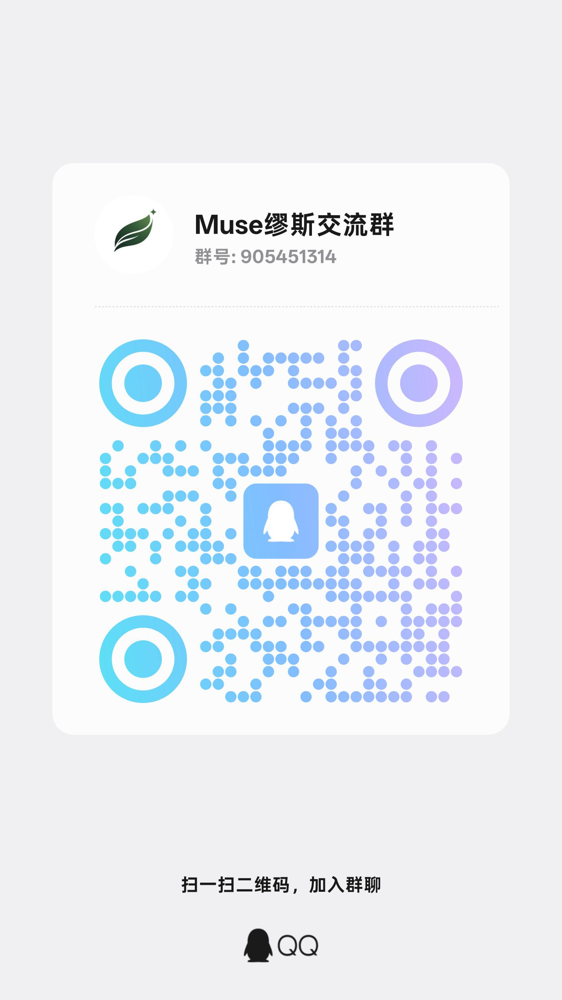

<p align="center">
  
</p>

<p align="center">
  <a href="README.md">中文</a> · <a href="README_EN.md">English</a> · <a href="README_JA.md">日本語</a> · <b>한국어</b> · <a href="README_ES.md">Español</a> · <a href="README_PT.md">Português</a> · <a href="README_RU.md">Русский</a>
</p>

<p align="center">
  <a href="https://github.com/Zer0Qing/Muse/releases/latest"></a>
  <a href="https://github.com/Zer0Qing/Muse/releases"></a>
  <a href="https://github.com/Zer0Qing/Muse/stargazers"></a>
  <a href="LICENSE"></a>
  
  
</p>
<p align="center">
  <a href="https://qm.qq.com/q/905451314"></a>
  <a href="https://museai.ltd"></a>
  <a href="https://museai.ltd/download/"></a>
</p>

<p align="center">
  <a href="#muse란-무엇인가">Muse란 무엇인가</a> ·
  <a href="#스크린샷">스크린샷</a> ·
  <a href="#다운로드">다운로드</a> ·
  <a href="#빠른-시작">빠른 시작</a> ·
  <a href="#기능-상세">기능 상세</a> ·
  <a href="#소스에서-빌드">소스에서 빌드</a> ·
  <a href="#기여하기">기여하기</a>
</p>

---

## Muse란 무엇인가

Muse는 내 Android 스마트폰에 직접 설치해 쓰는 개인 AI 에이전트입니다.

대부분의 AI 서비스는 브라우저나 앱을 열어 대화하고 닫으면 대화와 기억이 모두 남의 서버에 남습니다. Muse는 내 기기 안에 오래 머무르는 도구로 만들었습니다. 회원가입도, 분석 텔레메트리도 없고, 대화·기억·지식 베이스는 기본적으로 로컬 SQLite에 저장됩니다. OpenAI, Anthropic, Gemini, DeepSeek, Qwen, Zhipu, 로컬 OpenAI 호환 서버 등 원하는 API를 자유롭게 연결하고 언제든 바꿀 수 있습니다.

일반 API 클라이언트와 다른 점은 크게 네 가지입니다:

- **세션이 아니라 '사람'을 기억합니다**: 중요한 사실은 자동으로 추출·요약·정리되고, 의료나 신원 같은 핵심 정보는 잊히지 않도록 보호됩니다. 모델을 바꾸거나 새 창을 열어도 사용자를 계속 알아봅니다.
- **필요할 때 먼저 말을 겁니다**: 마음에 걸린 일을 장부에 적어 두었다가 정해진 시각이나 오랜 침묵 뒤에 먼저 인사를 건넵니다. 자주 무시하면 빈도를 낮추고, 방해 금지 시간에는 조용히 기다립니다.
- **실제로 폰을 조작하고 명령을 실행합니다**: 권한을 켜 주면 화면 읽기·터치, 셸 명령, 내장 브라우저, 샌드박스 파일 작업, 온디맨드 `proot` Ubuntu 런타임(Node / Python), 그리고 SSH로 내 Linux 호스트까지 연결해 작업할 수 있습니다.
- **채팅 안에서 작동하는 인터랙티브 카드**: 긴 텍스트만 띄우는 대신 차트나 HTML/SVG 인터랙티브 카드(오목, 트래커, 퀴즈 등)를 만들고, 채팅창을 도배하지 않은 채 카드 내부에서 백그라운드로 AI와 주고받을 수 있습니다.

---

## 스크린샷

<p align="center">
  
  
  
  
</p>

<details>
<summary>스크린샷 더 보기</summary>

<p align="center">
  
  
  
</p>
<p align="center">
  
  
  
</p>
<p align="center">
  
  
  
</p>

</details>

---

## 다운로드

| 사용 기기 | 선택 | 비고 |
| --- | --- | --- |
| 최신 Android 폰 | `arm64-v8a` | 권장, 가장 작은 용량 |
| 구형 32비트 기기 | `armeabi-v7a` | 호환용 |
| 잘 모를 때 | `universal` | 모든 ABI 지원 |

- **GitHub Releases**: [최신 릴리스](https://github.com/Zer0Qing/Muse/releases/latest)
- **공식 사이트**: [museai.ltd/download](https://museai.ltd/download/)

기존 앱 위에 덮어 설치해도 로컬 대화와 기억은 유지됩니다.

> [!WARNING]
> 공식 GitHub Releases 또는 공식 웹사이트에서만 다운로드하세요. 앱 내 업데이트 확인도 공식 페이지를 열어 줄 뿐 백그라운드에서 APK를 임의로 내려받지 않습니다.

---

## 빠른 시작

1. **API 키 입력**: **설정 → 모델 및 제공자**에서 원하는 제공자를 고르고 API 키를 입력한 뒤 연결 테스트와 모델 목록 불러오기를 진행합니다.
2. **홈 레이아웃 선택**: **설정 → 외관**에서 **클래식 3탭**(Agent / 대화 / 그룹 채팅)과 **미니멀 서랍**(열자마자 바로 대화) 레이아웃을 실시간 미리보기와 함께 바꿀 수 있습니다.
3. **대화 시작**: 첫 메시지를 보내면 로컬에 기억이 쌓이기 시작합니다.
4. **필요한 권한만 선택 허용(선택)**: 단순 대화만 쓴다면 추가 권한이 전혀 필요 없습니다. 화면 자동화나 스크립트 실행을 쓰려면 **설정 → 권한 설정 마법사**에서 접근성 / Shizuku를 켜거나 `proot` Ubuntu 런타임을 내려받으세요.

---

## 클라우드 에이전트와 다른 점

| | 클라우드 에이전트 | Muse |
|---|---|---|
| 실행 위치 | 원격 클라우드 서버 | 내 스마트폰 |
| 데이터 보관 | 서비스 서버에 저장 | 기본적으로 로컬 Room SQLite 저장 |
| 제어 가능 범위 | 웹 API와 브라우저 탭 | 기기 화면, 파일, 알림, 셸, 개인 SSH 호스트 |
| 모델 선택 | 플랫폼 종속 | 40개 이상 프리셋 + 호환 엔드포인트 |
| 비용 | 구독료와 개인정보 | 본인 기기와 API 키 |

---

## 기능 상세

<details>
<summary><b>채팅 및 읽기 경험</b> —— 듀얼 홈, 타이포그래피, 인터랙티브 카드, 음성·비전</summary>

- **두 가지 홈 레이아웃**: 3탭 구성과 바로 대화 시작형 서랍(Drawer) 레이아웃을 지원합니다.
- **안정적인 스트리밍**: SSE 스트리밍 중단/재개, 빈 스트림 자동 비스트리밍 폴백, 사고 강도(`OFF`~`XHIGH`) 설정을 지원합니다.
- **정돈된 가독성**: 한중일 문자와 영문·숫자·인라인 코드 사이의 간격 자동 보정(URL과 `$...$` 수식 보호), 20개 이상 언어 구문 강조, KaTeX, Mermaid, 전체 화면 아티팩트 리더를 제공합니다.
- **카드 내 조용한 상호작용**: HTML/SVG 카드 안에서 `window.muse.ask` / `saveState`로 채팅창을 어지럽히지 않고 백그라운드로 AI와 여러 턴을 주고받습니다.
- **멀티 모델 및 비전 보조**: 대화·제목·압축·기억 정리에 서로 다른 모델을 지정할 수 있고, 비전 미지원 모델에 이미지를 보낼 때는 비전 모델이 8가지 항목으로 설명을 만들어 전달합니다.
- **검색·음성·문서**: 웹 검색, 세션별 내장 브라우저, 스트리밍 음성 입력, 로컬/클라우드 TTS 및 음성 복제, PDF / DOCX / EPUB / 오프라인 OCR을 지원합니다.

</details>

<details>
<summary><b>기억과 지식 베이스</b> —— 4계층 기억, 독립 프로필, 로컬 RAG, 예약 알림</summary>

- **4계층 기억**: 대화 스트림 → 사실 추출 → 롤링 요약 → 주기적/수동 Dream 정리(롤백 지원).
- **독립 저장되는 '나에 대한 정보'**: 습관·건강·대인·업무/학습·취향 5개 영역을 지식 베이스와 분리된 로컬 파일에 보관하며 별도 스위치로 켜고 끌 수 있습니다.
- **로컬 RAG**: 벡터+키워드 하이브리드 검색, `@문서` 범위 지정, 대용량 파일 스트리밍 색인, 대형 폴더/지식 베이스 일괄 삭제를 지원합니다.
- **정밀 예약 선제 메시지**: 몇 분 뒤 또는 특정 시각에 깨어나 알림을 보내며, 방해 금지 시간과 사용자 무시에 따라 빈도를 조절합니다.

</details>

<details>
<summary><b>기기 자동화 및 클라우드 PC</b> —— 180+ 도구, proot 런타임, 가상 화면, SSH</summary>

- **계층형 도구 모음**: 180개 이상 내장 도구(MCP·플러그인·스킬 확장 시 200+개)를 `find_tools`로 필요할 때만 불러와 컨텍스트를 아낍니다.
- **다양한 실행 채널**: 별도 프로세스 접근성 서비스(앱 업데이트 후에도 유지), Shizuku, Root, Termux, 그리고 기본 APK 용량을 늘리지 않는 온디맨드 `proot` Ubuntu(Node / Python)를 지원합니다.
- **가상 디스플레이 & GUI Agent**: 숨겨진 백그라운드 화면에서 다단계 조작을 처리해 메인 화면을 가리지 않습니다.
- **경량 Linux 클라우드 PC(Compute Node)**: 개인 Linux 서버에 SSH 터널로 연결해 무거운 작업이나 원격 브라우저 실시간 제어를 맡길 수 있습니다.
- **안전 장치**: `device_shell` 허용 명령어 화이트리스트, 4단계 도구 권한, 위험도 승인, 작업공간 샌드박스, 제조사별 백그라운드 제한 진단을 포함합니다.

</details>

<details>
<summary><b>멀티 에이전트·그룹 채팅·채널·플러그인</b> —— WeChat / QQ / Feishu / Telegram / DingTalk</summary>

- **멀티 어시스턴트 & `@` 위임**: 어시스턴트별로 페르소나·모델·기억 공간을 나누고 `@이름`으로 작업을 맡기거나 그룹 회의에서 토론할 수 있습니다.
- **5개 외부 메신저 연동**: WeChat, QQ, Feishu, Telegram, DingTalk를 연결해 연락처별 대화는 분리하면서 같은 인격과 기억을 공유합니다.
- **MCP·스킬·JS 플러그인**: 외부 MCP 서버(OAuth/SSE), `.skill.json`, 화면 녹화 기반 스킬 컴파일, 샌드박스 JS 플러그인을 지원합니다.

</details>

<details>
<summary><b>외관·백업·프라이버시</b> —— 테마, 가져오기, 암호화 백업</summary>

- **커스터마이징**: 12종 라이트/다크 테마, 색각 이상 배려 팔레트, Android 12+ 다이나믹 컬러, 179개 자체 아이콘([muse-icons](https://github.com/Zer0Qing/muse-icons)), 7개 언어 UI.
- **백업과 마이그레이션**: 암호화 로컬 내보내기, WebDAV / S3 동기화, ChatGPT·CherryStudio·Chatbox·RikkaHub·Kelivo 기록 가져오기를 지원합니다.
- **기본 프라이버시**: 계정 없음, 텔레메트리 없음, Android Keystore 암호화, 전송 전 개인정보(전화번호·신분증·카드번호) 자동 마스킹을 지원합니다.

</details>

---

## 기술 스택 및 모듈

| 영역 | 기술 |
|---|---|
| 언어 / UI | Kotlin 2.4 · Jetpack Compose · Material 3 |
| 아키텍처 | MVVM + 단방향 데이터 흐름 · Koin |
| 데이터 / 검색 | Room (SQLite) · DataStore · ONNX Runtime · HNSW + FTS |
| 네트워크 / 원격 | OkHttp · Ktor · JSch (SSH 터널) |
| 런타임 / 파싱 | `proot` Ubuntu 런타임 · PDFBox · ML Kit OCR · 자체 PTY/xterm |
| 품질 검증 | detekt · ktlint · Android Lint · 커스텀 CI 스크립트 |

```text
:app                        메인 앱 (UI, 세션, 도구 오케스트레이션, 채널, 설정)
:ai                         모델 프로바이더 추상화 (OpenAI / Anthropic / Gemini)
:memory                     기억 엔진 (사실 저장소, 요약, 컴파일, Dream)
:conversation-core          공통 대화 상태 및 메시지 계약
:material3                  다이나믹 컬러 및 커스텀 테마 확장
:miniphone                  독립 미니폰 샌드박스 모듈
:accessibility(+provider)   접근성 서비스 및 별도 프로세스 유지 프로바이더
:virtual-display-*          가상 디스플레이 프로토콜 및 서버
:common                     로깅, Result, 프로세스 쓰기 게이트 등 공용 유틸리티
```

---

## 소스에서 빌드

필요 환경: **JDK 21**, **Android SDK** (Platform 36, Build-Tools 36.0.0).

```bash
git clone https://github.com/Zer0Qing/Muse.git
cd Muse

./gradlew :app:assembleDebug
./gradlew :app:installDebug
```

릴리스 빌드는 명시적 버전 플래그와 루트 `keystore.properties`가 필요합니다:

```powershell
./gradlew :app:assembleRelease "-PversionName=<x.y.z>" "-PversionCode=<number>"
python ci/script/validate_release_apks.py --apk "app/build/outputs/apk/release/*.apk"
```

---

## 기여하기

이슈, PR, 플러그인, 번역 기여 모두 환영합니다:

- [기여 가이드](CONTRIBUTING.md) · [보안 정책](SECURITY.md) · [플러그인 문서](docs/plugin/)
- PR 전에 `ci/script/` 검사 스크립트와 단위 테스트를 확인해 주세요.

---

## 후원 및 연락처

Muse는 1인 개발자가 무료 오픈소스로 만들고 유지하고 있습니다. 도움이 되었다면 커피 한 잔 정도의 자발적 후원으로 응원해 주실 수 있습니다:

<p align="center">
  
  
  
  
</p>

청두의 개인 개발자가 유지보수하고 있습니다. 연락처 WeChat: `QingTian07707`.

---

## 라이선스

**GNU General Public License v3** (GPL v3). 자세한 내용은 [LICENSE](LICENSE) 및 [NOTICE](NOTICE)를 참고하세요.
