<p align="center">
  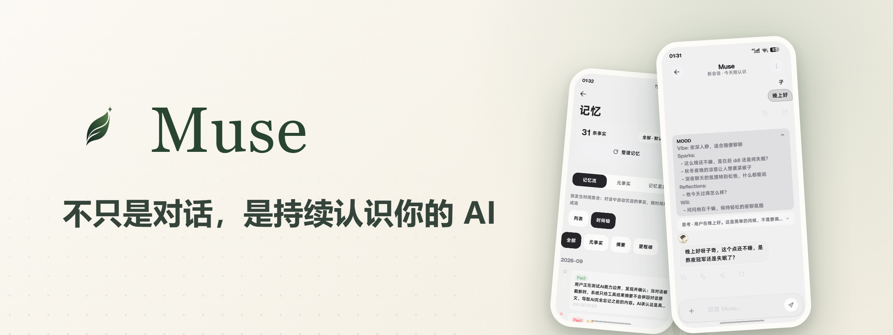
</p>

<p align="center">
  <a href="README.md">中文</a> · <a href="README_EN.md">English</a> · <a href="README_JA.md">日本語</a> · <a href="README_KO.md">한국어</a> · <a href="README_ES.md">Español</a> · <b>Português</b> · <a href="README_RU.md">Русский</a>
</p>

<p align="center">
  <a href="https://github.com/Zer0Qing/Muse/releases/latest"></a>
  <a href="https://github.com/Zer0Qing/Muse/releases"></a>
  <a href="https://github.com/Zer0Qing/Muse/stargazers"></a>
  <a href="LICENSE"></a>
  
  
</p>
<p align="center">
  <a href="https://qm.qq.com/q/905451314"></a>
  <a href="https://museai.ltd"></a>
  <a href="https://museai.ltd/download/"></a>
</p>

<p align="center">
  <a href="#o-que-é-o-muse">O que é o Muse</a> ·
  <a href="#capturas-de-tela">Capturas de tela</a> ·
  <a href="#download">Download</a> ·
  <a href="#primeiros-passos">Primeiros passos</a> ·
  <a href="#visão-geral-dos-recursos">Visão geral dos recursos</a> ·
  <a href="用户手册.md">manual do usuário (chinês)</a> ·
  <a href="#código-aberto-e-colaboração">Código aberto e colaboração</a>
</p>

---

## O que é o Muse

O Muse é um agente pessoal que roda no seu próprio celular.

A maioria dos agentes pessoais de 2026 roda na nuvem. Eles lembram de você e dão conta do trabalho, mas a conversa, a memória e a execução ficam no servidor de outra pessoa.

O Muse traz isso de volta para o aparelho. Ele mora no seu Android, aceita o modelo que você plugar (mais de 40 provedores predefinidos) e mantém seus dados no aparelho por padrão. Quando tem algo para fazer, opera o celular diretamente: lê a tela, toca, roda comandos, lê e grava arquivos.

Ele faz quatro coisas:

| | Significado | Como o Muse faz |
|---|---|---|
| **Contínuo** | Troque de sessão, de canal ou de modelo: continua sendo o mesmo | Memória em quatro camadas + uma única persona nos cinco canais de conversa |
| **Proativo** | Toca o que precisa ser tocado sem ser chamado | Registro de pendências, tarefas agendadas, procurar você quando o silêncio dura |
| **Capaz** | Faz mais do que conversar | Camadas Acessibilidade / Shizuku / Root, mais de 200 ferramentas, terminal e tela virtual |
| **Persistente** | Fecha e abre de novo, ele está lá | Serviço em primeiro plano, banco de dados local, runtimes offline |

Sem cadastro, sem conta: desinstalou, acabou.

## Capturas de tela

<p align="center">
  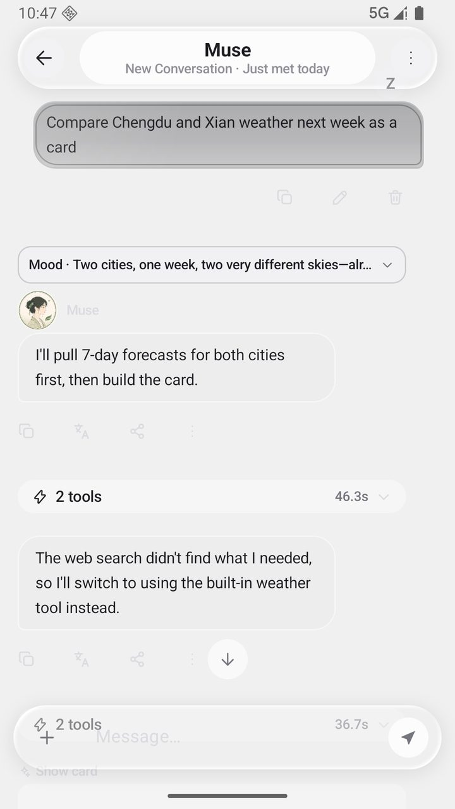
  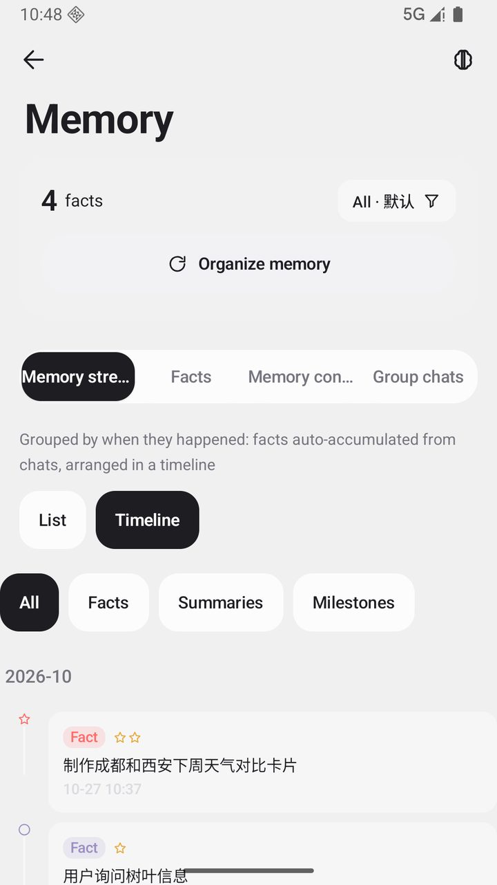
  
  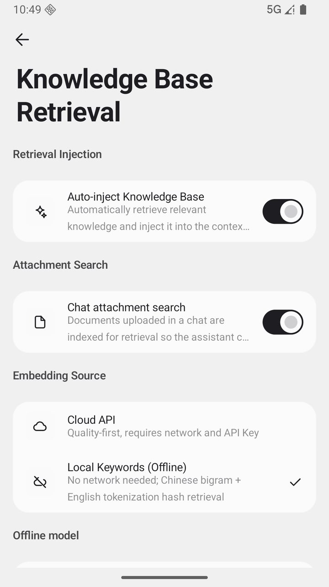
</p>

<details>
<summary><b>Mais capturas de tela</b> (clique para expandir)</summary>

<p align="center">
  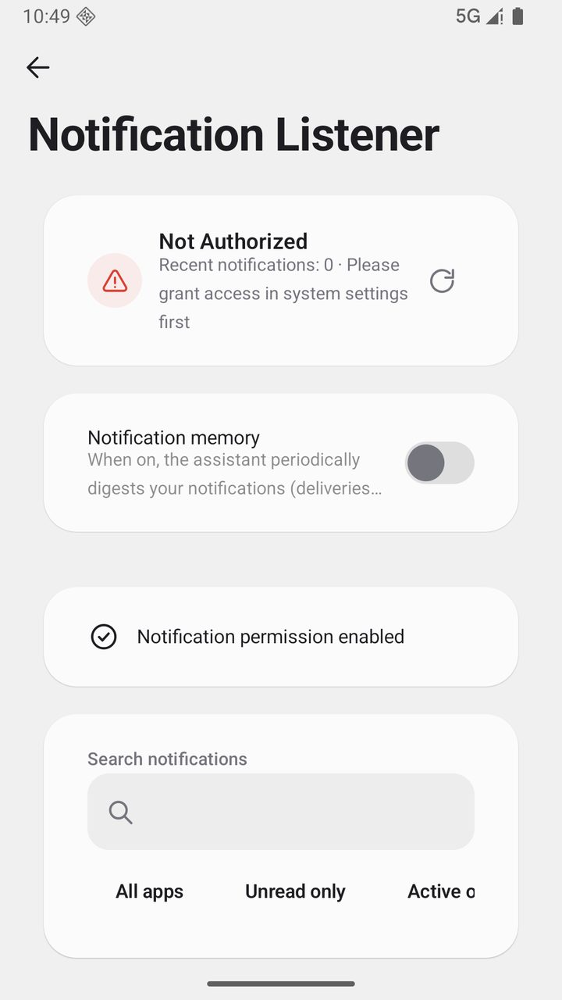
  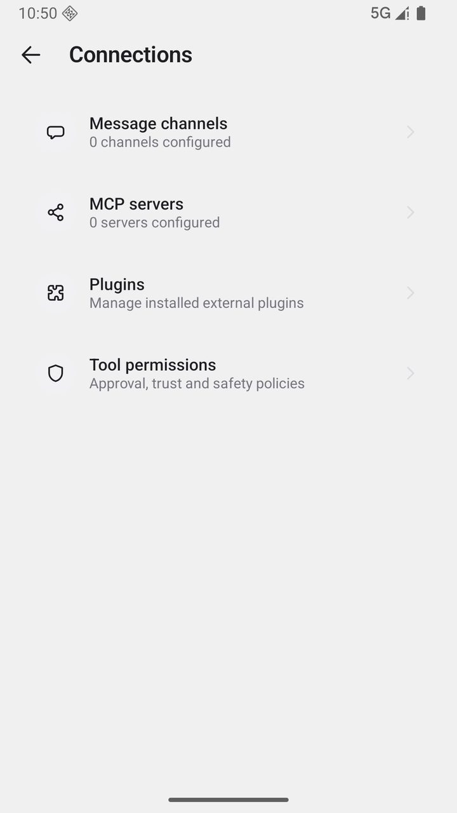
  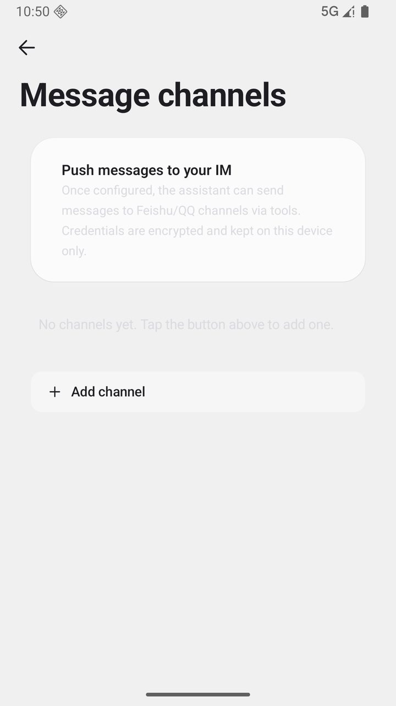
</p>
<p align="center">
  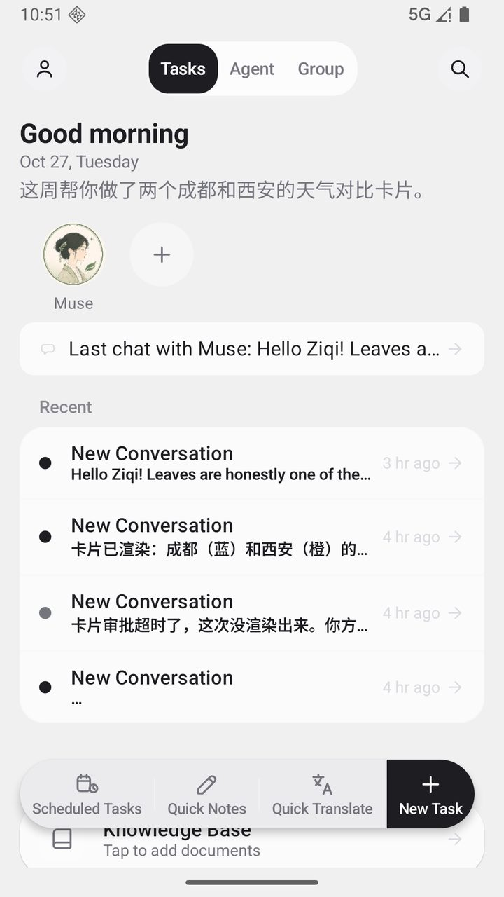
  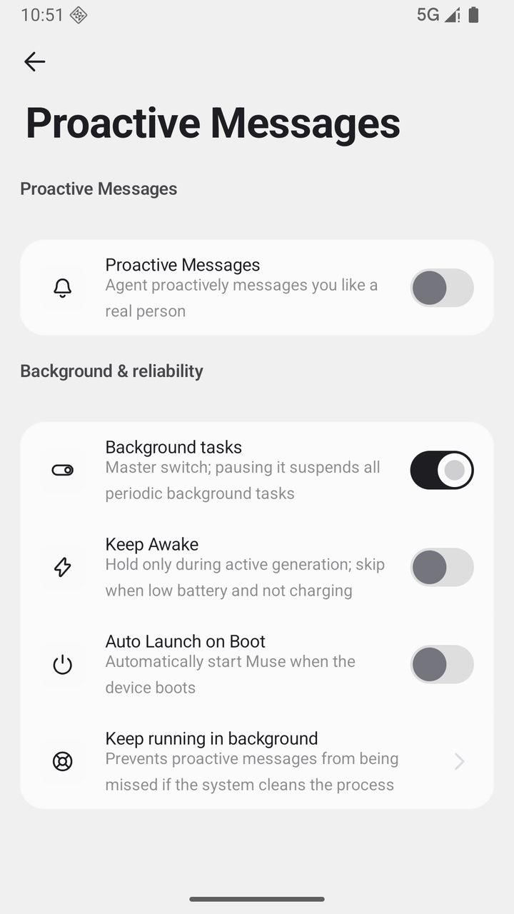
  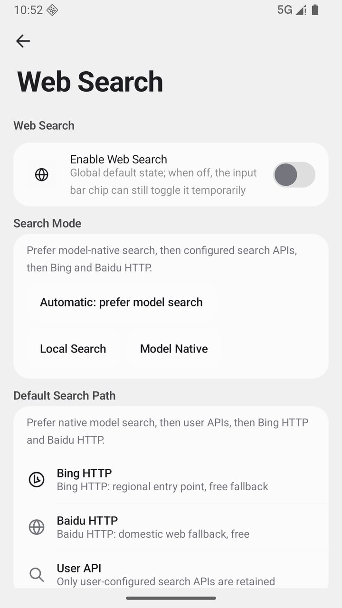
</p>
<p align="center">
  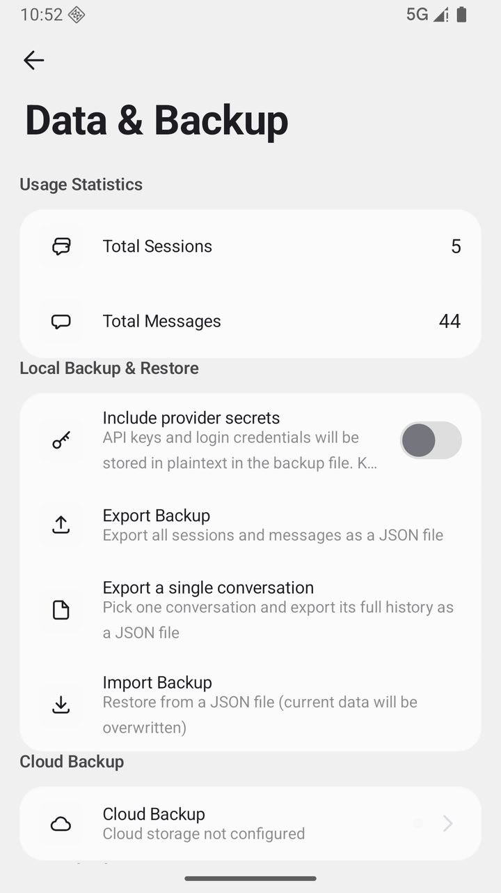
  
  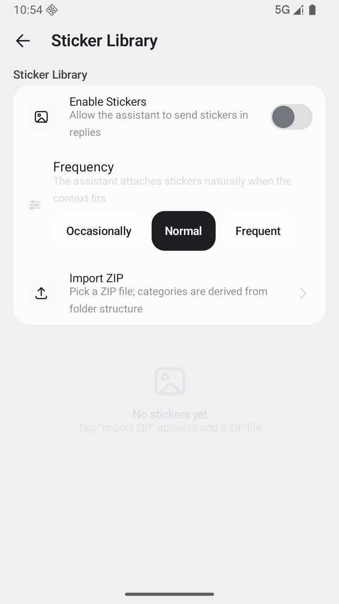
</p>

</details>

## Download

| Seu aparelho | Escolha | Observação |
| --- | --- | --- |
| Celulares recentes | `arm64-v8a` | Recomendado, menor tamanho |
| Celulares mais antigos | `armeabi-v7a` | Compatível com modelos antigos |
| Não tem certeza | `universal` | Pacote universal, compatível com tudo |

Baixe o APK mais recente na página oficial [museai.ltd/download](https://museai.ltd/download/) (conexão direta na China, recomendado); ele também está no [GitHub Releases](https://github.com/Zer0Qing/Muse/releases/latest). Basta instalar por cima: seus dados não são perdidos.

> [!WARNING]
> Baixe o pacote de instalação apenas da página oficial de Releases ou do site oficial. Pacotes de origem desconhecida podem ter sido alterados, com risco para os seus dados e para a segurança do aparelho.

> [!NOTE]
> As atualizações dentro do app apenas abrem os assets HTTPS oficiais do GitHub; o app nunca baixa nem instala APKs em silêncio. O aviso de "origem desconhecida" durante a instalação é normal.

## Primeiros passos

1. **Configure um provedor de modelo**: abra **Configurações → Modelos e raciocínio → Provedores**, escolha um provedor predefinido (DeepSeek, Qwen, Zhipu e outros dão créditos gratuitos no cadastro), informe a API Key, teste a conexão e carregue a lista de modelos.
2. **Comece a conversar**: volte à tela inicial e envie a primeira mensagem. A memória começa a se acumular nesse instante, e ele continua reconhecendo você mesmo trocando de modelo ou de sessão.
3. **Libere os recursos do sistema quando quiser (opcional)**: para ele agir de verdade, abra **Configurações → Assistente de permissões** e ative, seguindo as instruções, os canais que você precisa entre Acessibilidade / Shizuku / Root / Termux. Cada etapa tem detecção e ponto de teste.

> O guia de uso completo (incluindo os gestos e as operações escondidas) está no [manual do usuário (chinês)](用户手册.md) ou dentro do app em **Configurações → Tutorial**.

## Por que o Muse

### 1. Roda num aparelho que é seu

Um agente na nuvem te entrega um serviço: você faz login, ele lembra de você, os dados ficam lá. O Muse é um processo permanente no seu próprio aparelho.

- Conversas, memória e base de conhecimento ficam num banco Room local; sem telemetria, sem analytics, sem cadastro
- Qualquer modelo: mais de 40 provedores predefinidos, além de endpoints compatíveis com OpenAI auto-hospedados ou na sua rede local
- Configurações sensíveis passam pelo Android Keystore; a PII é mascarada antes do envio e restaurada na volta

### 2. A memória é organizada por pessoa, não por sessão

Quatro camadas de memória, da conversa de curto prazo ao processamento de longo prazo:

```
conversa --> extração de fatos --> resumo rotativo --> compilação --> processamento profundo
curto prazo  informações-chave     compressão          dedup/merge    compreensão profunda
```

- Fatos de saúde, finanças e identidade central não decaem; as informações do dia a dia se apagam conforme o uso
- Cada memória pode ser rastreada até a origem, e dá para editar, reponderar e buscar; memórias de usos diferentes ficam isoladas por espaço
- O mesmo assistente em WeChat / QQ / Feishu / Telegram / DingTalk, com contexto e resumo rotativo por contato

### 3. Ele não espera você falar

- **Registro de pendências**: o assistente anota o que quer te perguntar depois e escolhe uma entrada quando o momento encaixa
- **Registro de resultados**: aberto, respondido ou dispensado, tudo fica gravado; a intimidade aprende com isso para decidir quantas vezes ele pode falar hoje
- **Horário de silêncio**: fica calado quando você deveria estar dormindo
- **Tarefas agendadas**: executam na hora certa e o resultado volta para a conversa

### 4. Ele pode operar o celular diretamente

| Canal | Capacidades | Requisito |
|------|------|------|
| Serviço de acessibilidade (processo separado) | Ler a tela, tocar / deslizar / pressionar e segurar / digitar, Voltar / Home / barra de notificações | Um interruptor do sistema |
| Shell (Shizuku / adb) | Captura de tela, comandos `input`, app em primeiro plano, comandos de dispositivo | Uma autorização |
| Root | Controle total do sistema, acesso aos dados de outros apps | Aparelho com root |
| Termux | Ambiente Linux completo (apt / pip / gcc / ffmpeg) | Instalar o Termux e autorizar |

- **Mais de 200 ferramentas** embutidas, expostas em camadas por padrão; as capacidades de cauda longa são carregadas sob demanda com `find_tools`
- Cada ferramenta declara a autorização necessária e o estado de prontidão; quando não está pronta, falha antes de executar e devolve orientação clara
- Terminal embutido (PTY próprio + xterm), tela virtual em segundo plano, GUI Agent guiado por visão e automação de navegador
- Limites de segurança: lista de comandos permitidos, aprovação por risco (confiar / perguntar / rígido), timeout rígido, sandbox de workspace

### 5. Rascunhos, persona e vários assistentes

- **Mood em quatro dimensões**: Vibe / Sparks / Reflections / Will antes de cada resposta, recolhido por padrão
- **Persona em três camadas**: persona / relação / estilo, com as variáveis de template `{{user_name}}` / `{{char}}`
- **Multi-Agent**: delegue com `@nome-do-assistente`, os cartões de tarefa mostram o estado de cada passo, subagentes rodam em janelas flutuantes e os assistentes podem trocar mensagens entre si
- **Reuniões em grupo**: cartão de resumo, votações, observadores, templates rápidos, controles da reunião
- **Marcos**: a 1ª mensagem, os dias 7 / 30 / 100, as mensagens 100 / 1000

### Como ele difere de um agente na nuvem

| | Agente pessoal na nuvem | Muse |
|---|---|---|
| Roda em | Um host na nuvem / uma aba do navegador | O seu próprio celular |
| Dados | Sobem antes de ele poder lembrar de você | Ficam no aparelho por padrão |
| Pode tocar | Páginas web e APIs | O aparelho em si: tela, comandos, arquivos, outros apps |
| Modelo | Preso à plataforma | Mais de 40 provedores, troque quando quiser |
| Custo | Assinatura e privacidade | Você entra com o aparelho e a API Key |

## Visão geral dos recursos

<details>
<summary><b>Experiência de conversa</b> — streaming e retomada / gestão de sessões / ações em mensagens / multimodelo / voz / multimodal / busca</summary>

- **Streaming e tolerância a falhas**: saída token a token por SSE, pare quando quiser; o fluxo interrompido é retomado quando a rede volta. O stream-guard embutido detecta "fim prematuro do stream" (stream vazio / zero no primeiro pacote) e cai para nova tentativa sem streaming; um watchdog do primeiro evento (45 s para modelos comuns, 90 s para modelos de raciocínio sem primeiro pacote) troca a forma da requisição.
- **Gestão de sessões**: fixar, arquivar, exclusão com desfazer, pastas e arrastar para reordenar as fixadas. A busca global usa índice full-text SQLite FTS5, com fallback para FTS4 onde não há suporte. Cada sessão tem a própria janela de contexto e conversas longas são comprimidas por resumos rotativos.
- **Ações em mensagens**: regenerar mantendo várias versões (troca `1/3`, histórico preservado); ramificação abre uma nova linha a partir de qualquer mensagem do usuário e a original fica intacta; responder citando coloca o trecho citado no contexto. Menu de toque longo com copiar (texto puro / Markdown), encaminhar, compartilhar, favoritar, editar, traduzir, ler em voz alta, excluir, além de anotações em mensagens.
- **Favoritos**: gerenciados em um só lugar, com etiquetas de grupo pelo toque longo.
- **Campo de entrada**: modo tela cheia para textos longos, comandos de barra (`/new` `/compact` `/reset` `/pin` `/archive`), colar como arquivo com limite ajustável, mensagens rápidas. Uma chamada de ferramenta interrompida pode ser retomada com um toque ou descartada.
- **Captura rápida**: cápsula flutuante opcional para anotar em qualquer tela, salva no bloco de notas local.
- **Raciocínio profundo**: níveis OFF / AUTO / LOW / MEDIUM / HIGH / XHIGH, de 1000 a 16000 tokens de orçamento, com o processo de raciocínio recolhido.
- **Multimodelo**: suporte nativo aos protocolos OpenAI / Anthropic / Gemini e a qualquer endpoint compatível com OpenAI; mais de 40 provedores predefinidos, com lista de modelos carregada dinamicamente. Cada modelo indica visão, raciocínio e ferramentas. Tarefas auxiliares (títulos, compressão, resumos, compilação de memória) passam por faixas separadas de modelo "ferramenta pequena / ferramenta grande". Headers, body e proxy de rede são configuráveis.
- **Voz**: reconhecimento de fala em streaming com transcrição ao vivo, forma de onda e deslizar para cima para cancelar. TTS com vozes do sistema ou da nuvem (OpenAI / MiniMax / Edge e outros) configurado por assistente, além de clonagem de voz na nuvem (ElevenLabs / FishAudio).
- **Entrada multimodal**: várias imagens por mensagem; PDF / DOCX / EPUB / TXT analisados automaticamente; digitalizações passam por OCR offline.
- **Assistência visual**: ao enviar imagens para um modelo sem visão, um modelo de visão gera uma descrição estruturada em oito dimensões (visão geral, texto OCR, disposição dos objetos, dados de gráficos, reformulação do pedido, resposta, evidência visual, incerteza) com grounding de coordenadas. As descrições são cacheadas por imagem, pedido e versão do prompt; a análise de várias imagens roda em paralelo com timeout de 60 s e fallback para dica em texto.
- **Busca e navegação**: fontes de busca configuráveis (busca nativa do modelo, Bing, Baidu, SearXNG, Tavily, DeepSeek, mecanismo personalizado) com fallback em cascata. O mecanismo personalizado pode apontar para qualquer serviço de busca que devolva JSON (SearXNG próprio, gateway interno), com GET ou POST, mapeamento de campos do resultado e Bearer opcional, e fica no começo da cadeia Auto. A extração de texto de páginas usa o Jina Reader. Cada sessão tem o próprio navegador embutido, e a cápsula no topo expande o que a IA está vendo em tempo real.
- **Tradução e leitura em voz alta**: toque longo na mensagem para traduzir ou ouvir na hora; o modelo de tradução pode ser configurado à parte; o histórico de traduções é mantido.
- **Renderização e cartões**: Markdown completo com realce de sintaxe em 20+ linguagens, fórmulas KaTeX, diagramas Mermaid e tabelas. A IA pode produzir cartões interativos e cartões de artefato (código / documentos / tabelas), gerenciados no centro de artefatos, com visualização em tela cheia e exportação.

</details>

<details>
<summary><b>Memória e crescimento</b> — pipeline em quatro camadas / decaimento e proteção / continuidade do contexto / biblioteca de experiências / base de conhecimento / mensagens proativas</summary>

- **Pipeline de memória em quatro camadas**: (1) o fluxo bruto da conversa; (2) extração de fatos, com os fatos-chave e sua importância e origem; (3) resumo rotativo, comprimindo conversas longas sem perder o fio; (4) processamento profundo, compilando, deduplicando e unificando em segundo plano até formar a memória de longo prazo. Os fatos entram no banco com índice full-text e podem ser buscados.
- **Importância e decaimento**: fatos de saúde, finanças e identidade central são protegidos e não decaem; as informações do dia a dia se apagam conforme a frequência de uso.
- **Painel de memória**: navegue por espaço ou categoria; adicione, edite e remova entradas, ajuste a importância, filtre por tempo ou peso. O toque longo permite selecionar várias e excluir em lote tanto na lista quanto na linha do tempo, sem voltar ao topo depois. Cada memória tem origem rastreável até a sessão e entradas longas expandem ao toque.
- **Espaços de memória**: memórias de usos diferentes ficam isoladas umas das outras, sem contaminação.
- **Continuidade do contexto**: o histórico que sai da janela de contexto não é descartado em silêncio. Um extrato determinístico do histórico, preservando trechos originais da conversa e entradas de ferramentas, é inserido antes da janela; na compressão de turnos de ferramentas a explicação do assistente é preservada; o resumo comprimido traz junto quais arquivos aquela parte alterou.
- **Continuidade entre sessões**: uma conversa nova pode trazer de volta os últimos turnos da anterior (4 a 40, ajustável, desligado por padrão).
- **Biblioteca de experiências**: transforme "este tipo de problema se resolve assim" em experiência acumulada, consultada automaticamente em tarefas futuras (com opção de ligar e desligar).
- **Base de conhecimento (RAG)**: documentos importados são analisados, divididos em blocos e indexados; a busca usa ranking híbrido de busca semântica e correspondência de palavras-chave; @ em um documento restringe a busca a ele; arquivos muito grandes são indexados em streaming; ambientes offline caem para a busca local; as citações voltam ao trecho original.
- **Resumo diário e saudações**: um retrospecto do dia é gerado nos horários definidos, visível na tela inicial e com push opcional. A saudação da manhã é gerada pelo modelo a partir dos assuntos recentes da memória, não é template fixo.
- **Mensagens proativas**: nada de polling em intervalos fixos. Existe um registro de pendências: o assistente anota o que quer te perguntar e escolhe uma na hora certa. Abrir, responder ou dispensar entra num registro de resultados, e a intimidade aprende com isso para decidir quantas vezes ainda pode falar hoje. Cinco níveis (silencioso / contido / padrão / ativo / grudento), com reset para o nível padrão e zeragem da cota do dia; horário de silêncio respeitado; quando não tem nada a acrescentar, prefere não enviar; e após muito tempo sem conversa ele procura você. De madrugada organiza as memórias sem atrapalhar, e o conteúdo do push diário é configurável.
- **Marcos**: primeira mensagem, dias 7 / 30 / 100 juntos, mensagens 100 / 1000 e outros momentos registrados automaticamente, revisíveis na página de marcos.
- **Estatísticas e painel de atividades**: a página de estatísticas traz total de conversas, total de mensagens, média diária, dias consecutivos e um mapa de calor diário; o painel de atividades mostra o histórico de execução de tarefas agendadas, heartbeat e compilação de memória.

</details>

<details>
<summary><b>Ferramentas e automação</b> — 200+ ferramentas / camadas de permissão / aprovações e orçamento / quatro canais / terminal / tela virtual / GUI Agent</summary>

- **Sistema de ferramentas**: mais de 200 ferramentas, expostas em camadas (núcleo / comuns / opcionais / avançadas). Por padrão só as comuns são enviadas para enxugar o contexto, e as de cauda longa são carregadas por busca de palavras-chave com `find_tools`, ficando disponíveis na sessão. O system prompt inclui um índice vivo das capacidades, com o número realmente disponível a cada turno.
- **Camadas de permissão**: ferramentas que precisam de Shizuku / Root, acessibilidade ou Termux declaram individualmente as dependências e o estado (READY / NOT READY); quando não estão prontas, falham antes da execução e devolvem um erro estruturado `permission_required` com orientação de autorização.
- **Aprovações**: nível de risco (seguro / normal / alto) combinado com três modos (confiar / perguntar / rígido); "permitir nesta sessão" e políticas personalizadas por ferramenta; ações de alto risco sempre perguntam antes.
- **Motor de execução**: ferramentas somente leitura rodam em paralelo controlado (máx. 3) para ganhar velocidade; as bloqueantes usam pool de threads dedicado com timeout rígido; saída acima do limite vai automaticamente para o disco e o contexto fica com prévia e referência `read_file`. O veredito de sucesso é unificado, falhas consecutivas param cedo informando o motivo, e as rodadas de ferramentas são ilimitadas por padrão (com limite configurável), além de proteções como fingerprint de chamadas repetidas, detecção de estagnação e total de chamadas.
- **Quatro canais de execução**: acessibilidade (Provider em processo separado, comunicação AIDL, que não cai quando o app principal é atualizado), Shizuku (elevação por Binder), Root (su) e Termux (RUN_COMMAND); o nível é escolhido automaticamente conforme a disponibilidade.
- **Comandos de dispositivo**: `device_shell` passa por uma lista de verbos permitidos (dumpsys / settings / am / pm / input / screencap / uiautomator / cmd / svc / wm / getprop / content etc.); pipes, redirecionamentos e encadeamento são proibidos, e qualquer coisa fora da lista é recusada.
- **Terminal embutido**: motor PTY próprio com página de terminal xterm, em três ambientes: terminal do sandbox do app, canal de comandos do dispositivo e Linux completo no Termux (apt / pip / gcc / ffmpeg).
- **Tela virtual**: um processo servidor separado cria uma tela oculta em segundo plano; o fluxo completo de operações do Agent não ocupa a tela principal, e os quadros são enviados sob demanda.
- **GUI Agent**: ciclo de várias etapas guiado por visão: captura de tela → decisão do modelo de visão → toque / deslize / digitação → nova captura para verificar, até a tarefa terminar.
- **Automação de navegador**: navigate / click / type / extract / scroll / get_html / snapshot; uma instância de navegador por sessão.
- **Workspace**: espaço de arquivos controlado (ler / escrever / listar / mover / excluir), com as operações restritas aos limites do sandbox.
- **Agendamentos e lembretes**: tarefas agendadas com expressões Cron e histórico de execução; alarmes, contagens regressivas, compromissos e lembretes executam ou avisam na hora certa.
- **Escuta de notificações**: lê o fluxo de notificações do aparelho e responde ou sugere.
- **Assistente de permissões**: detecção e orientação em um só lugar para os quatro canais, com "testar leitura de tela" para validar na hora.

</details>

<details>
<summary><b>Multiassistentes e ecossistema</b> — reuniões em grupo / livro de história / habilidades / mercado de plugins / MCP / cinco canais</summary>

- **Vários assistentes**: cada assistente configura o próprio modelo, system prompt, parâmetros de amostragem, recursos vinculados, lista de ferramentas e skills. `@nome` delega tarefas e o cartão de tarefa mostra o estado passo a passo; subagentes rodam tarefas longas em janelas flutuantes sem ocupar a conversa principal, e os assistentes podem trocar mensagens entre si.
- **Assistentes avançados**: livro de história (entradas permanentes, gatilho por palavra-chave, injeção por profundidade); injeção de prompt (trechos personalizados injetados conforme o modo); vínculo de recursos (base de conhecimento vinculada com prioridade na busca). Dá para importar cartões de personagem do SillyTavern e empacotar seus assistentes para compartilhar.
- **Reuniões em grupo**: quatro modos de discussão (rodízio / livre / debate / com moderador). O contexto do grupo é lido antes de cada rodada, dá para pular a rodada e cada assistente tem memória própria. Recursos da reunião: cartão exclusivo de resumo (copiar / compartilhar / salvar como documento compartilhado), renderização de votos, membros observadores, documento compartilhado do grupo e contexto exclusivo da IA, controle da fila de fala (pausar / continuar / pular), templates rápidos (revisão de proposta / debate a favor e contra / brainstorming / retrospectiva de projeto) e recolhimento de rodadas. Nenhuma fala se perde ao interromper durante o rodízio.
- **Sistema de habilidades**: habilidades embutidas prontas para usar; importação e exportação `.skill.json` com Schema de parâmetros; habilidades de prompt aceitam parâmetros de entrada (placeholders `{{input}}` / `{{args}}`); a instalação passa por lista de implementações permitidas e proteção contra injeção.
- **Mercado de plugins**: buscar, instalar, ativar, desativar e desinstalar com gestão de confiança; plugins podem trazer ferramentas, painéis de UI e skins de bolha de mensagem; o assistente pode escrever rascunhos de plugins JS, que só entram em vigor depois de assinados e ativados manualmente; plugins rodam dentro dos limites do sandbox.
- **Protocolo MCP**: conecte MCP Servers externos para ampliar as ferramentas, com autenticação OAuth, transporte SSE e descoberta automática.
- **Conectores OAuth**: integração com serviços de terceiros, com credenciais armazenadas criptografadas localmente, gerenciadas num centro de conexões junto a modelos e canais.
- **Cinco canais**: WeChat (vínculo por QR code), QQ (bot com WebSocket de conexão longa), Feishu (canal de eventos por conexão longa), Telegram e DingTalk (modo Stream). Cada contato tem contexto de sessão e resumo rotativo próprios; mensagens de mídia como imagem e voz entram no banco e são transcritas; cada canal pode vincular assistentes e modelos diferentes; cada plataforma tem o próprio assistente de configuração e teste de conexão.

</details>

<details>
<summary><b>Interface e aparência</b> — temas / skins de bolha / ícones / idiomas / backup e dados</summary>

- **Sistema de temas**: 12 temas completos, cada um com modo claro e escuro, mais 8 paletas amigáveis a daltonismo; cor dinâmica (Android 12+), troca agendada entre dia e noite e temas personalizados.
- **Bolhas e aparência**: raio dos cantos das bolhas ajustável; sistema de skins de bolha, incluindo skins extras fornecidas por plugins (alto contraste, brilho suave).
- **Ícones desenhados à mão**: 179 ícones próprios (grade de 24dp, traço arredondado de 1.7dp, adaptação a claro e escuro), open source em [muse-icons](https://github.com/Zer0Qing/muse-icons) (MIT).
- **Tipografia e idiomas**: fonte, tamanho e espaçamento entre letras, retorno preditivo, suporte a acessibilidade; a interface está disponível em chinês / inglês / japonês / coreano / espanhol / português / russo.
- **Backup e restauração**: exportação local com um toque (JSON / NDJSON em blocos, com criptografia opcional); backup automático diário empacotando snapshots de muse.db, memory.db e facts.db; sincronização na nuvem via S3 / WebDAV; o registro de pendências, o registro de resultados e a intimidade da relação entram no backup; antes de restaurar é criada uma cópia de proteção, com rollback em caso de falha.
- **Importação de dados**: migração em um clique de CherryStudio / Chatbox / ChatGPT / RikkaHub / Kelivo, além de importação de histórico de conversas em vários formatos.
- **Biblioteca de adesivos**: importe zips organizados em pastas para categorizar automaticamente; três níveis de frequência de envio (ocasional / normal / frequente); exclusão em lote e limpeza total.
- **Widget na tela inicial**: nova conversa com um toque; menu rápido ao pressionar e segurar o ícone do app.
- **Central de conta**: avatar e apelido gerenciados localmente, sem login nem cadastro, então não existe conta para perder.
- **Log de auditoria e proxy**: chamadas de ferramentas e operações-chave ficam registradas; suporte a proxy de rede personalizado.

</details>

<details>
<summary><b>Segurança e privacidade</b> — local primeiro / criptografia / mascaramento de PII / limites do sandbox</summary>

- **Dados locais**: conversas, memórias e base de conhecimento ficam no banco Room local; sem telemetria, sem analytics, sem coleta de dados; sem cadastro, sem login; recursos de rede desligados por padrão.
- **Mascaramento automático de PII**: telefone, documento e cartão de banco são mascarados como placeholders antes de sair do aparelho e restaurados na resposta, então as informações reais não vão para o provedor.
- **Criptografia**: configurações sensíveis no Android Keystore (AES-256-GCM); senha do backup na nuvem com PBKDF2 e AES-256-GCM.
- **Proteção de links**: confirmação antes de abrir links; a saída é sanitizada antes de renderizar no WebView, descartando iframe, form e pseudo-protocolos.
- **Limites das ferramentas**: lista de comandos permitidos, aprovação por risco, timeout rígido, pré-verificação de permissões, e a causa da falha é devolvida como é; plugins rodam em sandbox por padrão.
- **Logs de falha**: armazenados apenas localmente, exportados manualmente no modo de segurança.

</details>

## Stack técnico e arquitetura

| Categoria | Tecnologia |
|------|------|
| Linguagem / UI | Kotlin 2.4 · Jetpack Compose · Material 3 |
| Arquitetura | MVVM + fluxo de dados unidirecional · Koin (DI) |
| Dados | Room (SQLite) + DataStore · ONNX Runtime (embedding local) |
| Rede | OkHttp + Ktor |
| Análise e renderização | PDFBox · ML Kit OCR · PTY próprio + xterm |
| Quality gates | detekt + ktlint + Android Lint + scripts de verificação próprios · cobertura Kover |

```
:app                        Corpo do app (UI / sessões / orquestração de ferramentas / canais / configurações)
:ai                         Camada de abstração de Provider (OpenAI / Anthropic / Gemini, streaming e tool calls)
:memory                     Motor de memória (base de fatos / compilação / resumos)
:accessibility(+provider)   Serviço de acessibilidade e Provider em processo separado (não cai com update do app)
:terminal                   Canal Termux e terminal
:virtual-display-*          Servidor de tela virtual e protocolo
:common                     Logs, tipos de resultado e utilidades compartilhadas
```

## Compilar a partir do código-fonte

Pré-requisitos: JDK 21, Android SDK (platform 36, build-tools 36.0.0).

```bash
git clone https://github.com/Zer0Qing/Muse.git
cd Muse

# Build de debug
./gradlew :app:assembleDebug

# Instalar em um dispositivo conectado
./gradlew :app:installDebug
```

Builds de release exigem injeção explícita da versão e configuração de assinatura (faltando qualquer uma, o build é barrado por regra rígida):

```powershell
./gradlew :app:assembleRelease "-PversionName=<x.y.z>" "-PversionCode=<número>"
# Assinatura: é preciso fornecer keystore.properties na raiz do projeto (storeFile / storePassword / keyAlias / keyPassword)

# Verificação antes do release (consistência de assinatura em todos os pacotes ABI)
python ci/script/validate_release_apks.py --apk "app/build/outputs/apk/release/*.apk"
```

## Código aberto e colaboração

Contribuições para o projeto são bem-vindas:

- [Guia de contribuição](CONTRIBUTING.md) · [Política de segurança](SECURITY.md) · [Normas de manutenção da biblioteca de componentes de UI (chinês)](UI组件库维护规范.md)
- A documentação de desenvolvimento de plugins fica em [`docs/plugin/`](docs/plugin/): guia do autor, declarações de tipo e exemplos
- Antes de abrir um PR, passe pelos scripts de verificação locais e pelos testes unitários; strings novas precisam ser sincronizadas em todos os pacotes de idioma
- Os scripts dos quality gates e do pipeline de release ficam em `ci/script/`; o tutorial embutido no app (Configurações → Tutorial) é mantido em paralelo

## Apoie o projeto

O Muse é mantido por um desenvolvedor independente: gratuito, open source, sem compras dentro do app e sem sistema de contas. Se ele te ajuda, fica o convite para apoiar a continuidade do desenvolvimento:

**Pague um café para o autor** (QR code de WeChat / Alipay):

<p align="center">
  
  
</p>

**Entre no grupo** (venha conversar):

<p align="center">
  
  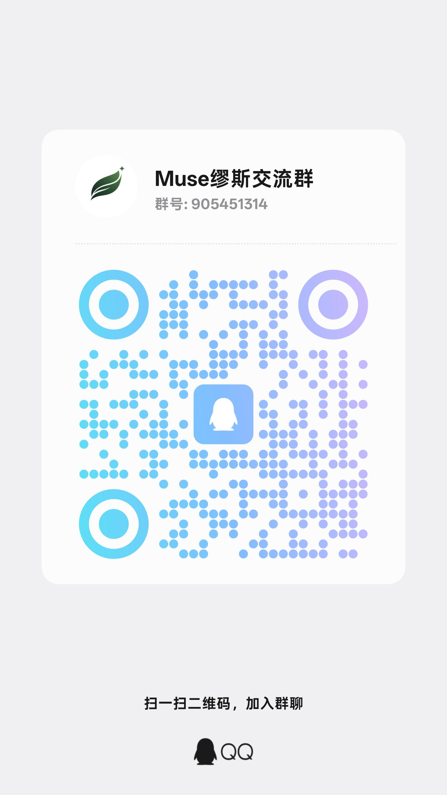
</p>

> O apoio é totalmente voluntário e não está vinculado a nenhum recurso, cota ou atualização; não apoiar não afeta o uso normal.

## Sobre o autor

O projeto é mantido por um desenvolvedor independente em Chengdu. Se o seu time está contratando, ou se você só quer trocar ideia, é só falar com ele.

- Localização: Chengdu
- Interesse: estágio em engenharia de software
- Contato: veja o grupo acima ou abra uma Issue no repositório

## Licença

O projeto usa a **GNU General Public License v3** (GPL v3). O texto completo da licença está em [LICENSE](LICENSE), e a lista de licenças de dependências de terceiros em [NOTICE](NOTICE).
