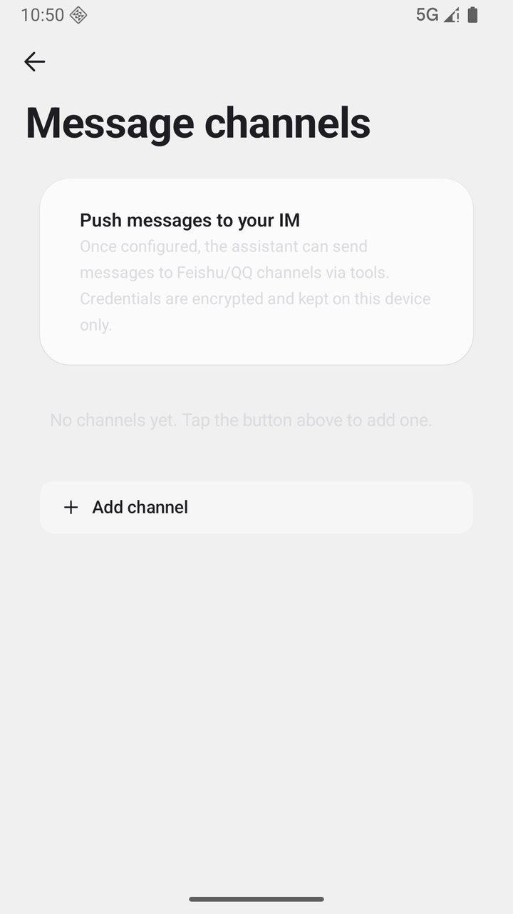
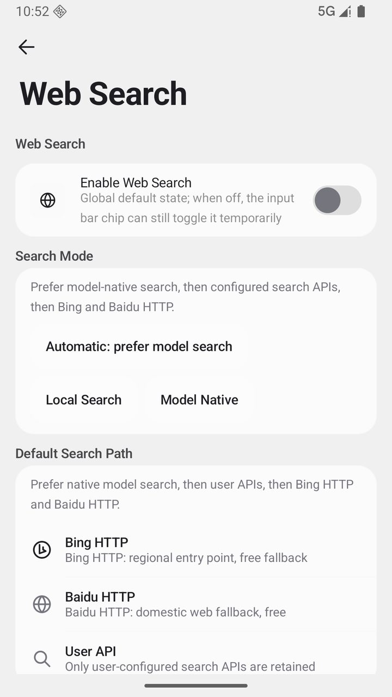

<p align="center">
  
</p>

<p align="center">
  <a href="README.md">中文</a> · <a href="README_EN.md">English</a> · <a href="README_JA.md">日本語</a> · <a href="README_KO.md">한국어</a> · <a href="README_ES.md">Español</a> · <b>Português</b> · <a href="README_RU.md">Русский</a>
</p>

<p align="center">
  <a href="https://github.com/Zer0Qing/Muse/releases/latest"></a>
  <a href="https://github.com/Zer0Qing/Muse/releases"></a>
  <a href="https://github.com/Zer0Qing/Muse/stargazers"></a>
  <a href="LICENSE"></a>
  
  
</p>
<p align="center">
  <a href="https://qm.qq.com/q/905451314"></a>
  <a href="https://museai.ltd"></a>
  <a href="https://museai.ltd/download/"></a>
</p>

<p align="center">
  <a href="#o-que-é-o-muse">O que é o Muse</a> ·
  <a href="#capturas">Capturas</a> ·
  <a href="#download">Download</a> ·
  <a href="#início-rápido">Início rápido</a> ·
  <a href="#recursos">Recursos</a> ·
  <a href="#compilar-do-código">Compilar</a> ·
  <a href="#contribuir">Contribuir</a>
</p>

---

## O que é o Muse

O Muse é um agente pessoal de IA que mora no seu próprio celular Android.

A maioria dos assistentes de IA roda na nuvem: você abre, conversa e fecha, enquanto tudo fica no servidor de outra pessoa. O Muse foi feito para ficar no seu aparelho. Sem conta e sem telemetria: conversas, memórias e base de conhecimento ficam no SQLite local por padrão, e você conecta a API que preferir (OpenAI, Anthropic, Gemini, DeepSeek, Qwen, Zhipu ou servidores locais compatíveis com OpenAI) e troca quando quiser.

O que muda em relação a um cliente comum de API:

- **Lembra de você, não só de uma conversa**: extrai fatos importantes, resume e organiza ao longo do tempo, protegendo dados médicos ou de identidade do esquecimento. Troque de modelo ou abra outra sessão e ele continua te reconhecendo.
- **Toma iniciativa quando faz sentido**: anota pendências para perguntar depois, desperta no horário marcado e respeita o horário de silêncio (reduzindo a frequência se você dispensar).
- **Opera o celular de verdade**: com as permissões certas, lê a tela, toca, executa comandos, navega em um WebView isolado, manipula arquivos em sandbox, roda Python/Node em um Ubuntu `proot` sob demanda ou conecta via SSH ao seu próprio servidor Linux.
- **Cartões interativos dentro do chat**: além de texto, renderiza gráficos e cartões HTML/SVG interativos (como Gomoku, rastreadores ou quizzes) que conversam em segundo plano com a IA sem poluir o histórico.

---

## Capturas

<p align="center">
  
  
  
  
</p>

<details>
<summary>Ver mais capturas</summary>

<p align="center">
  
  
  
</p>
<p align="center">
  
  
  
</p>
<p align="center">
  
  
  
</p>

</details>

---

## Download

| Seu aparelho | Escolha | Notas |
| --- | --- | --- |
| Celulares Android recentes | `arm64-v8a` | Recomendado, menor tamanho |
| Aparelhos antigos 32 bits | `armeabi-v7a` | Compatibilidade legada |
| Não tem certeza | `universal` | Funciona em todas as arquiteturas |

- **GitHub Releases**: [Última versão](https://github.com/Zer0Qing/Muse/releases/latest)
- **Site oficial**: [museai.ltd/download](https://museai.ltd/download/)

Instale por cima da versão atual sem perder seus dados locais.

> [!WARNING]
> Baixe apenas pelo GitHub Releases ou site oficial. A verificação de atualização no app só abre a página oficial e nunca baixa APKs em segundo plano.

---

## Início rápido

1. **Adicione sua chave API**: vá em **Configurações → Modelos e provedores**, escolha um provedor, insira a chave, teste a conexão e busque os modelos.
2. **Escolha seu layout inicial**: em **Configurações → Aparência**, visualize e alterne entre **Clássico (3 abas)** e **Gaveta minimalista** (abre direto no chat).
3. **Comece a conversar**: a memória local começa a ser construída já na primeira mensagem.
4. **Libere permissões só se precisar**: conversar não exige permissões extras. Para automação ou scripts, abra **Configurações → Assistente de permissões** ou baixe o runtime Ubuntu `proot` sob demanda.

---

## Diferença para agentes na nuvem

| | Agentes na nuvem | Muse |
|---|---|---|
| Onde roda | Servidores remotos | Seu próprio Android |
| Onde ficam os dados | Enviados ao provedor | SQLite Room local por padrão |
| O que alcança | APIs web e abas | Tela, arquivos, notificações, shell e seu host SSH |
| Modelos | Preso a uma plataforma | 40+ provedores predefinidos, troque quando quiser |
| Custo | Assinatura + privacidade | Seu aparelho e sua própria chave API |

---

## Recursos

<details>
<summary><b>Chat e leitura</b> —— dois layouts, tipografia, cartões interativos, voz e visão</summary>

- **Dois layouts de início**: 3 abas clássicas ou gaveta minimalista direto para o chat.
- **Streaming resiliente**: pausar/retomar SSE, fallback automático sem streaming em fluxos vazios e níveis de raciocínio (`OFF` a `XHIGH`).
- **Tipografia limpa e leitor**: espaçamento entre CJK, texto latino, números e código inline (preservando URLs e matemática `$...$`), destaque para 20+ idiomas, KaTeX, Mermaid e leitor de artefatos em tela cheia.
- **Cartões silenciosos**: cartões HTML/SVG consultam o assistente em segundo plano (`window.muse.ask` / `saveState`) sem encher o chat de mensagens.
- **Roteamento multimodelo e visão**: modelos distintos para chat, títulos, compressão e memória; descrição visual automática em 8 dimensões ao enviar imagens para modelos sem visão.
- **Busca, voz e arquivos**: busca web configurável, navegador por sessão, ASR em streaming, TTS local/nuvem + clonagem de voz, e leitura de PDF / DOCX / EPUB / OCR offline.

</details>

<details>
<summary><b>Memória e base de conhecimento</b> —— quatro camadas, perfil independente, RAG local</summary>

- **Memória em quatro camadas**: fluxo de conversa → extração de fatos → resumos contínuos → organização Dream (com rollback).
- **Perfil "Sobre você" isolado**: cinco domínios pessoais salvos em arquivos locais privados fora da base de conhecimento, com chave própria.
- **RAG local**: busca híbrida vetorial + palavras-chave, menções `@documento`, indexação em streaming para arquivos grandes e exclusão em lote.
- **Mensagens proativas agendadas**: lembretes exatos por minutos ou data/hora, respeitando horário de silêncio.

</details>

<details>
<summary><b>Automação e Compute Node</b> —— 180+ ferramentas, proot, tela virtual, SSH</summary>

- **Mais de 180 ferramentas** (200+ com MCP, plugins e skills), carregadas sob demanda via `find_tools`.
- **Múltiplos canais**: acessibilidade em processo separado (sobrevive a atualizações), Shizuku, Root, Termux e runtime Ubuntu `proot` sob demanda para Node/Python.
- **Tela virtual e GUI Agent**: executa tarefas em tela oculta sem tomar sua tela principal.
- **Compute Node leve via SSH**: conecte seu próprio host Linux via SSH para tarefas pesadas e controle ao vivo do navegador remoto.
- **Limites de segurança**: allowlist no `device_shell`, permissões em quatro níveis, aprovações por risco e diagnóstico de restrições de bateria.

</details>

<details>
<summary><b>Multiagente, grupos, canais e plugins</b> —— WeChat / QQ / Feishu / Telegram / DingTalk</summary>

- **Multiagente e delegação `@`**: personas, modelos e memórias isoladas por assistente, além de reuniões em grupo com rodízio, debate ou moderador.
- **Cinco plataformas**: WeChat, QQ, Feishu, Telegram e DingTalk com histórico por contato e a mesma persona local.
- **MCP, Skills e plugins JS**: servidores MCP (OAuth/SSE), `.skill.json`, gravação de passos para skills e plugins JS em sandbox.

</details>

<details>
<summary><b>Aparência, backup e privacidade</b> —— temas, importação e criptografia</summary>

- **Personalização**: 12 temas claro/escuro, 8 paletas para daltonismo, cor dinâmica (Android 12+), 179 ícones autorais ([muse-icons](https://github.com/Zer0Qing/muse-icons)) e 7 idiomas.
- **Backup e migração**: exportação local criptografada, sincronização WebDAV / S3 e importação de ChatGPT, CherryStudio, Chatbox, RikkaHub e Kelivo.
- **Privacidade por padrão**: sem conta, sem telemetria, segredos no Android Keystore e mascaramento automático de dados sensíveis antes do envio.

</details>

---

## Stack e módulos

| Área | Tecnologia |
|---|---|
| Linguagem e UI | Kotlin 2.4 · Jetpack Compose · Material 3 |
| Arquitetura | MVVM + fluxo unidirecional · Koin |
| Dados e busca | Room (SQLite) · DataStore · ONNX Runtime · HNSW + FTS |
| Rede e remoto | OkHttp · Ktor · JSch (túnel SSH) |
| Runtime e parsing | Runtime Ubuntu `proot` · PDFBox · ML Kit OCR · PTY/xterm próprio |
| Qualidade | detekt · ktlint · Android Lint · scripts CI próprios |

```text
:app                        App principal (UI, sessões, ferramentas, canais, ajustes)
:ai                         Camada de provedores (OpenAI / Anthropic / Gemini)
:memory                     Motor de memória (fatos, resumos, Dream)
:conversation-core          Estado e contratos compartilhados de conversa
:material3                  Cor dinâmica e extensões de tema
:miniphone                  Módulo sandbox independente
:accessibility(+provider)   Serviço de acessibilidade em processo separado
:virtual-display-*          Protocolo e servidor de tela virtual
:common                     Logs, Result e utilitários compartilhados
```

---

## Compilar do código

Requisitos: **JDK 21** e **Android SDK** (Platform 36, Build-Tools 36.0.0).

```bash
git clone https://github.com/Zer0Qing/Muse.git
cd Muse

./gradlew :app:assembleDebug
./gradlew :app:installDebug
```

Para build Release é necessário informar versão e `keystore.properties` na raiz:

```powershell
./gradlew :app:assembleRelease "-PversionName=<x.y.z>" "-PversionCode=<number>"
python ci/script/validate_release_apks.py --apk "app/build/outputs/apk/release/*.apk"
```

---

## Contribuir

Issues, PRs, plugins e traduções são bem-vindos:

- [Guia de contribuição](CONTRIBUTING.md) · [Segurança](SECURITY.md) · [Documentação de plugins](docs/plugin/)

---

## Apoio e contato

O Muse é um projeto independente, gratuito e de código aberto. Se ele te ajudar, qualquer apoio voluntário é bem-vindo:

<p align="center">
  
  
  
  
</p>

Mantido por um desenvolvedor independente em Chengdu. WeChat: `QingTian07707`.

---

## Licença

Sob **GNU General Public License v3** (GPL v3). Veja [LICENSE](LICENSE) e [NOTICE](NOTICE).
