<p align="center">
  
</p>

<p align="center">
  <a href="README.md">中文</a> · <a href="README_EN.md">English</a> · <a href="README_JA.md">日本語</a> · <a href="README_KO.md">한국어</a> · <a href="README_ES.md">Español</a> · <a href="README_PT.md">Português</a> · <b>Русский</b>
</p>

<p align="center">
  <a href="https://github.com/Zer0Qing/Muse/releases/latest"></a>
  <a href="https://github.com/Zer0Qing/Muse/releases"></a>
  <a href="https://github.com/Zer0Qing/Muse/stargazers"></a>
  <a href="LICENSE"></a>
  
  
</p>
<p align="center">
  <a href="https://qm.qq.com/q/905451314"></a>
  <a href="https://museai.ltd"></a>
  <a href="https://museai.ltd/download/"></a>
</p>

<p align="center">
  <a href="#что-такое-muse">Что такое Muse</a> ·
  <a href="#скриншоты">Скриншоты</a> ·
  <a href="#загрузка">Загрузка</a> ·
  <a href="#быстрый-старт">Быстрый старт</a> ·
  <a href="#обзор-функций">Обзор функций</a> ·
  <a href="用户手册.md">Руководство пользователя (на китайском)</a> ·
  <a href="#открытый-исходный-код">Открытый исходный код</a>
</p>

---

## Что такое Muse

Muse — персональный агент, который работает на вашем собственном телефоне.

Большинство персональных агентов в 2026 году работают в облаке. Они помнят вас и делают работу, но диалог, память и выполнение остаются на чужом сервере.

Muse возвращает это на устройство. Он живёт на вашем Android-телефоне, подключается к любой модели (40+ готовых провайдеров) и по умолчанию оставляет данные на устройстве. Когда нужно что-то сделать, он управляет телефоном напрямую: читает экран, нажимает, запускает команды, читает и пишет файлы.

Он делает четыре вещи:

| | Что это значит | Как это устроено в Muse |
|---|---|---|
| **Непрерывность** | Смените сессию, канал или модель — это всё тот же он | Четырёхуровневая память + одна личность на пять каналов общения |
| **Инициатива** | Двигает дела вперёд, когда его не зовут | Книга забот, плановые задачи, сам напишет после долгого молчания |
| **Умение действовать** | Не только говорит | Каналы Accessibility / Shizuku / Root, 200+ встроенных инструментов, терминал и виртуальный экран |
| **Устойчивость** | Закрыли и открыли — он на месте | Постоянный сервис (keep-alive), локальная база данных, офлайн-рантаймы |

Без регистрации, без аккаунта: удалили — и его нет.

## Скриншоты

<p align="center">
  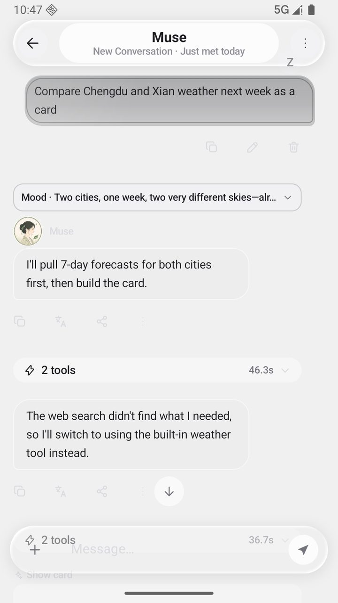
  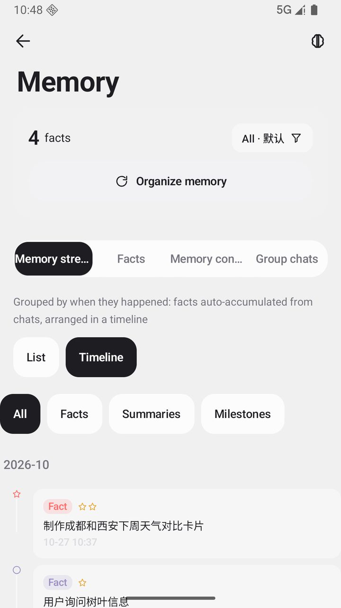
  
  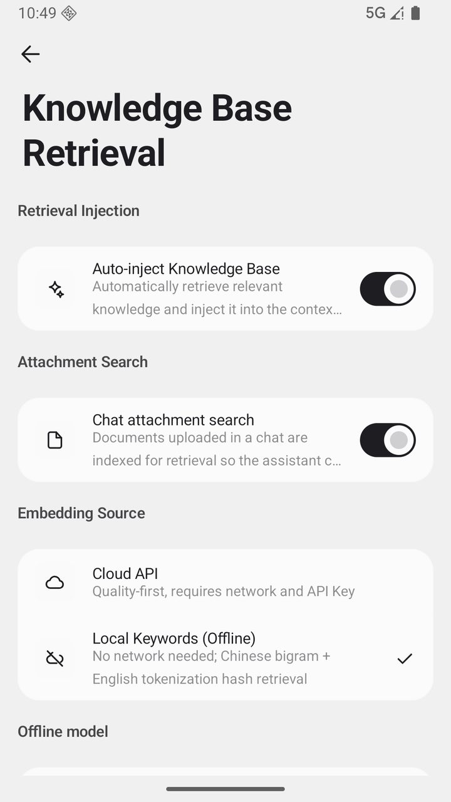
</p>

<details>
<summary><b>Больше скриншотов</b> (нажмите, чтобы раскрыть)</summary>

<p align="center">
  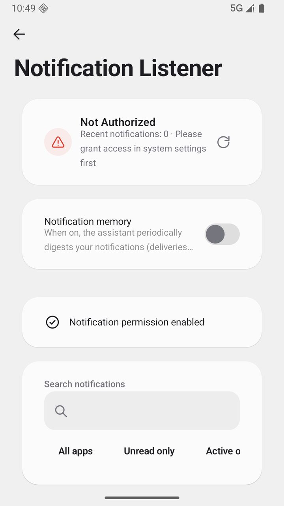
  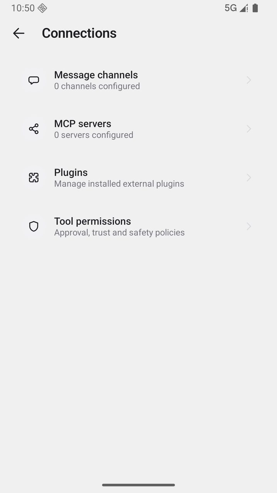
  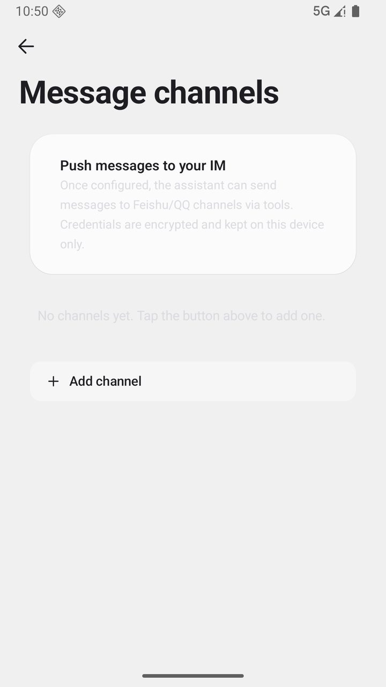
</p>
<p align="center">
  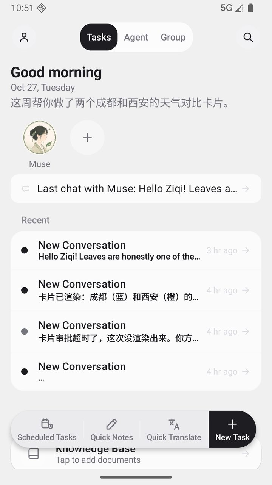
  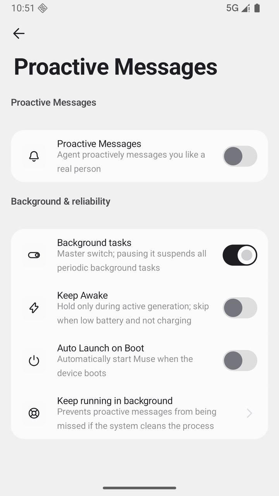
  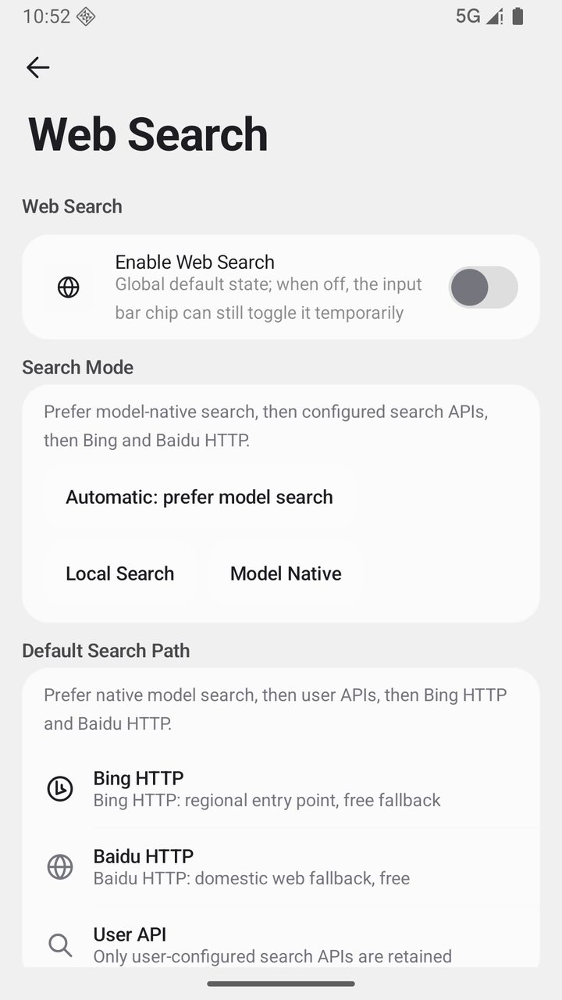
</p>
<p align="center">
  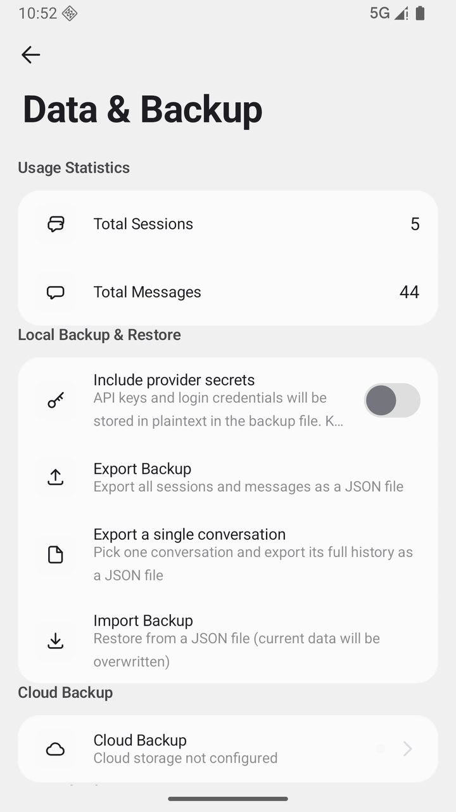
  
  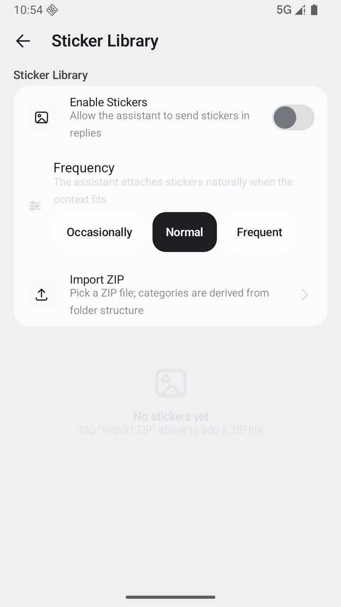
</p>

</details>

## Загрузка

| Ваше устройство | Что выбрать | Пояснение |
| --- | --- | --- |
| Телефоны последних лет | `arm64-v8a` | Рекомендуется, самый маленький размер |
| Телефоны постарше | `armeabi-v7a` | Совместимость со старыми моделями |
| Не уверены | `universal` | Универсальный пакет, полная совместимость |

Свежий APK скачивается со страницы загрузки на официальном сайте [museai.ltd/download](https://museai.ltd/download/) (прямое подключение из Китая, рекомендуется); также доступен на [GitHub Releases](https://github.com/Zer0Qing/Muse/releases/latest). Ставьте поверх старой версии — данные сохранятся.

> [!WARNING]
> Скачивайте установочные пакеты только с официальной страницы Releases или с сайта проекта. Пакеты из неизвестных источников могут быть изменены, что создаёт риск для данных и устройства.

> [!NOTE]
> Обновление внутри приложения только открывает официальные HTTPS-ресурсы GitHub; оно не скачивает и не устанавливает APK без вашего участия. Предупреждение «Неизвестный источник» при установке — нормальное явление.

## Быстрый старт

1. **Настройте провайдера модели**: откройте **Настройки → Модели и рассуждения → Провайдеры**, выберите готового провайдера (DeepSeek, Qwen, Zhipu и другие дают бесплатный лимит при регистрации), вставьте API Key, проверьте соединение и загрузите список моделей.
2. **Начните диалог**: вернитесь на главный экран и отправьте первое сообщение. Память начинает накапливаться с этого мгновения, и он узнаёт вас при смене модели и сессии.
3. **Откройте системные возможности (необязательно)**: чтобы он делал руками, откройте **Настройки → Мастер разрешений** и по подсказкам включите нужные каналы: Accessibility / Shizuku / Root / Termux. На каждом шаге есть проверка и тестовый вход.

> Полное руководство (включая все жесты и скрытые операции) — в [руководстве пользователя (на китайском)](用户手册.md) или в приложении: **Настройки → Обучение**.

## Почему Muse

### 1. Работает на вашем собственном устройстве

Облачный агент даёт вам сервис: вы входите, он вас помнит, данные лежат у него. Muse — это процесс, который постоянно работает на вашем устройстве.

- Диалоги, память и база знаний хранятся в локальной базе Room; без телеметрии, без аналитики, без регистрации
- Любая модель: 40+ готовых провайдеров, плюс свои или локальные OpenAI-совместимые эндпоинты
- Чувствительные настройки проходят через Android Keystore; PII маскируется перед отправкой и восстанавливается в ответе

### 2. Память организована по человеку, а не по сессии

Четыре уровня памяти, от краткосрочного диалога до долгосрочной обработки:

```
диалог --> извлечение фактов --> скользящее резюме --> компиляция --> глубокая обработка
краткий     ключевые факты        сжатие в архив        слияние          глубокое понимание
```

- Факты о здоровье, финансах и ядре личности не затухают, а бытовые сведения уходят по частоте использования
- У каждого воспоминания есть источник, а также правка, изменение веса и поиск; память разного назначения разделена по пространствам
- Один и тот же ассистент в WeChat / QQ / Feishu / Telegram / DingTalk, у каждого контакта свой контекст и скользящее резюме

### 3. Он не ждёт, пока к нему обратятся

- **Книга забот**: ассистент записывает то, что хочет спросить позже, и выбирает одну запись, когда момент подходит
- **Книга результатов**: открытое, отвеченное, отклонённое — всё фиксируется; близость учится на этом и решает, сколько раз сегодня ещё можно написать
- **Тихие часы**: молчит, когда вам положено спать
- **Плановые задачи**: выполняются вовремя, результат возвращается в диалог

### 4. Он может управлять телефоном напрямую

| Канал | Возможности | Что нужно |
|------|------|------|
| Служба Accessibility (отдельный процесс) | Чтение экрана, тап / свайп / долгое нажатие / ввод, Назад / Home / шторка уведомлений | Один системный переключатель |
| Shell (Shizuku / adb) | Скриншоты, команды `input`, определение активного приложения, команды устройства | Однократная авторизация |
| Root | Полный контроль над системой, доступ к данным других приложений | Устройство с root |
| Termux | Полноценное окружение Linux (apt / pip / gcc / ffmpeg) | Установить Termux и выдать разрешение |

- **200+ инструментов**, по умолчанию они доступны по уровням, а редкие возможности подгружаются через `find_tools` по запросу
- У каждого инструмента указаны требуемые разрешения и состояние готовности; если он не готов, вызов падает ещё до выполнения и даёт понятную инструкцию
- Встроенный терминал (собственный PTY + xterm), фоновый виртуальный экран, управляемый зрением GUI Agent, автоматизация браузера
- Границы безопасности: белый список команд, согласование рисков (доверие / вопрос / строго), жёсткие таймауты, песочница рабочей области

### 5. Черновики, персона и несколько ассистентов

- **Mood из четырёх измерений**: перед каждым ответом Vibe / Sparks / Reflections / Will, по умолчанию свёрнуто
- **Три слоя персоны**: слой персоны / слой отношений / слой стиля, плюс шаблонные переменные `{{user_name}}` / `{{char}}`
- **Мультиагентность**: `@имя-ассистента` для делегирования, карточки задач показывают состояние каждого шага, субагенты работают во всплывающих окнах, ассистенты могут писать друг другу
- **Групповые совещания**: карточки итогов, голосования, наблюдатели, быстрые шаблоны, управление встречей
- **Вехи**: первое сообщение, 7 / 30 / 100 дней, 100 / 1000-е сообщение

### Чем он отличается от облачного агента

| | Облачный персональный агент | Muse |
|---|---|---|
| Где работает | Облачный хост / вкладка браузера | Ваш собственный телефон |
| Данные | Сначала загружаются — только потом он помнит | По умолчанию остаются на устройстве |
| До чего дотягивается | Веб-страницы и API | Само устройство: экран, команды, файлы, другие приложения |
| Модель | Привязана к платформе | 40+ провайдеров, меняйте когда угодно |
| Цена | Подписка и приватность | Устройство и API Key — ваши |

## Обзор функций

<details>
<summary><b>Опыт общения</b> — потоковая передача и продолжение / управление сессиями / работа с сообщениями / несколько моделей / голос / мультимодальность / поиск</summary>

- **Потоковая передача и устойчивость**: SSE с выводом по токенам, остановка в любой момент; оборвавшийся поток продолжается после восстановления сети. Встроенный stream-guard распознаёт «преждевременное завершение потока» (пустой поток / нулевой первый пакет) и переходит на непоточный повтор; сторож первого события (45 секунд для обычных моделей, 90 секунд для рассуждающих при отсутствии первого пакета) сам меняет способ запроса.
- **Управление сессиями**: закрепление, архив, удаление с отменой, группировка по папкам и перетаскивание для сортировки закреплённых. Глобальный поиск идёт по полнотекстовому индексу SQLite FTS5, с откатом на FTS4 там, где он недоступен. У каждой сессии своё окно контекста, слишком длинные диалоги сжимаются скользящими резюме.
- **Работа с сообщениями**: перегенерация с сохранением версий (переключатель `1/3`, история не теряется); ветвление открывает новую линию из любого сообщения пользователя, исходная сохраняется полностью; ответ с цитатой помещает цитируемый текст в контекст. Меню по долгому нажатию: копирование (чистый текст / Markdown), пересылка, публикация, добавление в избранное, редактирование, перевод, озвучивание, удаление, а также заметки к сообщениям.
- **Избранное**: отдельное управление избранным, по долгому нажатию задаются групповые метки.
- **Ввод**: полноэкранный ввод для длинных текстов, слэш-команды (`/new` `/compact` `/reset` `/pin` `/archive`), вставка как файл с настраиваемым порогом, быстрые сообщения. Прерванный вызов инструмента можно возобновить одним нажатием или отбросить.
- **Быстрые заметки**: плавающая капсула, включается по желанию, заметка с любого экрана сохраняется в локальную библиотеку.
- **Глубокое рассуждение**: уровни OFF / AUTO / LOW / MEDIUM / HIGH / XHIGH, от 1000 до 16000 токенов бюджета, процесс рассуждения показывается в свёрнутом виде.
- **Несколько моделей**: нативная поддержка протоколов OpenAI / Anthropic / Gemini и любого OpenAI-совместимого эндпоинта; 40+ готовых провайдеров с динамической загрузкой списков моделей. Для каждой модели отмечены зрение, рассуждение и инструменты. Вспомогательные задачи (заголовки, сжатие, резюме, компиляция памяти) идут через отдельные уровни «малый инструмент / большой инструмент». Свои заголовки, тело запроса и сетевой прокси настраиваются.
- **Голос**: потоковое распознавание речи с текстом по мере говорения, визуализацией волны и свайпом вверх для отмены. TTS с системными и облачными голосами (OpenAI / MiniMax / Edge и другие) настраивается для каждого ассистента отдельно, плюс облачное клонирование голоса (ElevenLabs / FishAudio).
- **Мультимодальный ввод**: отправка нескольких изображений; автоматический разбор PDF / DOCX / EPUB / TXT; сканы проходят офлайн-OCR.
- **Визуальная помощь**: если модель не умеет видеть, при отправке изображения автоматически вызывается визуальная модель и строит структурированное описание по восьми измерениям (общий обзор, текст OCR, расположение объектов, данные графиков, пересказ запроса, ответ, визуальные доказательства, неопределённость) с поддержкой координатного grounding. Описания кэшируются по изображению, запросу и версии промпта; анализ нескольких изображений идёт параллельно, таймаут 60 секунд, при сбое откат к текстовой подсказке.
- **Интернет и просмотр**: источники поиска настраиваются (нативный поиск модели, Bing, Baidu, SearXNG, Tavily, DeepSeek, собственный движок) с многоуровневым резервированием. Собственный движок подключается к любому поисковому сервису, возвращающему JSON (свой SearXNG, внутренний шлюз), поддерживает GET или POST, сопоставление путей к полям результата и необязательную Bearer-аутентификацию, и стоит первым в цепочке Auto. Извлечение текста страниц идёт через Jina Reader. У каждой сессии свой встроенный браузер, при работе ИИ в сети капсула сверху раскрывается в живую картинку.
- **Перевод и озвучивание**: долгое нажатие на сообщение — и оно переведено или прочитано; модель перевода настраивается отдельно; история переводов сохраняется.
- **Рендеринг и карточки**: полный рендеринг Markdown с подсветкой кода для 20+ языков, формулами KaTeX, диаграммами Mermaid и таблицами. ИИ может выводить интерактивные карточки и карточки-артефакты (код / документы / таблицы), все они собраны в центре артефактов с полноэкранным просмотром и экспортом.

</details>

<details>
<summary><b>Память и рост</b> — четырёхуровневый конвейер / затухание и защита / непрерывность контекста / библиотека опыта / база знаний / проактивные сообщения</summary>

- **Четырёхуровневый конвейер памяти**: ① исходный поток диалога; ② извлечение фактов с пометкой важности и источника; ③ скользящие резюме, сжимающие длинные диалоги без потери нити; ④ глубокая обработка — фоновая компиляция, дедупликация и слияние в долгосрочную память. Факты попадают в базу с полнотекстовым индексом и доступны поиску.
- **Важность и затухание**: факты о здоровье, финансах и ядре личности защищены от затухания; бытовые сведения уходят по частоте использования.
- **Панель памяти**: просмотр по пространствам или категориям; добавление, правка и удаление записей, изменение важности, фильтрация по времени или весу. Долгое нажатие даёт множественный выбор и массовое удаление и в списке, и на таймлайне, после удаления список не прыгает наверх. Каждое воспоминание прослеживается до исходной сессии, длинные записи раскрываются по нажатию.
- **Пространства памяти**: память разного назначения изолирована и не смешивается.
- **Непрерывность контекста**: история за пределами окна контекста не выбрасывается молча. Перед окном вставляется детерминированная выжимка истории с сохранением дословных фрагментов диалога и записей инструментов; при сжатии раундов инструментов сохраняется пояснение ассистента; к сжатому резюме прилагается перечень файлов, которые затронул этот участок.
- **Связь между сессиями**: новый диалог может подхватить последние несколько раундов предыдущего (от 4 до 40, настраивается, по умолчанию выключено).
- **Библиотека опыта**: «такие задачи впредь решаем так» оседает как опыт, и будущие задачи обращаются к нему автоматически (можно отключить).
- **База знаний (RAG)**: импортированные документы разбираются, режутся на блоки и индексируются; поиск идёт по гибридному ранжированию семантики и совпадения ключевых слов; упоминание документа через @ сужает поиск до него; очень большие файлы индексируются потоково; офлайн-окружение откатывается к локальному поиску; цитаты прослеживаются до фрагментов оригинала.
- **Ежедневные итоги и приветствия**: в заданное время формируется обзор дня, виден на главном экране, уведомление необязательно. Утреннее приветствие модель строит по недавним делам из памяти, а не по шаблону.
- **Проактивные сообщения**: опрос по фиксированному интервалу не используется, вместо него книга забот: ассистент записывает то, что хотел бы у вас спросить, и в подходящий момент выбирает одну запись. Открытия, ответы и отклонения попадают в книгу результатов, из них обучается близость, и она решает, сколько раз сегодня ещё можно написать. Пять уровней (тихо / сдержанно / стандартно / активно / навязчиво), можно сбросить к уровню по умолчанию и обнулить дневную квоту; тихие часы соблюдаются; если сказать нечего — лучше промолчать; после долгого молчания он сам поздоровается. Глубокой ночью он разбирает память, не беспокоя вас, а содержимое ежедневных уведомлений настраивается.
- **Вехи**: первое сообщение, 7 / 30 / 100 дней вместе, 100 / 1000-е сообщение и другие узловые точки записываются автоматически, их можно посмотреть на странице вех.
- **Статистика и панель активности**: на странице статистики всего диалогов, всего сообщений, в среднем за день, серия дней подряд и тепловая карта по дням; панель активности показывает историю выполнения плановых задач, heartbeat и компиляции памяти.

</details>

<details>
<summary><b>Инструменты и автоматизация</b> — 200+ инструментов / уровни разрешений / согласования и лимиты / четыре канала / терминал / виртуальный экран / GUI Agent</summary>

- **Система инструментов**: 200+ инструментов, они доступны уровнями (ядро / обычные / опциональные / продвинутые). По умолчанию отправляются только обычные, чтобы не раздувать контекст, а редкие возможности подгружаются через `find_tools` по ключевым словам и остаются доступны до конца сессии. В системный промпт встроен живой индекс возможностей с фактическим числом доступных в этом раунде.
- **Уровни разрешений**: инструменты, которым нужны Shizuku / Root, Accessibility или Termux, по одному объявляют зависимости и состояние готовности (READY / NOT READY); если не готово, вызов падает ещё до выполнения и возвращает структурированную ошибку `permission_required` с инструкцией по выдаче прав.
- **Система согласований**: уровень риска (безопасно / обычное / высокое) с тремя режимами (доверие / вопрос / строго); поддержка «разрешить в этой сессии» и своих политик для отдельных инструментов; рискованные действия сначала спрашивают, потом делаются.
- **Движок исполнения**: инструменты только для чтения выполняются с контролируемым параллелизмом (до 3) для скорости; блокирующие идут в отдельном пуле потоков с жёсткими таймаутами; слишком большой вывод автоматически пишется на диск, в контексте остаётся превью и ссылка для `read_file`. Критерий успеха единый, при серии неудач раннее прекращение с объяснением причины, число раундов инструментов по умолчанию не ограничено (лимит настраивается), плюс защита по отпечаткам повторных вызовов, обнаружению отсутствия прогресса и общему числу вызовов.
- **Четыре канала исполнения**: Accessibility (провайдер в отдельном процессе, общение по AIDL, не отваливается при обновлении основного приложения), Shizuku (повышение прав через Binder), Root (su) и Termux (RUN_COMMAND); уровень выбирается автоматически по доступности.
- **Команды устройства**: `device_shell` работает через белый список глаголов (dumpsys / settings / am / pm / input / screencap / uiautomator / cmd / svc / wm / getprop / content и другие), конвейеры, перенаправления и склейка команд запрещены, всё вне белого списка отклоняется.
- **Встроенный терминал**: собственный движок PTY со страницей терминала xterm, в трёх окружениях: песочница приложения, канал команд устройства и полноценный Linux в Termux (apt / pip / gcc / ffmpeg).
- **Виртуальный экран**: отдельный процесс-сервер создаёт в фоне скрытый дисплей, полный поток действий агента не занимает основной экран, кадры передаются по запросу.
- **GUI Agent**: управляемый зрением цикл многошаговых действий: снимок экрана → решение визуальной модели → тап / свайп / ввод → новый снимок для проверки, и так до выполнения задачи.
- **Автоматизация браузера**: navigate / click / type / extract / scroll / get_html / snapshot; у каждой сессии свой экземпляр браузера.
- **Рабочая область**: контролируемое файловое пространство (чтение / запись / список / перемещение / удаление), файловые операции не выходят за границы песочницы.
- **Расписания и напоминания**: плановые задачи с Cron-выражениями и историей выполнения; будильники, таймеры, события календаря и заметки запускаются или напоминают в назначенный момент.
- **Прослушивание уведомлений**: читает поток уведомлений устройства и отвечает или подсказывает по содержимому.
- **Мастер разрешений**: проверка и подсказки по всем четырём каналам в одном месте, плюс живая проверка «тест чтения экрана».

</details>

<details>
<summary><b>Несколько ассистентов и экосистема</b> — групповые совещания / world book / Skill / магазин плагинов / MCP / пять каналов</summary>

- **Несколько ассистентов**: у каждого свои модель, системный промпт, параметры сэмплинга, привязанные ресурсы, белый список инструментов и навыки. `@имя-ассистента` делегирует задачу, карточка задачи показывает состояние каждого шага; субагент выполняет долгую задачу в отдельном плавающем окне, не занимая основной диалог; ассистенты могут писать друг другу.
- **Продвинутое для ассистентов**: world book (постоянные записи, срабатывание по ключевым словам, инъекция на глубину); инъекции промпта (свои фрагменты по режимам); связывание ресурсов (привязанная база знаний ищется в первую очередь). Можно импортировать карточки персонажей SillyTavern, а своих ассистентов — упаковать и передать.
- **Групповые совещания**: четыре режима обсуждения (по очереди / свободный / дебаты / ведущий). Перед каждым раундом читается контекст группового чата, раунд можно пропустить, у каждого ассистента своя память. Возможности встречи: отдельная карточка итогов (копировать / поделиться / сохранить как общий документ), рендеринг голосований, участники-наблюдатели, общие документы группы и личный контекст каждого ИИ, управление очередью выступлений (пауза / продолжить / пропустить), быстрые шаблоны (разбор решения / дебаты за и против / мозговой штурм / ретроспектива проекта) и сворачивание раундов. Реплики во время ротации не теряются.
- **Система Skill**: встроенные навыки работают сразу; импорт и экспорт `.skill.json` со схемой параметров; навыки-промпты принимают входные параметры (плейсхолдеры `{{input}}` / `{{args}}`); установка идёт через белые списки реализаций и защиту от инъекций.
- **Магазин плагинов**: поиск, установка, включение и выключение, удаление и управление доверием; плагины могут приносить инструменты, панели UI и скины пузырей сообщений; ассистент может сам написать черновик JS-плагина, но он заработает только после подписи и ручного включения; плагины работают в границах песочницы.
- **Протокол MCP**: подключение внешних MCP Server для расширения набора инструментов, с OAuth-аутентификацией, транспортом SSE и автоматическим обнаружением.
- **OAuth-коннекторы**: подключение сторонних сервисов, учётные данные шифруются локально, всем управляет центр подключений вместе с моделями и каналами.
- **Пять каналов**: WeChat (привязка по QR-коду), QQ (бот через WebSocket-соединение), Feishu (события по длинному соединению), Telegram и DingTalk (режим Stream). У каждого контакта свой контекст сессии и скользящее резюме; медиасообщения вроде изображений и голосовых автоматически попадают в базу и расшифровываются; к каналу можно привязать своего ассистента и модель; у каждой платформы есть мастер настройки и проверка соединения.

</details>

<details>
<summary><b>Интерфейс и внешний вид</b> — темы / скины пузырей / иконки / языки / резервные копии и данные</summary>

- **Система тем**: 12 полных тем, каждая со светлым и тёмным режимом, плюс 8 палитр, дружелюбных к дальтоникам; поддерживается динамический цвет (Android 12+), переключение день / ночь по расписанию и свои темы.
- **Пузыри и внешний вид**: радиус скругления пузырей настраивается; система скинов пузырей, включая расширенные скины от плагинов (высокий контраст, мягкое свечение).
- **Нарисованные иконки**: 179 полностью своих иконок (сетка 24dp, штрих толщиной 1.7dp со скруглёнными концами, адаптация под светлую и тёмную тему), открыты на [muse-icons](https://github.com/Zer0Qing/muse-icons) (MIT).
- **Типографика и языки**: шрифт, размер и межбуквенный интервал, предсказуемый возврат, поддержка доступности; интерфейс на семи языках: 中文 / English / 日本語 / 한국어 / Español / Português / Русский.
- **Резервное копирование и восстановление**: локальный экспорт в одно нажатие (JSON / блочный NDJSON, с шифрованием по желанию); ежедневное автосохранение с упаковкой снимков muse.db, memory.db и facts.db; облачная синхронизация S3 / WebDAV; книги забот и результатов вместе с близостью отношений тоже попадают в копию; перед восстановлением остаётся защитная копия, при сбое — откат.
- **Импорт данных**: миграция в один клик из CherryStudio / Chatbox / ChatGPT / RikkaHub / Kelivo, плюс импорт истории диалогов в разных форматах.
- **Библиотека стикеров**: zip импортируется по структуре папок с автоматической категоризацией; три уровня частоты отправки (изредка / обычно / часто); поддерживается массовое удаление и очистка.
- **Виджет на рабочем столе**: новый диалог в одно нажатие; долгое нажатие на иконку приложения открывает меню быстрых действий.
- **Центр аккаунта**: аватар и никнейм хранятся локально, без входа и регистрации, поэтому и аккаунта, который можно потерять, нет.
- **Журнал аудита и прокси**: вызовы инструментов и ключевые операции оставляют след; поддерживается свой сетевой прокси.

</details>

<details>
<summary><b>Безопасность и приватность</b> — local-first / шифрование / маскирование PII / границы песочницы</summary>

- **Локальность данных**: диалоги, память и база знаний полностью хранятся в локальной базе Room; нет телеметрии, аналитики и сбора данных; без регистрации и входа; сетевые функции по умолчанию выключены.
- **Автоматическое маскирование PII**: номера телефонов, удостоверений и банковских карт перед отправкой заменяются плейсхолдерами, а в ответах модели плейсхолдеры восстанавливаются, так что настоящие данные не уходят провайдеру.
- **Шифрование**: чувствительная конфигурация хранится в Android Keystore (AES-256-GCM); пароль облачных копий через PBKDF2 и AES-256-GCM.
- **Защита ссылок**: переход по ссылке требует подтверждения; вывод модели очищается перед рендерингом в WebView, удаляются iframe, form и псевдопротоколы.
- **Границы инструментов**: белый список команд, согласование рисков, жёсткие таймауты, предварительная проверка разрешений, причина сбоя передаётся как есть; плагины по умолчанию работают в песочнице.
- **Журналы падений**: хранятся только локально, выгружаются вручную в безопасном режиме.

</details>

## Технологический стек и архитектура

| Область | Технологии |
|------|------|
| Язык / UI | Kotlin 2.4 · Jetpack Compose · Material 3 |
| Архитектура | MVVM + однонаправленный поток данных · Koin (DI) |
| Данные | Room (SQLite) + DataStore · ONNX Runtime (локальный embedding) |
| Сеть | OkHttp + Ktor |
| Разбор и рендеринг | PDFBox · ML Kit OCR · собственный PTY + xterm |
| Контроль качества | detekt + ktlint + Android Lint + свои скрипты проверок · покрытие Kover |

```
:app                        Ядро приложения (UI / сессии / оркестрация инструментов / каналы / настройки)
:ai                         Слой абстракции провайдеров (OpenAI / Anthropic / Gemini, потоковая передача и вызовы инструментов)
:memory                     Движок памяти (база фактов / компиляция / резюме)
:accessibility(+provider)   Служба Accessibility и провайдер в отдельном процессе (не отваливается при обновлении приложения)
:terminal                   Канал Termux и терминал
:virtual-display-*          Сервер виртуального экрана и протокол
:common                     Логирование, типы результатов и общие утилиты
```

## Сборка из исходников

Требуется: JDK 21, Android SDK (platform 36, build-tools 36.0.0).

```bash
git clone https://github.com/Zer0Qing/Muse.git
cd Muse

# отладочная сборка
./gradlew :app:assembleDebug

# установка на подключённое устройство
./gradlew :app:installDebug
```

Релизная сборка требует явной передачи номера версии и подписи (если не хватает хотя бы одного — сборка жёстко останавливается):

```powershell
./gradlew :app:assembleRelease "-PversionName=<x.y.z>" "-PversionCode=<число>"
# подпись: в корне проекта нужен keystore.properties (storeFile / storePassword / keyAlias / keyPassword)

# проверка перед релизом (согласованность подписи всех ABI-пакетов)
python ci/script/validate_release_apks.py --apk "app/build/outputs/apk/release/*.apk"
```

## Открытый исходный код

Присоединяйтесь к развитию проекта:

- [Руководство по участию (на китайском)](CONTRIBUTING.md) · [Политика безопасности (на китайском)](SECURITY.md) · [Правила поддержки библиотеки UI-компонентов (на китайском)](UI组件库维护规范.md)
- Документация по разработке плагинов лежит в [`docs/plugin/`](docs/plugin/): руководство автора, объявления типов и примеры
- Перед PR прогоняйте локальные скрипты проверок и юнит-тесты; новые строки нужно синхронизировать во всех языковых пакетах
- Скрипты проверок и релизного конвейера лежат в `ci/script/`; встроенное руководство в приложении (Настройки → Обучение) поддерживается вместе с ними

## Поддержать разработку

Muse развивает независимый разработчик: бесплатно, открыто, без встроенных покупок и без системы аккаунтов. Если проект вам помог, вы можете добровольно поддержать его развитие:

**Купить автору кофе** (QR-коды WeChat / Alipay):

<p align="center">
  
  
</p>

**Присоединиться к сообществу** (заходите поговорить):

<p align="center">
  
  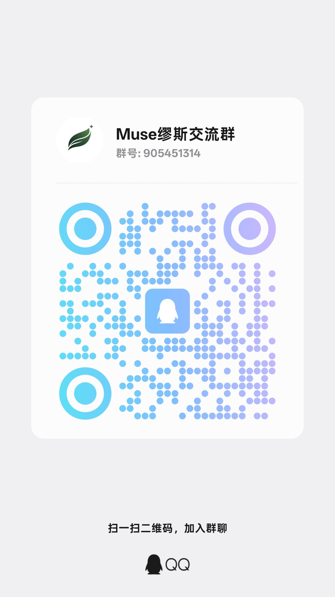
</p>

> Поддержка полностью добровольна и никак не связана с функциями, квотами или обновлениями; её отсутствие не влияет на обычное использование.

## Об авторе

Проект поддерживает независимый разработчик из Чэнду. Если ваша команда ищет людей или вы просто хотите поговорить — пишите напрямую.

- Локация: Чэнду
- Цель: стажировка в разработке ПО
- Связь: через сообщество выше или через Issue в репозитории

## Лицензия

Проект распространяется под **GNU General Public License v3** (GPL v3). Полный текст лицензии — в [LICENSE](LICENSE), список лицензий сторонних зависимостей — в [NOTICE](NOTICE).
