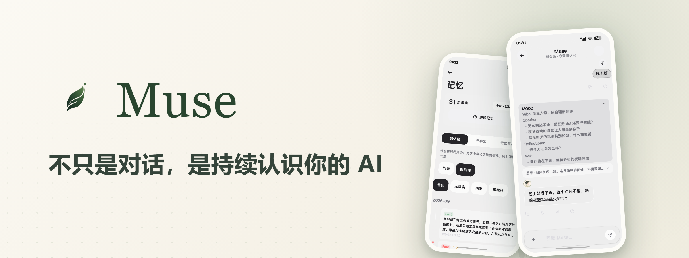
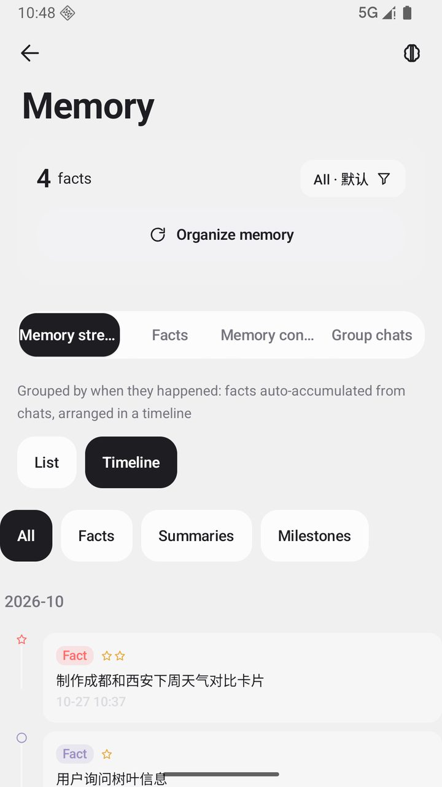

<p align="center">
  
</p>

<p align="center">
  <a href="README.md">中文</a> · <a href="README_EN.md">English</a> · <a href="README_JA.md">日本語</a> · <a href="README_KO.md">한국어</a> · <a href="README_ES.md">Español</a> · <a href="README_PT.md">Português</a> · <b>Русский</b>
</p>

<p align="center">
  <a href="https://github.com/Zer0Qing/Muse/releases/latest"></a>
  <a href="https://github.com/Zer0Qing/Muse/releases"></a>
  <a href="https://github.com/Zer0Qing/Muse/stargazers"></a>
  <a href="LICENSE"></a>
  
  
</p>
<p align="center">
  <a href="https://qm.qq.com/q/905451314"></a>
  <a href="https://museai.ltd"></a>
  <a href="https://museai.ltd/download/"></a>
</p>

<p align="center">
  <a href="#что-такое-muse">Что такое Muse</a> ·
  <a href="#скриншоты">Скриншоты</a> ·
  <a href="#загрузка">Загрузка</a> ·
  <a href="#быстрый-старт">Быстрый старт</a> ·
  <a href="#возможности">Возможности</a> ·
  <a href="#сборка-из-исходников">Сборка</a> ·
  <a href="#участие">Участие</a>
</p>

---

## Что такое Muse

Muse — это персональный ИИ-агент, который живёт на вашем собственном Android-смартфоне.

Большинство ИИ-помощников — это вкладки в облаке: вы открываете их, общаетесь, закрываете, а вся история остаётся на чужом сервере. Muse задуман иначе: без аккаунтов и телеметрии, переписка, память и база знаний по умолчанию хранятся локально в SQLite. Вы сами подключаете нужные API (OpenAI, Anthropic, Gemini, DeepSeek, Qwen, Zhipu или локальные OpenAI-совместимые серверы) и можете менять их в любой момент.

Чем он отличается от обычного API-клиента:

- **Помнит человека, а не одну сессию**: важные факты извлекаются, сжимаются в сводки и со временем упорядочиваются, а медицинские и личные данные защищены от затухания. Смените модель или откройте новый чат — он всё так же вас узнает.
- **Пишет сам, когда нужно**: записывает, о чём хотел спросить позже, просыпается по расписанию или после долгого перерыва, но снижает частоту, если вы его смахиваете, и молчит в тихие часы.
- **Управляет телефоном на деле**: при наличии разрешений читает экран, нажимает кнопки, выполняет shell-команды, работает в изолированном браузере и песочнице файлов, запускает Python/Node через скачиваемый по запросу `proot` Ubuntu или подключается по SSH к вашему Linux-серверу.
- **Интерактивные карточки в чате**: кроме текста, ассистент строит графики и HTML/SVG-карточки (например, гомоку, трекеры, тесты), которые тихо общаются с моделью в фоне, не засоряя переписку.

---

## Скриншоты

<p align="center">
  
  
  
  
</p>

<details>
<summary>Показать ещё скриншоты</summary>

<p align="center">
  
  
  
</p>
<p align="center">
  
  
  
</p>
<p align="center">
  
  
  
</p>

</details>

---

## Загрузка

| Ваше устройство | Файл | Примечание |
| --- | --- | --- |
| Современные Android-смартфоны | `arm64-v8a` | Рекомендуется, минимальный размер |
| Старые 32-битные устройства | `armeabi-v7a` | Для старых моделей |
| Не уверены | `universal` | Подходит для всех ABI |

- **GitHub Releases**: [Последний релиз](https://github.com/Zer0Qing/Muse/releases/latest)
- **Официальный сайт**: [museai.ltd/download](https://museai.ltd/download/)

Устанавливайте поверх текущей версии — локальные данные сохранятся.

> [!WARNING]
> Скачивайте APK только с GitHub Releases или официального сайта. Проверка обновлений внутри приложения лишь открывает официальную страницу релиза и никогда не скачивает файлы в фоне.

---

## Быстрый старт

1. **Добавьте API-ключ**: откройте **Настройки → Модели и провайдеры**, выберите провайдера, вставьте ключ, проверьте соединение и загрузите список моделей.
2. **Выберите главный экран**: в **Настройки → Внешний вид** можно переключиться между **Классикой (3 вкладки)** и **Минималистичной панелью** (сразу открывается чат).
3. **Начните диалог**: память начинает накапливаться с первого сообщения.
4. **Разрешения — по желанию**: для обычного общения лишние права не нужны. Для автоматизации или скриптов откройте **Настройки → Мастер разрешений** или скачайте `proot` Ubuntu по запросу.

---

## Отличия от облачных агентов

| | Облачные агенты | Muse |
|---|---|---|
| Где работает | Удалённые серверы | Ваш Android-смартфон |
| Где хранятся данные | На сервере сервиса | Локально в Room SQLite |
| Что доступно | Веб-API и вкладки | Экран, файлы, уведомления, shell и ваш SSH-хост |
| Модели | Привязка к платформе | 40+ провайдеров, меняйте в любой момент |
| Цена | Подписка и приватность | Ваше устройство и ваш API-ключ |

---

## Возможности

<details>
<summary><b>Чат и чтение</b> —— два режима главного экрана, типографика, карточки, голос и зрение</summary>

- **Два режима главного экрана**: классические 3 вкладки или минималистичная шторка сразу с чатом.
- **Надёжный стриминг**: пауза/возобновление SSE, откат к обычному запросу при пустом потоке, уровни размышлений (`OFF`–`XHIGH`).
- **Типографика и ридер**: аккуратные интервалы между CJK, латиницей, цифрами и кодом (не ломает ссылки и `$...$`), подсветка 20+ языков, KaTeX, Mermaid и полноэкранный ридер артефактов.
- **Тихие карточки**: HTML/SVG-карточки опрашивают модель в фоне (`window.muse.ask` / `saveState`), не засоряя ленту чата.
- **Мультимодельность и зрение**: отдельные модели для чата, заголовков, сжатия и памяти; автоматическое 8-мерное описание изображений для текстовых моделей.
- **Поиск, голос и файлы**: веб-поиск, отдельный браузер на сессию, потоковый ASR, локальный/облачный TTS + клонирование голоса, чтение PDF / DOCX / EPUB / офлайн OCR.

</details>

<details>
<summary><b>Память и база знаний</b> —— четыре уровня, отдельный профиль, локальный RAG</summary>

- **Четырёхуровневая память**: поток диалогов → извлечение фактов → скользящие сводки → периодическая/ручная сборка Dream (с откатом).
- **Отдельный профиль «О вас»**: пять категорий фактов хранятся в приватных локальных файлах вне базы знаний и управляются отдельным переключателем.
- **Локальный RAG**: гибридный векторный + полнотекстовый поиск, `@упоминания` документов, потоковая индексация больших файлов и пакетное удаление.
- **Точные напоминания**: пробуждение через заданное число минут или в конкретное время с учётом тихих часов.

</details>

<details>
<summary><b>Автоматизация и Compute Node</b> —— 180+ инструментов, proot, виртуальный экран, SSH</summary>

- **Более 180 встроенных инструментов** (200+ с MCP, плагинами и навыками), подгружаемых по запросу через `find_tools`.
- **Несколько каналов**: служба специальных возможностей в отдельном процессе (переживает обновления), Shizuku, Root, Termux и скачиваемый `proot` Ubuntu для Node/Python.
- **Виртуальный экран и GUI Agent**: многошаговые действия на скрытом дисплее в фоне.
- **Лёгкий Linux Compute Node**: подключение к вашему Linux-серверу по SSH для тяжёлых задач и удалённого браузера.
- **Границы безопасности**: белый список команд `device_shell`, четыре уровня прав, подтверждение опасных действий и диагностика ограничений батареи.

</details>

<details>
<summary><b>Мультиагентность, группы, каналы и плагины</b> —— WeChat / QQ / Feishu / Telegram / DingTalk</summary>

- **Несколько ассистентов и `@` делегирование**: отдельные персоны, модели и пространства памяти, а также групповые обсуждения.
- **Пять мессенджеров**: WeChat, QQ, Feishu, Telegram и DingTalk с раздельной историей по контактам.
- **MCP, навыки и JS-плагины**: внешние MCP-серверы (OAuth/SSE), `.skill.json`, запись шагов в навыки и изолированные JS-плагины.

</details>

<details>
<summary><b>Внешний вид, бэкапы и приватность</b> —— темы, импорт и шифрование</summary>

- **Оформление**: 12 светлых/тёмных тем, 8 палитр для дальтонизма, динамические цвета Android 12+, 179 авторских иконок ([muse-icons](https://github.com/Zer0Qing/muse-icons)) и 7 языков.
- **Резервное копирование**: шифрованный экспорт, WebDAV / S3, импорт из ChatGPT, CherryStudio, Chatbox, RikkaHub и Kelivo.
- **Приватность по умолчанию**: без аккаунта, без телеметрии, ключи в Android Keystore и маскировка персональных данных перед отправкой.

</details>

---

## Стек и модули

| Направление | Технологии |
|---|---|
| Язык и UI | Kotlin 2.4 · Jetpack Compose · Material 3 |
| Архитектура | MVVM + однонаправленный поток · Koin |
| Данные и поиск | Room (SQLite) · DataStore · ONNX Runtime · HNSW + FTS |
| Сеть и удалёнка | OkHttp · Ktor · JSch (SSH-туннель) |
| Рантайм и парсинг | `proot` Ubuntu · PDFBox · ML Kit OCR · свой PTY/xterm |
| Качество | detekt · ktlint · Android Lint · собственные CI-скрипты |

```text
:app                        Основное приложение (UI, сессии, инструменты, каналы, настройки)
:ai                         Слой провайдеров (OpenAI / Anthropic / Gemini)
:memory                     Движок памяти (факты, сводки, Dream)
:conversation-core          Общее состояние и контракты диалога
:material3                  Динамические цвета и расширения темы
:miniphone                  Независимый sandbox-модуль
:accessibility(+provider)   Служба доступности в отдельном процессе
:virtual-display-*          Протокол и сервер виртуального дисплея
:common                     Логи, Result и общие утилиты
```

---

## Сборка из исходников

Требуются **JDK 21** и **Android SDK** (Platform 36, Build-Tools 36.0.0).

```bash
git clone https://github.com/Zer0Qing/Muse.git
cd Muse

./gradlew :app:assembleDebug
./gradlew :app:installDebug
```

Для Release-сборки нужны явные параметры версии и `keystore.properties` в корне репозитория:

```powershell
./gradlew :app:assembleRelease "-PversionName=<x.y.z>" "-PversionCode=<number>"
python ci/script/validate_release_apks.py --apk "app/build/outputs/apk/release/*.apk"
```

---

## Участие

Issue, PR, плагины и переводы приветствуются:

- [Руководство для контрибьюторов](CONTRIBUTING.md) · [Безопасность](SECURITY.md) · [Документация плагинов](docs/plugin/)

---

## Поддержка и контакты

Muse разрабатывается и поддерживается независимо, бесплатно и с открытым исходным кодом:

<p align="center">
  
  
  
  
</p>

Разрабатывается независимым автором в Чэнду. WeChat: `QingTian07707`.

---

## Лицензия

**GNU General Public License v3** (GPL v3). Подробности в [LICENSE](LICENSE) и [NOTICE](NOTICE).
